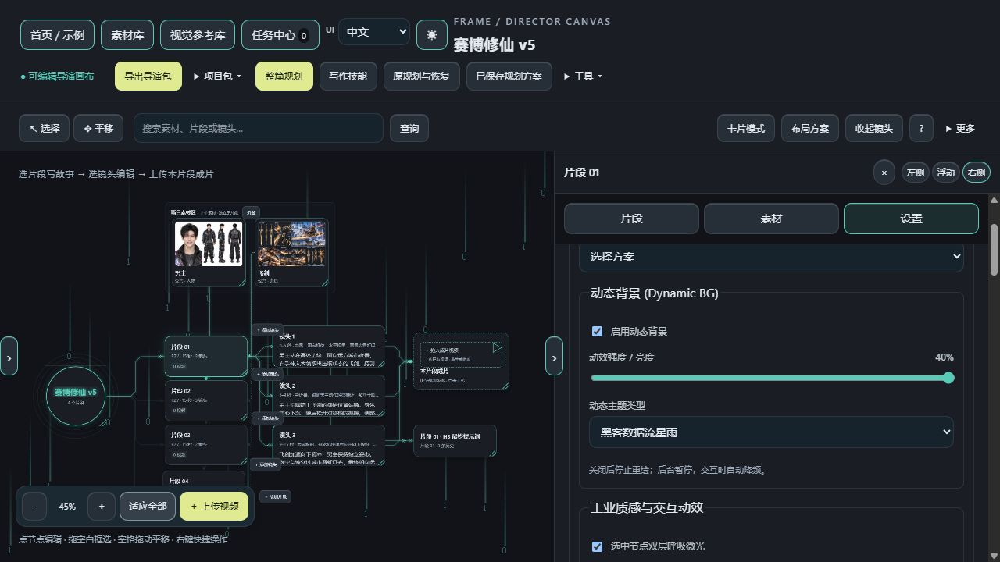
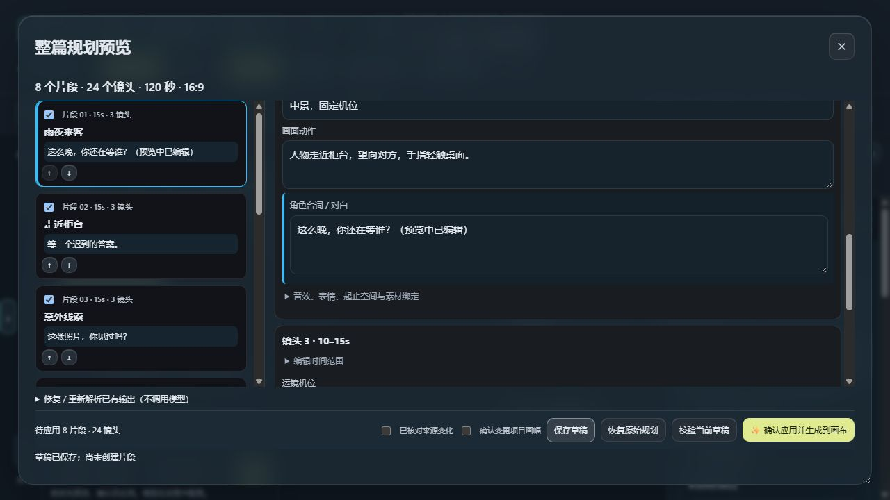
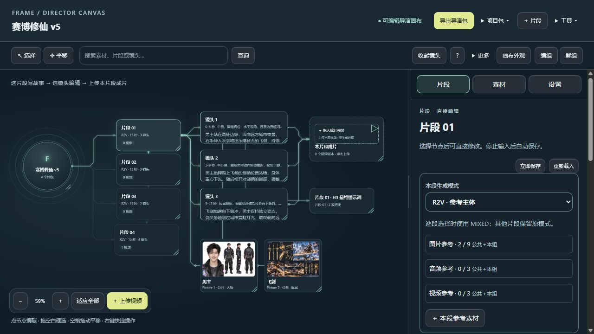
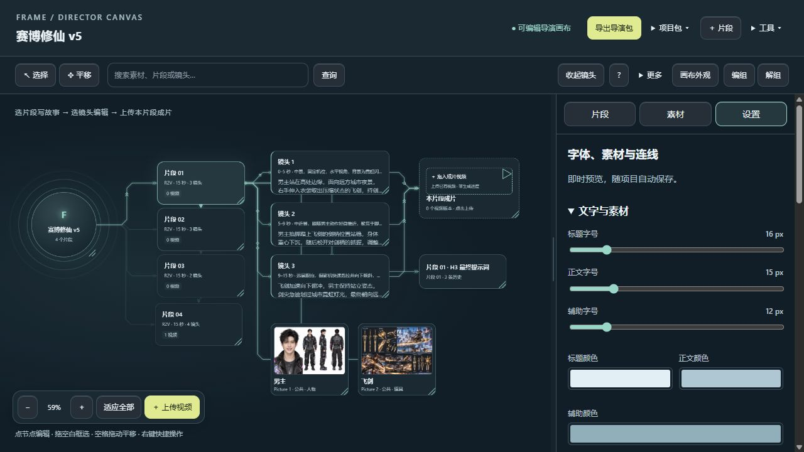

# 更新日志 / Changelog

所有版本记录以本文件为准。历史独立说明已完整归并；原始文件名和校验摘要保留在对应段落中。相同版本的简要日志与详细说明同时保留，避免删减历史信息。

后续版本遵循 [Semantic Versioning 2.0.0](https://semver.org/spec/v2.0.0.html)：`MAJOR.MINOR.PATCH`，Git 标签为 `vMAJOR.MINOR.PATCH`（例如 `v4.0.0`），不再添加 `canvas-rXX`。历史版本号与 GitHub 标签保留原样；排序按数值版本、预发布及历史 R 编号倒序。

[English changelog](docs/CHANGELOG.en.md) · [使用说明](docs/quick-start.md)

All release history is consolidated here. New releases use three-part SemVer tags; historical tags remain unchanged. Original summaries and complete release notes are retained together.

<a id="version-v3.41.3"></a>
## [v3.41.3] - 2026-11-03

- 将全部独立版本说明和补充历史记录归并到根目录 CHANGELOG，按版本倒序排列，保留正文与来源校验信息。
- 删除 docs/releases/，修复文档链接、发布清单与发布说明提取流程。
- 后续标签使用严格三段 SemVer；版本工具不再生成 canvas-rXX 后缀，历史标签和更新检测兼容性保留。
- Consolidate complete historical release notes, remove their former directory, and read release descriptions from this changelog.
- Use strict three-part SemVer for future releases while preserving existing tags and upgrade checks.
- 本地验证：223 项测试、30 项 R15 浏览器回归、Windows EXE 自检通过；历史正文校验与版本倒序检查通过。云端发布状态以对应提交为准。
- Local validation: 223 tests, 30 R15 browser checks, EXE self-test, retained-history checksums and descending-version checks passed; cloud publication is verified separately.

<a id="version-v3.41.2-canvas-r15"></a>
## [v3.41.2-canvas-r15] · 历史版本 / Historical release

### 原更新日志

#### V3.41.2 · R15 目录整理 — 2026-11-03

- 将 33 个后端模块按 AI、服务、项目资产、预设与通用工具分入 `backend/`，统一修正静态与动态导入。
- 历史版本说明归档到 `docs/releases/`；Windows 启动器源码移到 `tools/windows_launcher.py`。
- 保留 `server.py`、启动批处理及公共文档在根目录；修正资源根目录与写作技能预设加载路径。
- 同步源码更新器、更新批处理、发布清单、EXE 隐藏导入及 CI 路径。继续使用原项目格式、导演包格式、API 与用户数据目录。
- 新更新器备份涵盖 `backend/` 与文档；旧版更新器仍能接受新版 ZIP，旧根模块由新版启动流程备份后退役。

### 归并的完整版本说明

<!-- history-source: docs/releases/release-v3.41.2-canvas-r15.md; original-sha256: c643905d35e359c914eb81fa9883ddfe4813a2aa6c7cc9055ee75a6c0414d610; body-sha256: 3c668c03d62fca5b894475e6eb687b8289124292e0e147a182c121994c384605 -->

### FRAME V3.41.2 · R15 repository organization

#### V3.41.2 · R15 目录整理 — 2026-11-03

- 将 33 个后端模块按 AI、服务、项目资产、预设与通用工具分入 `backend/`，统一修正静态与动态导入。
- 历史版本说明归档到 `docs/releases/`；Windows 启动器源码移到 `tools/windows_launcher.py`。
- 保留 `server.py`、启动批处理及公共文档在根目录；修正资源根目录与写作技能预设加载路径。
- 同步源码更新器、更新批处理、发布清单、EXE 隐藏导入及 CI 路径。继续使用原项目格式、导演包格式、API 与用户数据目录。
- 新更新器备份涵盖 `backend/` 与文档；旧版更新器仍能接受新版 ZIP，旧根模块由新版启动流程备份后退役。

#### V3.41.2 · R15 repository organization — 2026-11-03

- Organize 33 backend modules into `backend/ai`, `services`, `project`, `presets` and `utils`, updating static and dynamic imports.
- Archive historical notes under `docs/releases/` and move the Windows launcher source to `tools/windows_launcher.py`.
- Keep `server.py`, batch entry points and general documentation at the root. Correct resource-root and bundled writing-skill paths.
- Update the source updater, manifests, EXE hidden imports and CI paths. Project/director-package formats, APIs and user-data locations remain unchanged.
- Updater backups include backend packages and documentation. Older updaters can accept the new ZIP; the new startup archives retired flat modules.

本次为目录与导入重构，不更改用户数据格式。源码与 Windows EXE 由对应提交的检查流程验证后发布。
This reorganizes code and imports; it does not migrate user project formats. Check the workflow for this exact commit before treating an EXE as published.

本地验证：218 项后端测试（含旧更新器兼容与资源定位）、前端编译/类型检查、59 项画布及 30 项 R15 浏览器检查、Windows EXE 自检通过。云端发布状态以 GitHub Actions 为准。
Local checks: 218 backend tests including flat-updater compatibility and resource paths, frontend build/typecheck, 59 canvas and 30 R15 browser checks, and Windows EXE self-test passed. See GitHub Actions for publication status.

<!-- history-source-end -->

<a id="version-v3.41.1-canvas-r15"></a>
## [v3.41.1-canvas-r15] · 历史版本 / Historical release

### 原更新日志

#### V3.41.1 · Canvas R15 补修 — 2026-11-03

- 片段 Agent 支持预览并只应用到当前片段；项目 Agent 新方案仍追加，不覆盖其他片段。
- 请求提供镜头及相邻片段的起止空间状态，明确锁定当前片段时长；时间线不完整时在原调用上限内要求补全，不自动把 5 秒拉伸成 15 秒。
- 完整文字分镜可按当前片段解析；解析失败仅显示修复入口，不再显示空的可应用预览。
- 修复流式读取的 `done` 作用域错误，覆盖 Ollama NDJSON、兼容 API SSE 和整包 JSON。
- 取消及时结束本地等待、尝试断开当前连接并丢弃迟到输出；不保证远端服务立即停止计算。
- 减少重复上下文和不必要的读取调用，修正任务范围与调用次数显示；不承诺真实模型固定响应速度。
- 公共/本组素材切换后使用稳定素材 ID 跟随右侧编辑器，修复误报删除和阻止后续保存；支持归属切换的撤销、重做。
- 本地验证：214 项后端测试、17 项 Agent 针对性测试、30 项 R15 浏览器回归、片段预览应用与素材归属专项浏览器测试及 EXE 自检通过。模型测试均为本地模拟，真实服务速度与生成质量未验证。GitHub CI 与发布状态请以对应提交为准。

### 归并的完整版本说明

<!-- history-source: docs/releases/release-v3.41.1-canvas-r15.md; original-sha256: 670befb13051b3a8a333b0a375bec24adacd1855c476172b86827646904420c0; body-sha256: 58867180f7879e6d5bd86f044b35b9b3b2464ff64d8777834b5f1aab48d87238 -->

### FRAME V3.41.1 · Canvas R15 patch

#### V3.41.1 · Canvas R15 补修 — 2026-11-03

- 片段 Agent 支持预览并只应用到当前片段；项目 Agent 新方案仍追加，不覆盖其他片段。
- 请求提供镜头及相邻片段的起止空间状态，明确锁定当前片段时长；时间线不完整时在原调用上限内要求补全，不自动把 5 秒拉伸成 15 秒。
- 完整文字分镜可按当前片段解析；解析失败仅显示修复入口，不再显示空的可应用预览。
- 修复流式读取的 `done` 作用域错误，覆盖 Ollama NDJSON、兼容 API SSE 和整包 JSON。
- 取消及时结束本地等待、尝试断开当前连接并丢弃迟到输出；不保证远端服务立即停止计算。
- 减少重复上下文和不必要的读取调用，修正任务范围与调用次数显示；不承诺真实模型固定响应速度。
- 公共/本组素材切换后使用稳定素材 ID 跟随右侧编辑器，修复误报删除和阻止后续保存；支持归属切换的撤销、重做。
- 本地验证：214 项后端测试、17 项 Agent 针对性测试、30 项 R15 浏览器回归、片段预览应用与素材归属专项浏览器测试及 EXE 自检通过。模型测试均为本地模拟，真实服务速度与生成质量未验证。GitHub CI 与发布状态请以对应提交为准。

#### V3.41.1 · Canvas R15 patch — 2026-11-03

- Segment Agent plans can be previewed and applied only to the selected segment; project plans remain append-only.
- Include neighboring shot/segment spatial states and lock the segment duration. Incomplete timelines request repair within the existing call budget; a five-second result is never silently stretched to fifteen seconds.
- Recover complete prose shot plans for the current segment. Unparsed results show a repair dialog rather than an empty applicable preview.
- Fix the streaming `done` variable scope error; cover Ollama NDJSON, compatible API SSE and whole JSON responses.
- Cancel local waits promptly, attempt to disconnect the current request and discard late output. Remote computation may continue.
- Reduce duplicate context and unnecessary reads; correct scope and call-count labels. No fixed real-model latency is promised.
- Keep the asset inspector attached to stable asset IDs when moving public/group scope; preserve editing, undo and redo without false deletion errors.
- Local validation: 214 backend tests, 17 targeted Agent tests, 30 R15 browser checks, scoped-plan and asset-scope browser checks, and EXE self-test passed. Model tests use local mocks; real-service speed and generation quality remain unverified. Check CI/release status for the concrete commit.

源码与 Windows EXE 由本提交的 Windows 工作流检查并构建。不要把私人项目、媒体或连接设置上传仓库。
Source and Windows EXE are checked and built by the workflow for this commit. User projects, media and connection settings are excluded.

<!-- history-source-end -->

<a id="version-v3.41-canvas-r15"></a>
## [v3.41-canvas-r15] · 历史版本 / Historical release

### 原更新日志

#### V3.41 · Canvas R15 — 2026-10-30

2026-10-30 本地交付，2026-10-31 同步 GitHub。

- 素材右键补齐 AI 分析说明与反推入口，反推自动选中当前图片。
- 分析任务直接打开 AI 草稿/说明历史；保存的反推结果不依赖原素材仍存在。
- 修复项目笔记双滚动条，Agent 输入区可独立调高并记住高度。
- 最终提示词使用独立弹窗，支持高亮、纯文本复制、编辑和保存。
- 素材库支持媒体查看、拖入文件、粘贴图片、排序保存、添加日期与实际媒体复制；Agent 可引用库内文字而不自动加入画布。
- 导演包可选携带并恢复笔记、对话、规划草稿和审查记录，提供 Markdown/JSON；不携带连接密钥和临时 Agent 附图。
- 新增多张 Markdown 画布笔记，支持真实父子分组、随动折叠、预览、尺寸、复制副本、删除和撤销重做；本地清理 HTML。
- 整篇规划改为左设置、右剧情，可拖动栏宽，窄窗口上下排列，底部操作固定。
- 包含此前本地 AI 连续性审查补修：调用配置文字模型，展示人物身份、场景地标、逐镜状态及修改对比，不冒充真实视频验收。
- GitHub 同步验证补修：保留刷新时的素材连线悬停高亮；先完成项目自动保存再保存最新布局，避免旧尺寸回写。
- GitHub 发布构建不再固化开发机绝对临时目录；本地可通过 `FRAME_BUILD_RUNTIME_TMP` 指定位置。现有本地 EXE 和桌面程序不替换。

本地交付验证：205 项后端测试、59 项回归、30 项专项与 EXE 自检。AI 和图片剪贴板使用模拟/替身；真实模型、视频效果及外部粘贴兼容性仍需验收。公开构建状态以对应 Actions 和 Release 为准。

详见 [R15 中英文发布说明](#version-v3.41-canvas-r15)。

### 归并的完整版本说明

<!-- history-source: docs/releases/R15-UPDATE.md; original-sha256: b45e12be857aad24138ae08cff0759f1ee3c5bbc7874ddca672ddc05b530da88; body-sha256: bebc0c4a983d8e5e047ffa62dc57f7133cc6d125a475aee88366281b83fb010d -->

### FRAME R15 · 本地更新

2026-10-30 本地交付，2026-10-31 同步 GitHub。沿用 R14 数据与统一 React Flow 内核，不修改桌面安装版。

[中英文发布说明](#version-v3.41-canvas-r15) · [English guide](docs/README.en.md)

#### 本次九类更新

1. 素材右键的“AI 与对话”补齐 AI 分析说明、提示词反推；反推自动选中点击的图片。
2. 素材分析任务直接打开素材说明、AI 草稿和历史。批量结果可逐张打开；源素材删除后仍可读取保存结果。
3. 项目笔记只保留一个可见正文滚动区域。
4. 最终提示词打开独立窗口，提供高亮阅读、纯文本复制、编辑与保存。保存沿用现有时间线解析与撤销机制，取消不修改。
5. Agent 输入区顶部增加拖动分隔条，独立调整并记住高度；浮动和停靠复用同一输入区。
6. 素材库增加媒体查看、文件拖入、图片粘贴、拖动排序、添加日期，以及复制实际媒体。图片使用 PNG 剪贴板；Windows 音视频使用文件剪贴板。Agent 可以 @ 素材库文字说明，无需添加到画布；不会假装已查看或听取媒体。旧素材未知日期明确标注。
7. 导演包可选包含笔记、Agent 对话、剧情规划草稿和审查记录，提供 handoff/README.md 和 handoff/records.json，导入后恢复项目记录。API 密钥、连接配置和临时 Agent 附图不随交接记录导出。模型再次生成不保证一致。
8. 空画布右键“更多编辑 → 新建 Markdown 笔记”。支持多张、改名、编辑/预览、尺寸调整、复制副本、删除、撤销重做。拖入分组后通过 parentId 真正归属容器，随动、随框折叠；可移出。Markdown 使用本地打包的 Marked 与 DOMPurify，支持常用排版与表格，不加载远程嵌入媒体。
9. 整篇剧情规划改为左设置、右大剧情区，可拖动栏宽，底部操作固定。窄窗口上下排列。

#### 启动

先退出旧启动器（关闭网页不等于退出服务），再启动 R15。旧 EXE 全部保留。

要沿用现有项目，把 R15 EXE 放在原 FRAME-Data 旁；程序保留原有数据目录设置。压缩包不包含用户项目、密钥或媒体。新文件夹启动会采用现有启动器的数据目录选择机制，数据未出现时先核对目录，不要当作项目已丢失。

#### 验证边界

后端单元测试、生产构建、类型检查、本地隔离浏览器回归和 EXE 自检均使用独立测试数据。AI 链路使用本地模拟模型，不调用用户配置的付费模型。图片剪贴板构建通过浏览器替身验证，不能据此宣称所有外部软件均兼容；Windows 文件剪贴板接收效果需在目标软件实际粘贴验收。

<!-- history-source-end -->

### 归并的完整版本说明

<!-- history-source: docs/releases/release-v3.41-canvas-r15.md; original-sha256: 03e6d78201e97ac5049dcad38916c0bf8f34cb4eeee798803d7336d2737e5c51; body-sha256: 824f1716079d0d03bba9573bb8c96fbe38d9c7a5f71b17dc093ceb59f3182a0e -->

### V3.41 · Canvas R15

2026-10-30 本地交付；2026-10-31 同步 GitHub。源码、CI 和已发布二进制的状态分别确认。

[中文说明](README.md) · [English guide](docs/README.en.md) · [English changelog](docs/CHANGELOG.en.md)

#### 中文

- **素材右键**：直接进入 AI 分析说明与提示词反推，反推自动选择当前图片。
- **任务结果**：素材分析打开 AI 草稿/说明历史，批量结果可逐张查看；反推结果不依赖仍存在的原素材。
- **项目笔记**：修复重复纵向滚动条，保留正文编辑与窗口缩放。
- **最终提示词**：独立弹窗支持高亮阅读、纯文本复制、编辑与保存，沿用时间线解析和撤销。
- **Agent 输入区**：独立拖动调整高度并记住设置，停靠布局保留可见的操作入口。
- **素材库**：媒体查看、拖入文件、图片粘贴、排序保存、添加日期及实际媒体复制。Agent 可引用库内文字说明，不自动添加画布素材、不冒充已看图或听音频。
- **导演包交接**：可选携带项目/画布笔记、Agent 对话、剧情规划草稿与审查记录；提供 Markdown 与 JSON，导入恢复。密钥、连接配置和临时 Agent 附图不随交接记录导出。
- **画布笔记**：多张 Markdown 笔记，支持尺寸、预览、复制副本、删除、撤销重做，以及真实父子分组和随动折叠。Markdown 本地解析并清理 HTML。
- **剧情规划布局**：左设置、右剧情，可调整栏宽；窄窗口上下排列，底部操作固定。

包含此前本地 R13/R14 的数据目录、启动器、规划输入、素材用途撤销、成品区与 AI 审查补修。[R13](#version-v3.39-canvas-r13) · [R14](#version-v3.40-canvas-r14)

##### 使用与验证

退出旧启动器后再运行新版，保留原数据目录和备份。不要只关闭网页。EXE 与源码 ZIP 以本页附件实际存在的文件为准。

本地 R15 交付记录：205 项后端测试、59 项回归检查、30 项专项检查、生产构建、有限范围类型检查和 EXE 自检通过。AI 使用模拟模型、图片剪贴板使用替身；外部粘贴、真实模型与生成视频效果仍需实际验收。AI 审查只读文字档案，不等于观看视频。

本次 GitHub 同步还调整公开 EXE 的构建参数：不再把构建机的绝对临时目录固化到发布文件；本地构建可通过 `FRAME_BUILD_RUNTIME_TMP` 指定位置。已有本地 EXE 和桌面程序不被替换。

#### English

- **Asset context menu:** analyze descriptions or reverse prompts directly; reverse-prompt input selects the clicked image.
- **Task results:** analysis opens the draft/history dialog, including per-item access for batches; saved reverse results do not require the original asset to remain present.
- **Global notes:** one visible vertical scrolling editor, with window resizing preserved.
- **Final prompts:** a separate highlighted dialog supports reading, plain-text copying, editing and saving through the existing timeline parser and undo path.
- **Agent input:** independently resize and remember the input height; docked layouts retain access to actions.
- **Reusable library:** media viewing, dropped files, pasted images, saved ordering, creation dates and actual media copying. Agent can reference library text without adding a canvas asset or claiming to have seen/heard media.
- **Director-package handoff:** optionally include notes, conversations, planning drafts and saved reviews as Markdown/JSON and restore them on import. Credentials, connection settings and temporary Agent image attachments are excluded from these records.
- **Canvas notes:** multiple Markdown nodes with resizing, preview, duplication, deletion, undo/redo and real parent-group movement/collapse. Markdown is parsed and sanitized locally.
- **Planner layout:** resizable settings/story columns, stacked sections on small windows, and fixed bottom actions.

Includes earlier local R13/R14 fixes for data directories, launcher UX, planning input, undoable scope changes, output areas and AI review.

##### Usage and validation

Exit the old launcher before starting the new version; keep your existing data directory and backups. Closing only the browser does not stop the service. Available public binaries and ZIPs are the actual attached release assets.

The R15 local delivery passed 205 backend tests, 59 regressions, 30 feature checks, production compilation, scoped type checks and EXE self-tests. AI used a mock model and the image clipboard used a stub. Real providers, rendered video results and external paste targets still require acceptance testing. AI review reads text dossiers, not video pixels.

This GitHub synchronization also removes the build machine's absolute extraction directory from public EXEs. Local builders may explicitly set `FRAME_BUILD_RUNTIME_TMP`. Existing local EXEs and desktop installations remain untouched.

<!-- history-source-end -->

<a id="version-v3.40-canvas-r14"></a>
## [v3.40-canvas-r14] · 历史版本 / Historical release

### 原更新日志

#### V3.40 · Canvas R14 — 2026-10-29

- 启动器按用途分为「开始 / 数据 / 维护」三组，每个按钮带一行说明；新增「备份全部」（打包 FRAME-Data 为 zip）与「查看日志」；窗口 480×355 → 560×600。
- 启动器中英双语，右上角实时切换；文案集中在 `LAUNCHER_TEXT`，中英各 40 条；语言检测支持 `FRAME_UI_LANGUAGE` 等环境变量。
- 移除首页「体验示例项目」入口，卡片布局改为 `auto-fit` 自适应；后端 `example` 接口与示例包保留，供启动器自检使用。
- 素材在「公共参考 / 本组参考」之间切换现在进撤销栈，`Ctrl+Z` 可撤回；撤销标签区分移入与移回方向。
- 修复提及编辑器（整篇剧情规划等）滚动到中间后点击跳回顶部：mirror 重建后改用自身 `scrollTop`，不再读取隐藏 textarea 的恒零值。
- 工程：`version.json` 与 `index.html` 52 处缓存键同步升到 `3.40-canvas-r14`；新增 `docs/release-v3.40-canvas-r14.md`。

### 归并的完整版本说明

<!-- history-source: docs/releases/release-v3.40-canvas-r14.md; original-sha256: 6156e4c7f5e2ac64e25ba6884b22db148f7d90a8b5f1d4aba0334171f6a287dc; body-sha256: 75bcde77daf013887d3a5aa867c3ec04ab08702c9fb8a2b53d756e5366d7065c -->

### V3.40 · 画布 R14

R14 修启动器可用性与两处交互缺陷，不改项目、素材、镜头、导演包的任何数据格式。R13 工程可直接打开。

#### 启动器按用途分组，每个按钮带说明

此前启动器只有一行五个按钮，没有任何说明。新用户看到「迁移旧数据」不知道它做什么，也不知道「打开工作台」之后才有导入导出。功能其实都在网页里，只是入口太深。

现在按用途分三组，每个按钮带一行灰色说明：

- **开始**：打开工作台 —— 继续创作、导入项目、导出导演包都在这里
- **数据**：打开数据目录 / 迁移旧数据 / 备份全部
- **维护**：检查更新 / 查看日志

新增两个功能：`备份全部` 把 `FRAME-Data` 打成 zip 存到指定位置；`查看日志` 直接打开 `logs/` 目录，出问题时不用再去翻安装路径。

窗口从 480×355 放大到 560×600，说明文字才放得下。

#### 启动器中英双语

右上角 `EN` / `中` 按钮实时切换，不需要重启。

语言检测顺序：`FRAME_UI_LANGUAGE` → `LANGUAGE` / `LC_ALL` / `LC_MESSAGES` / `LANG` → 系统区域设置。默认中文，英文环境自动切英文。

所有文案集中在 `windows_launcher.py` 的 `LAUNCHER_TEXT` 字典，中英各 40 条，缺一条会在导入时暴露出来。

#### 移除「体验示例项目」入口

首页原来有三张卡片，第一张是「体验示例项目 · 赛博修仙 v5」。按需求移除，首页现在只有「创建新项目」和「导入已有项目」。

卡片布局从固定三列改为 `auto-fit`，两张卡片自动均分，窄屏自动换行。

后端的 `example: true` 接口与 `presets/starter-project.mmxpack.zip` **保留**——启动器自检依赖它们做完整性校验。界面上不再有入口。

#### 素材从公共改为本组后可撤销

素材卡片的「素材用途」下拉可以把素材在「公共参考」和「本组参考」之间移动。此前这个改动直接写进项目对象，没有进撤销栈，按 `Ctrl+Z` 只会撤销上一步别的操作，素材归属停在原处，只能手动改回去。

原因是素材字段的 `change` 处理器只做了三件事：改字段、标记 dirty、重绘，没有调用 `frameUndo`。而粘贴、删除、绑定素材这些操作都走了 `frameUndo.push` / `commit`，所以撤销栈里根本没有这一条。

现在切换归属前先 `flush()` 落盘未保存的编辑，再 `frameUndo.push`，改完 `commit`。撤销标签区分方向：移入本组显示「素材移入本组」，移回公共显示「素材移回公共」。

#### 提及编辑器不再滚回顶部

「整篇剧情规划」等带 `@` 提及的输入框，滚动到中间后点一下，内容会跳回最上面。

这些输入框的显示层是一个 `contenteditable` 的 mirror div，真正的 textarea 是隐藏的值存储。每次刷新时 mirror 会重建 `innerHTML`，重建后用 `mirror.scrollTop = input.scrollTop` 恢复滚动位置。但 `input` 是隐藏的，它的 `scrollTop` 恒为 0（`mirror` 的滚动事件虽然会反向同步给 `input`，但刷新可能发生在同步之前），于是 mirror 被拉回顶部。

现在先记下 mirror 自己的 `scrollTop` / `scrollLeft`，重建后恢复这两个值，不再从隐藏的 textarea 读取。

#### 启动器可自定义数据目录与导出位置

数据目录此前只能落在 EXE 同目录的 `FRAME-Data`，想放到别的盘只能手动搬、再改环境变量。导出导演包也只能走浏览器下载，落到浏览器默认的下载文件夹。

现在「数据」组新增「存储设置」，一个窗口管两个路径：

- **数据目录**：项目、素材、设置都存在这里。更改后重启启动器生效，现有数据不会自动搬（提示里写明了）。
- **导演包导出位置**：设置后导出直接写进该目录，不再弹浏览器下载；留空则恢复浏览器决定。

配置存 `launcher-settings.json`，优先放程序目录（便携），程序目录不可写时回落到 `%APPDATA%\FRAME\`。`runtime_paths.data_dir()` 读取顺序变为：`FRAME_DATA_DIR` 环境变量 → 设置文件 → EXE 旁的 `FRAME-Data` → 旧版目录沿用。导出目录同理，由 `/api/bootstrap` 下发，前端 `downloadDirectorPack` 优先调用 `/api/project-download-to` 直接落盘，失败自动回退浏览器下载。

#### 工程

- `version.json` 与 `web/index.html` 的 52 处缓存键同步升到 `3.40-canvas-r14`。
- 启动器自检（`--self-test`）通过，资源版本、HTTP 接口、示例包一致性均正常。

<!-- history-source-end -->

<a id="version-v3.39-canvas-r13"></a>
## [v3.39-canvas-r13] · 历史版本 / Historical release

### 原更新日志

#### V3.39 · Canvas R13 — 2026-10-28

- 临时目录不再写死 D 盘：`FRAME_TEMP_DIR` → 程序目录 `temp/` → 系统临时目录依次回落，无 D 盘环境可正常启动。
- 数据目录固定为 `FRAME-Data`；EXE 旁旧版 `FRAME-Canvas-Rn-Data` 原地沿用，升级不再复制整份数据。
- 新增 `schema.json` 记录数据版本，后续版本可原地迁移。
- 发布包补齐 5 张说明截图；`check_release.py` 新增「文档引用的截图必须在清单内」校验。
- README / CHANGELOG 同步仓库版本，删除「未更新 GitHub」的过期说明。
- 文档数据路径与端口对齐代码（`FRAME-Data`、8845 / 8828 / 8852）。
- 画布布局按最近使用淘汰（原来按最早创建，项目超过 60 个时老项目排版会被静默丢弃），上限提到 200。
- 「工具 ▾ → 存储与清理」显示未被引用的媒体，手动清理时移入 `media/.trash` 保留 7 天；其他项目和回收站项目仍在用的文件不会被删。
- 关闭页面、切换标签前先落盘：`visibilitychange` / `pagehide` 立即保存，关闭确认框不再只是警告；画布卡片里未失焦的输入会先提交。
- 发布校验新增「当前文档不得再出现过期端口或数据路径」，防止文档再次与代码脱节。
- 工程：删除 `version.json` 里 258 条从未被读取的 `features`，更新日志只保留 CHANGELOG 一处并修正标题层级。
- 工程：带 `?v=` 的静态资源改为一年 immutable 缓存，首页与接口仍 `no-store`。
- 工程：新增 `tools/bump_version.py`，版本号与 `index.html` 里 52 处缓存键一次改完。
- 工程：22 条单行 POST 路由改为查表分发，新增 `tests/test_routes.py` 防止重复注册。
- 工程：新增 `requirements.txt`，README、安装文档与 CI 统一引用；前端构建自动写 `vendor-manifest.json` 校验值。
- 工程：测试不再写入源码 `data/` 目录；`tests/README-unified.md` 按实际文件重写；启动器自检改为从示例包推导。
- 修复：整篇规划的「整体剧情」长文本出现文字重影——透明输入层被外层 label 抢走焦点后，选中文字重新显形并叠在镜像层上；现在输入层不再接受指针与焦点，点击直接落在镜像层。
- 新增：任务详情可查看并复制本次规划提交的剧情；重开规划弹窗会自动带回上次剧情，并提供「清空并重新填写」。
- 新增：项目 Agent 的提示词注入项目写作技能，面板显示当前技能并可一键选择（此前技能只在整篇规划里生效）。
- 新增：选中多个卡片后，「设置 → 当前节点尺寸」按比例同步调整，片段与镜头混选一起改，撤销按一次操作还原。
- 修复：静态资源缓存改为按文件指纹生成 `?v=`（服务端在首页出口重写），改完 JS 不必再手动换版本号，也不会再出现"改了却还是旧界面"。
- 不改画布、素材、镜头与导演包格式，R12 工程可直接打开。

### 归并的完整版本说明

<!-- history-source: docs/releases/release-v3.39-canvas-r13.md; original-sha256: f545007d5b60885741568b71beca223c3fec230de8e61f3a9cff6017162b5799; body-sha256: 737bb6d16065ea57813cb05c0b578a6d76cdd8b47adbf688967a92c18881ba72 -->

### V3.39 · 画布 R13

R13 只修发行阻断问题，不改画布、素材、镜头、导演包的任何数据格式。R12 工程可直接打开。

#### 临时目录不再写死 D 盘

冻结版此前把临时目录固定为开发机上的 `D:\Codex\FRAME\FRAME-Canvas-R12\temp`，并且在模块导入时无条件创建。没有 D 盘的机器会在导入阶段抛 `FileNotFoundError`，启动器连错误对话框都来不及显示。CI 两条流水线都覆盖不到：ubuntu 上该分支直接返回，Windows runner 自带 D 盘。

现在依次尝试 `FRAME_TEMP_DIR` → 程序目录 `temp/` → 系统临时目录，每一步都先建目录再写探针文件，失败就继续回落，任何一步都不再让启动失败。

#### 数据目录固定为 FRAME-Data

此前每轮发布改一次 `DATA_FOLDER`，用户首次启动要把整个数据目录 `copytree` 一份，长期使用会堆出多份重复的工程和媒体。

现在只有一个稳定目录 `FRAME-Data`：

- 新安装：直接使用 EXE 同目录的 `FRAME-Data`。
- 升级：EXE 旁边已有的 `FRAME-Canvas-R12-Data` 等旧目录**原地沿用**，不复制、不改名、不删除，用户不会看到第二份数据。
- 旧数据在别的版本文件夹里：仍按原逻辑复制一次到 `FRAME-Data`，原目录保留。
- 新增 `schema.json` 记录 `schemaVersion`，后续版本可在原地做字段迁移，不必再整包复制。

#### 发布包补齐说明截图

README 引用了 5 张实际界面截图（工作台总览、素材分组、镜头编辑、最终提示词、任务中心），但 `release-manifest.json` 里一张都没有，打出的 ZIP 里是 5 个破图，而校验仍然通过。

现在 5 张图已进清单，`tools/check_release.py` 增加一条：任何 Markdown 引用的 `docs/assets/screenshots/*` 必须同时在发布清单里，否则直接失败。

#### 画布布局按最近使用淘汰

`layout.json` 上限 60，淘汰时删的是"最早创建"的项目，而不是"最久没打开"的项目：字典赋值不会改变键的顺序，所以天天在改的老项目反而先被删，打开后卡片全部回到默认布局，没有任何提示。

现在写入前先移除再插入（LRU），上限提到 200（单项目布局约 10KB）。超过上限时被淘汰的是真正最久没动过的那个。

#### 存储与清理

`project_media.orphans()` 从 R9 起就只有定义没有调用点，删项目、换素材之后 `media/` 里的文件只增不减。

现在画布「工具 ▾ → 存储与清理」会统计：媒体目录文件数与体积、未被引用的文件数与体积、回收站占用。清理把文件移到 `media/.trash/<时间戳>/`，保留 7 天，超期在下次清理时删除。

判定口径是**所有**项目文件（`project.json` + `projects/*.json`，含回收站项目）的 `mediaIndex` 与 `originalZipHash` 的并集。任何一个项目文件读不出来就整体停止，不会按猜测删除。

#### 关闭页面先落盘

`beforeunload` 原来只弹确认框，不保存；自动保存是 600ms 防抖，改完立刻关标签页会丢掉最后一次编辑。

现在 `visibilitychange → hidden`、`pagehide`、`beforeunload` 都会先触发保存；页面已隐藏时请求带 `keepalive`，超过浏览器 64KB 上限则回退为普通请求。画布卡片里还没失焦的输入会在同一时刻提交（`commitAll`）。

#### 实测反馈的四处修复

**整体剧情文字重影。** 该输入框是「透明 textarea + 镜像层」的双层编辑器，整个字段套在 `<label>` 里，点任意位置都会把焦点交给那个透明 textarea，镜像层随之切到 canonical 模式。此时在 textarea 里全选，`::selection` 会把本应透明的文字重新画出来，与镜像层叠在一起——所以只在长文本、需要滚动和全选时看得见。现在输入层不再接受指针和焦点，点击直接落到镜像层，重影消失。

**规划输入可回看。** 提交后原文一直保存在 `task-inputs/<任务id>.json` 与方案存档里，只是没有入口。现在任务详情有「本次输入的剧情」折叠块和「复制剧情」按钮；重开规划弹窗会自动带回上次剧情，并提示来源时间。

**项目 Agent 用上写作技能。** 服务端本来就把项目写作技能读进了快照，但只作为数据塞进用户消息，系统提示词里没有说明。现在会以「只影响文字风格，不覆盖工具调用与素材约束」的方式写进提示词；面板也显示当前技能并可一键选择。

**批量调整卡片尺寸。** 选中多个卡片后，尺寸面板显示「已选 N 个节点 · 按比例同步」，改动按同一比例作用到全部选中项，片段与镜头混选一起变，撤销一次还原。

#### 缓存键改为文件指纹

上一轮把带 `?v=` 的静态资源设成一年 `immutable`，本意是让浏览器别再重下 500KB 的 React Flow；但版本号是手写的，改了六个 JS 却忘了换，浏览器就一直拿旧文件——表现是"明明改了，界面还是老样子"。

现在服务端在输出 `index.html` 时，把所有 `?v=` 重写成 `web/` 目录的内容指纹（脚本与样式的相对路径 + 体积 + 修改时间）。任何一个 JS/CSS 变了，指纹就变，URL 就变，浏览器必然重新拉取；没变时仍然是一年 `immutable`，缓存收益不变。首页本身改成 `no-cache`，保证每次都能拿到新指纹。

`tools/bump_version.py` 仍然会同步 `index.html` 里的字面值（便于阅读），但已经不再是发版必须步骤。

#### 工程清理

- `version.json` 里的 `features` 有 258 条、全项目零引用，每次发版还要手工追加。已删除，更新日志只保留 `CHANGELOG.md` 一处，并修好被拆散的标题层级（`# 更新日志` 原本掉在第 43 行）。
- 静态资源原本用 `?v=` 版本化，却统一发 `Cache-Control: no-store`，等于每次刷新都重下 500KB 的 React Flow。现在带 `?v=` 的请求返回一年 immutable，首页与接口仍是 `no-store`。
- 新增 `tools/bump_version.py`：一条命令改完 `version.json` 与 `index.html` 里 52 处缓存键，漏改会被启动器自检拦住。
- `do_POST` 里 22 条单行路由改成 `POST_ROUTES` 表分发，新增 `tests/test_routes.py` 检查表内路由没有被重复写回 if 链。
- 新增 `requirements.txt`；`frontend/build.cjs` 现在自己写 `vendor-manifest.json` 的哈希，不用手工改。
- 测试不再写入源码 `data/` 目录（8 个模块 + 项目媒体模块补了模块级隔离）；`tests/README-unified.md` 按实际存在的文件重写，删掉指向已不存在的 `test_unified_*.cjs` 的说明。
- 启动器自检不再硬编码「2 素材 / 4 段 / 12 镜头」，改为从 `presets/starter-project.mmxpack.zip` 推导。

#### 文档

- 发布校验新增一条：当前文档（不含历史 `docs/release-*.md`）不得再出现 `8787` 或 `%LOCALAPPDATA%\FRAME\Workbench`，否则 `check_release.py` 直接失败。


- README 与 CHANGELOG 同步到仓库版本，删掉「本次为本地 R12，未更新 GitHub」的过期说明。
- `docs/faq.md`、`docs/install-and-data.md`、`docs/workbench-guide.md` 的数据路径改为 `FRAME-Data`，端口由过期的 8787 改为实际的 8845 / 8828 / 8852。

#### 验证边界

`tools/check_release.py` 通过（196 项）；Python 全量 `unittest discover` 189 项通过。

浏览器回归在 Edge 通道跑完 55 项（含 R12 的 53 项）。顺带修掉一个真问题：`tests/r12-browser.cjs` 把版本号写死成 `v3.38-canvas-r12`，每次发版都会失败，现在改为读 `version.json`。

冻结版验证：`tools/build_windows.py` 构建的 EXE 通过 `tools/test_windows_build.py` 自检（Tk、资源、HTTP、示例工程、写作技能）。另外单独验证了两条 R13 的关键路径：

- 把 `FRAME_TEMP_DIR` 指向不存在的 `Z://no-such-drive//temp`，EXE 仍能启动，临时目录回落到程序目录 `temp/`。
- 把 EXE 放进一个只有 `FRAME-Canvas-R12-Data` 的目录运行：数据原地沿用，没有生成 `FRAME-Data`，`schema.json` 写进旧目录。

**无 D 盘的实机环境仍未验证**——本机有 D 盘，上面两条是用不存在的盘符模拟同一条失败路径。AI 相关检查仍使用本地模拟接口，不代表真实模型效果。

<!-- history-source-end -->

<a id="version-v3.38-canvas-r12"></a>
## [v3.38-canvas-r12] · 历史版本 / Historical release

### 原更新日志

#### V3.38 · Canvas R12

- Group real assets by character, scene, and props/audio, with grouped dragging and collapse.
- Synchronize material-to-shot connections with stable asset bindings.
- Restore the final H3 prompt node after each segment's last shot.
- Resize business cards through Settings sliders, numeric inputs or corner handles; preserve layout and undo.
- Rewrite the README around user-provided actual workbench screenshots.

### 归并的完整版本说明

<!-- history-source: docs/releases/release-v3.38-canvas-r12.md; original-sha256: a2d6dfb163b7ba6ca5d947ca783af2573ed1f66e51fc22483348061ff257cfe1; body-sha256: bc41cf22cfb63895b392f2beb2abd4cbf2a210e9937a46d54c0d0e3fb304880c -->

### V3.38 · 画布 R12（本地构建）

真实素材分类分组：人物组、场景组、道具与声音。公共与片段素材保持原作用域。分组支持原生父子相对坐标、整体拖动、折叠和现有缩放操作；分类连线使用贝塞尔曲线，悬停分组也能聚焦关联线。

端点连接通过现有编辑事务保存稳定 assetIds、referenceNumbers / mediaAssetIds，编译目标片段提示词，支持撤销重做。跨片段的私有素材绑定会被拒绝。未改变 Project Store 或导演包格式。

分组仅写入 overviewLayout.unifiedFlow.views 的布局元数据。旧 R11 相对素材位置在首次转换时备份为 legacyAssetPositions；旧阅读器可忽略新布局字段。请保留旧项目备份，实际创作工程请由用户做端到端验收。

独立端口 8852，独立 FRAME-Canvas-R12-Data，未更新 GitHub，不覆盖桌面程序。

检查范围：严格类型检查覆盖新分组模块；既有 JS/JSX 覆盖语法、生产编译和浏览器回归。AI 检查使用模拟接口，不验证真实模型生成质量。不作所有工程或设备零缺陷承诺。


同版补修：恢复每段全部镜头末尾的最终提示词节点，连接最后镜头，显示现有 compiled-prompt 输出，支持复制与原编辑入口。折叠镜头后保留提示词入口。数据及导出实现保持不变。

尺寸补修：所有业务卡片接入原生 NodeResizer，右侧设置按选中节点显示宽高滑块与数字输入，支持保存和撤销。尺寸只影响布局，不改素材或镜头数据。容器需容纳已有子卡片，折叠时请先展开再调整。

<!-- history-source-end -->

<a id="version-v3.38-canvas-r11"></a>
## [v3.38-canvas-r11] · 历史版本 / Historical release

### 原更新日志

#### V3.38 · Canvas R11 — 2026-10-27

- 整篇剧情规划支持 @ 音频、视频，预览和应用保留稳定素材绑定。
- 卡片 / 画布增加自动对齐：片段和全部镜头横向排列，可撤销。
- 折叠容器收紧；+ / − 同时调整素材卡与容器，可撤销。
- 修复创作意图为空时规划提交失败；独立数据目录，EXE 默认端口 8851。

### 归并的完整版本说明

<!-- history-source: docs/releases/release-v3.38-canvas-r11.md; original-sha256: ab633bb31ff64244ad058478f7d1f51e79a8e5088950f1c357821e46ed7e43f7; body-sha256: 82aea93f2628f553719010bc719206e5530b348d1a6168c655641585b0c1774f -->

### V3.38 · 画布 R11

2026-10-27

修复整篇规划音视频引用，增加两种布局的自动对齐，修复折叠容器尺寸及缩放按钮。未填写创作意图的项目现在也可提交规划。

自动对齐会重排当前模式的节点位置，保留卡片尺寸，Ctrl+Z 可撤回。手动拖动保持原有自由度；已有散乱布局请点击自动对齐。

本版使用独立目录、数据目录与 EXE 默认端口 8851，不自动替换桌面程序。

AI 自动检查使用本地模拟接口，验证请求、素材绑定、预览与应用流程；未用付费模型验证内容质量。性能因工程和设备而异，本次不宣称新的帧率或耗时数字。


本地验证：173 项后端测试；打包 EXE 的 24 项浏览器检查；启动自检包含 7 项写作技能。发布工作流另在 Linux / Windows 上检查当前源码。音视频测试使用短 WebM/WAV 测试文件，不代表大型工程压力测试。

下载 EXE 无需 Python；源码运行 ZIP 包含已编译前端，需 Python。修改 React 前端请下载标签对应的完整开发源码。请核对同页 SHA256SUMS.txt。

<!-- history-source-end -->

<a id="version-v3.38-canvas-r10"></a>
## [v3.38-canvas-r10] · 历史版本 / Historical release

### 归并的完整版本说明

<!-- history-source: docs/releases/CANVAS-R10.md; original-sha256: a7d83b9d42712225c39fb990ac29a40bf026e056dda79f14eee94f04bfe0bce3; body-sha256: ae14de70e6d55006e1f3fa29e2ef000fc8bc9f82f578925bbac2251243212b91 -->

### FRAME 画布 R10

独立运行的版本。双击 `FRAME-Canvas-R10.exe`，再点启动窗口里的“打开工作台”。默认地址 `http://127.0.0.1:8848`。版本号已从 V3.37 升到 **V3.38**（R7 之后累积的画布改动不再挂在 V3.37 下）。

这一轮把 R9 排期里的 P1、P2、P3 一次做完。

#### P1 撤销覆盖到编辑

以前只有“删除”和“替换素材”能撤销。现在一个统一的撤销栈，覆盖：

- 片段 / 镜头 / 素材 / 项目的字段修改（名称、故事、画面动作、摄影机、对白、说明、时长…）
- 删除节点、删除片段、删除素材
- 替换素材
- 粘贴节点

`Ctrl+Z` 撤销，`Ctrl+Shift+Z` 重做，右下角会提示“已撤销：修改名称”。
栈上限 30 步，只保留本次运行；切换项目自动清空；如果之后又改过内容，会明确拒绝撤销，不覆盖新编辑。

工程现在只有 151KB（媒体是哈希引用），所以每步存整份快照，比逐字段做差异更稳。

#### P2 动态主题

外观从“一堆色值”变成“主题包”：**底片 + 氛围 + 材质 + 排版 + 转场**。

十个预设：赛博底片、极光深空、暗房胶片、雨夜霓虹、雪原清晨、萤火密林、熔炉火星、水墨留白、数据矩阵、纯色静默。
切换是 750ms 交叉叠化，不硬切。

粒子引擎：七种运动模型——星尘、浮尘、数据雨、雪、萤火、火花、墨点。
一个画布、一个 `requestAnimationFrame`，预渲染精灵图，不逐帧建渐变、不开阴影。
密度、速度、浓度、底片压暗、暗角、大字字号与透明度都能单独调，全部即时生效。

底片支持渐变、图片、视频（用项目里已有的视频，或选一张图）。
项目大字铺在卡片下面，透明度默认 9%。

#### P3 诊断包

工具栏「工具 ▾ → 导出诊断包」生成一个 JSON：版本、运行方式、数据目录、工程与媒体体积、
片段/镜头/素材数量、最近 25 条错误、AI 配置（只留 provider/model/endpoint，不含密钥）。
出问题直接把这个文件发出来即可。

#### 数据与原版本

R10 数据在 EXE 同目录的 `FRAME-Canvas-R10-Data`。首次启动且该目录为空时，会从同目录或上一级
`FRAME-Canvas-R9` 里的 `FRAME-Canvas-R9-Data` 复制一次；旧目录保留，不覆盖。

程序临时文件固定在 `D:\Codex\FRAME\FRAME-Canvas-R10\temp`。

本次未覆盖桌面程序，未提交或推送 GitHub。ZIP 不含个人项目、AI 设置、密钥或复现视频。

#### 验证范围

- 后端单元检查 162 项通过。
- 浏览器检查 30 项通过（新增 7 项：撤销编辑 / 重做 / 删除撤销、预设切换、粒子绘制、静默预设、密度滑杆、主题保留）。
- 源码与打包后的 EXE 各跑一遍。

限制：撤销只保留本次运行；粒子在低配机器会自动减半；视频底片未在超大视频上压测；未调用真实模型。

#### 22:55 补修（同版更新）

用户实测反馈两处：

1. **「更多高级外观微调」打不开**——动态主题区块被外观方案逻辑当成普通子节点，一起塞进了这个折叠块里；
   而主题按钮的点击处理用 `closest('[data-theme-preset]')` 找按钮，`<dialog>` 自身也带同名属性，
   于是任何点击都被当成"点了主题预设"，`preventDefault()` 把折叠块的展开也一起取消了。
   修法：主题区块不再被移入折叠块并固定在最上面；按钮选择器改成 `button[data-theme-preset]`；
   对话框上的当前主题属性改名为 `data-theme-current`，避免和按钮属性撞名。

2. **版本号还是 V3.37**——已升到 V3.38，release 为 `v3.38-canvas-r10`。

顺带修：旧工程第一次加载会建立媒体索引但不落盘，导致 `project.json` 仍是 59MB。
现在首次加载就会把媒体拆出去并重写工程文件（诊断包里 `projectFileMB` 会立刻降下来）。

#### 01:45 按实测反馈重做主题层

**移除三处**：

- **项目大字**：整层删掉（画布、面板、`theme.type` 字段）。它只是装饰，实际没人用。
- **旧「画布背景」**：启用极光呼吸 / 动效强度 / 背景方案整块删掉，极光 canvas 一起删。
  它和主题底片都在 z-index 0，会互相叠色——这就是"开了没效果还把渐变带偏"的原因。
- **「根节点形状」**：`projectShape` 从来没被 React Flow 画布读过，纯死功能，删掉面板入口。

**改掉两处观感**：

- **底板不再透**：分组底板原来是 `cardBackground` 混 28% 透明，粒子和大光斑会从底板里透出来。
  现在底板用实色，玻璃只作用于面板，不作用于卡片正文。
- **粒子重新调参**：星尘从 0.8–1.6px 提到 1.2–2.6px、闪烁幅度加大，现在看得见；
  浮尘 8–22px→4–9px、墨点 46–96px→20–40px，两者改用正常混合并压到 0.7 倍增益，不再刺眼。

**补一个功能**：

- **全局底片库**：新增 `theme-backdrops` 存储与 `/api/theme-backdrops` 接口（上传/列表/读取）。
  底片素材下拉列出全局库里的图片和视频，旁边有「从本地选择图片 / 视频」和「清除底片」。
  单文件上限 60MB，按内容哈希去重；底片跨项目可用，不进导出包。

验证：后端 166 项（新增 4 项底片库测试）、浏览器 30 项，源码与 EXE 各跑一遍。

<!-- history-source-end -->

### 归并的完整版本说明

<!-- history-source: docs/releases/release-v3.38-canvas-r10.md; original-sha256: c48f5e956d3bac33c1aa918a10a8b8e6bf2c98fa0ed9417550b9b5b1c414b7da; body-sha256: 00fc3db6be5aac16b08f7ce64db9c1c0d1ada868c52fca8586a77442253ef132 -->

### V3.38 · 画布 R10

#### 中文

这一版主要解决三件事：**打开慢、改错回不去、画布没质感。**

> 性能数字沿用此前 R9 单个测试工程的测量，R10 未重复超大视频压力测试，不代表所有设备或工程的耗时。

##### 打开快了很多

大工程以前要等八九秒，现在两三秒就能开始编辑。

原因是素材不再塞进项目文件里：以前一个 217MB 的工程，每次保存都要把 200 多 MB 的图片重新写一遍；
现在素材单独存放，项目文件从 227MB 降到 151KB，保存一次从 3.8 秒降到 0.05 秒。

##### 改错了可以撤回

`Ctrl+Z` 撤销，`Ctrl+Shift+Z` 重做，覆盖：改文字、删节点、删片段、替换素材、粘贴。最多 30 步。
如果之后又改过内容，会明确提示不能撤销，不会覆盖你的新编辑。

##### 画布可以换主题

10 套动态主题，切换是淡入淡出不是硬切：

赛博底片 · 极光深空 · 暗房胶片 · 雨夜霓虹 · 雪原清晨 · 萤火密林 · 熔炉火星 · 水墨留白 · 数据矩阵 · 纯色静默

粒子效果有星尘、浮尘、数据雨、雪、萤火、火花、墨点七种，密度、速度、浓度都能调，也能整个关掉。
底片可以用项目里的图，也可以上传自己的图片或视频——存在**全局底片库**里，所有项目共用，单文件上限 60MB。

##### 出问题更好说清楚

顶部「工具 ▾ → 导出诊断包」会生成一个 JSON：版本、数据目录、项目与素材体积、最近 25 条错误、AI 配置（不含密钥）。反馈问题时附上它，比截图快得多。

##### 删掉的东西

- 画布上那层半透明项目大字（多余，且关不掉）
- 「启用极光呼吸」那组设置（和主题底片互相叠色，开了没效果还把渐变带偏）
- 「根节点形状」（从来没生效过）

##### 下载

- [Windows EXE](https://github.com/Alan-Poo-Kai-Lun/frame-storyboard-workbench/releases/download/v3.38-canvas-r10/FRAME-Workbench-Windows-x64-v3.38-canvas-r10.exe) — 双击即用，不需要 Python
- [Python 源码 / BAT运行包](https://github.com/Alan-Poo-Kai-Lun/frame-storyboard-workbench/releases/download/v3.38-canvas-r10/FRAME-Storyboard-Workbench-v3.38-canvas-r10.zip) — 需要 Python

##### 升级提醒

新版数据默认在 **EXE 同目录的 `FRAME-Canvas-R10-Data`**。首次启动如果该目录为空，会从同目录或上一级的旧数据复制一次，**旧目录保留、不覆盖**。升级前建议先「保存项目备份」。

##### 已知限制

- 撤销只保留本次运行，关掉程序就清空
- 旧工程第一次打开需要一次性建立素材索引，耗时取决于工程与硬盘
- 低配机器上粒子会自动减半
- AI 功能仍是可选的；这一版的自动化测试使用的是本地模拟接口，没有调用真实模型

---

#### English

Three things this release fixes: **slow loading, no way back from mistakes, and a flat-looking canvas.**

> Performance figures are earlier R9 measurements on one test project, not a guarantee. R10 has not repeated a large-video stress test.

##### Loading is much faster

A large project used to take eight or nine seconds; it now takes two or three.

Media is no longer embedded in the project file. A 217 MB project used to rewrite 200 MB of images on every save; now media lives separately, the project file went from 227 MB to 151 KB, and a save takes 0.05 s instead of 3.8 s.

##### Undo covers real editing

`Ctrl+Z` / `Ctrl+Shift+Z`, covering text edits, deleted nodes, deleted segments, replaced media and pastes — up to 30 steps. If content changed afterwards, undo refuses rather than overwriting your newer work.

##### The canvas takes themes

Ten animated presets with a crossfade instead of a hard cut:

Cyber Reel · Aurora Deep · Darkroom Film · Neon Rain · Snowfield Dawn · Firefly Forest · Forge Sparks · Ink Wash · Data Matrix · Quiet Solid

Seven particle models (stardust, dust motes, data rain, snow, fireflies, sparks, ink) with adjustable density, speed and strength — or switch them off entirely. Backdrops can come from the project or from your own image/video, stored in a **workbench-wide backdrop library** shared by all projects (60 MB per file).

##### Easier to report problems

Tools ▾ → Export diagnostics writes a JSON with version, data folder, project and media size, the last 25 errors and the AI configuration (no keys). Attaching it beats screenshots.

##### Removed

- The translucent project title painted over the canvas (redundant, and it could not be turned off)
- The old "aurora breathing" background settings (they stacked on top of the theme backdrop, looked like nothing and shifted the gradient)
- "Root node shape" (never had any effect)

##### Downloads

- [Windows EXE](https://github.com/Alan-Poo-Kai-Lun/frame-storyboard-workbench/releases/download/v3.38-canvas-r10/FRAME-Workbench-Windows-x64-v3.38-canvas-r10.exe) — double-click, no Python
- [Python source / BAT runtime ZIP](https://github.com/Alan-Poo-Kai-Lun/frame-storyboard-workbench/releases/download/v3.38-canvas-r10/FRAME-Storyboard-Workbench-v3.38-canvas-r10.zip) — needs Python

##### Upgrading

Data now lives in **`FRAME-Canvas-R10-Data` next to the EXE**. On first launch, an empty folder is filled by copying from the previous data folder, which is left untouched. Save a project backup before upgrading.

##### Known limits

- Undo lasts for the current run only
- An older project builds its media index once on first open (~1.5 s)
- Particles halve themselves on slower machines
- AI stays optional; automated tests in this release used local mock endpoints, not a live model

<!-- history-source-end -->

<a id="version-v3.37-beta.4"></a>
## [v3.37-beta.4] · 历史版本 / Historical release

### 原更新日志

#### V3.37 Beta 4 · 2026-10-22（本地测试）

- 剧情/人物/场景/声音/其他素材连线语义分色，悬停聚焦与同色端点焊盘。
- 详情抽屉单击互斥切换，当前节点、空白处和 Esc 关闭，编辑保存失败保护。
- 取消音频及视频音轨分析；纯视觉报告左右分栏，文字自然展开、可编辑、操作栏固定。
- 音频参考播放、绑定与导出保留；不覆盖桌面程序，不发布 GitHub。

### 归并的完整版本说明

<!-- history-source: docs/releases/release-v3.37-beta.4.md; original-sha256: 7eaec4dab5552c93836d97163e567bd2fd8f287ac405ca63dad6c9c31d89d487; body-sha256: 0e56211983040ef778a2c5822dcd29956544b6fc6123b997f5ceff43bc20b28e -->

### V3.37 Beta 4（2026-10-22，马来西亚）

连线按语义区分：剧情主干天蓝实线，人物紫色、场景琥珀色、声音橙色、其他素材青绿虚线。素材引用线默认透明度 0.55；悬停相关节点时关联线升至 1.0、加宽 1px，无关线降至 0.1，移出后以 0.2 秒恢复。箭头、连线端口与开启的焊盘保持同色。遵循低动效设置；折叠素材区保留来源区分。

详情抽屉使用单一活动节点。选中与打开详情分离，避免 pointerdown/click 双重触发。不同节点单击切换，再次点击当前节点收起；空白处或 Esc 关闭。修改后先保存，失败保留输入和错误信息；Esc 在抽屉编辑期间保存并关闭。

视频拆解仅发送实际抽样画面：单次最多前 120 秒、8 帧。移除音频分析入口、模型依赖、音轨请求与缺少音频配置警告。既有音频文件、播放、参考绑定和导演包导出不受影响；历史分析原数据不作为当前视觉报告使用。

视频报告改为宽屏左右分栏（45% 播放器、55% 报告），报告独立滚动，编辑文字自然展开，无字段内部滚动条；底部设置、重新分析、保存与采用按钮固定。设置往返保留未保存草稿；采用视觉说明时保留原备注历史。旧版人物字典或数组转换成可读文字。

视频沿用当前视觉模型，本机需要 FFmpeg/FFprobe；未内置解码程序。抽样不能保证完整剧情或快速动作识别，不根据图像猜测未见事件。模型效果未在用户私人媒体上进行推理验证。

发布提供 Windows x64 EXE、完整源码/BAT ZIP 与 SHA256SUMS.txt。建议先备份原工程，在独立目录试用；下载包不包含用户工程、密钥或摄像头模型。ComfyUI 直连继续暂缓。

本地验证：132 项后端检查、29 组主界面回归，及连线/抽屉、纯视觉报告、媒体引用、画布生命周期专项检查通过；Windows EXE 隔离启动通过。GitHub 发布流程会针对本次提交重新检查并构建。未进行私人媒体推理复测或真实 GPU 性能基准测试。

从 Beta 1 升级还包含：音视频参考可出现在 Agent 素材清单及规划绑定中，导演包使用按类型独立编号的 AudioN / VideoN 文件名与参考清单；整篇规划预览补齐全局和逐段引导设置，已应用方案可只保存引导，不重复生成节点。

<!-- history-source-end -->

<a id="version-v3.37-beta.3"></a>
## [v3.37-beta.3] · 历史版本 / Historical release

### 原更新日志

#### V3.37 Beta 3 · 2026-10-22（本地测试）

- 实际音轨转录及声音角色分析、视频抽样剧情动作拆解；可编辑保存，明确说明模型配置与抽样范围。
- 规划预览增加段间引导全局参数及逐段开关，已应用方案可只更新引导，不重复生成。
- 详见 docs/release-v3.37-beta.3.md 的使用条件和验证边界。

### 归并的完整版本说明

<!-- history-source: docs/releases/release-v3.37-beta.3.md; original-sha256: a46d11e06ce830af699cbb9ddf62e83287eb0c715f7e3aa5408288ae51f07555; body-sha256: 00f68dcfe34ffb9250441b9f3b8c62cf8f37cef6f33532e47654252ffb1a180a -->

### V3.37 Beta 3（本地测试版，2026-10-22）

- 音频素材卡片增加“分析音频”：提取实际音轨，交给兼容音频输入的模型做原语言转录、分说话者时间线、音色、语气、语速与角色适配建议；声音性别呈现与宽泛年龄段均标明估计。可编辑结果、手工绑定工程角色，或明确采用为素材说明。
- 视频素材卡片增加“拆解视频”：在本机提取 8 个带时间点的关键帧，送至当前视觉模型分析可见剧情、动作、人物和镜头。快速变化与镜头边界可能漏检，界面显示抽样范围；配置音频模型后另外分析视频实际音轨，失败时保留画面结果。
- 单次最多分析前 120 秒。原素材不改动，分析结果随工程保存；替换文件后旧结果失效，后台旧任务不会覆盖新素材。任务中心可跟踪、停止、重试及查看结果，清理记录不删除素材分析。
- Agent 可以引用素材上已保存的实际分析；未分析文件仅提供文件信息及用户说明，不声称已听过或看过。
- 整篇规划预览增加全局段间引导、0–120 引导帧数、保留前段尾部与逐段引导开关。已经应用的方案可只保存引导设置，不重新推理或改写已有镜头。

使用前：在音视频分析窗口的“分析设置”中配置支持 `input_audio` 的 OpenAI Compatible Chat Completions 音频模型（没有默认模型）；视频沿用当前视觉模型。配置的服务将收到实际音轨或抽样帧。普通文字模型不能代替听音频。本机需要 FFmpeg 与 FFprobe，可从系统 PATH 查找或指定路径；本测试包不内置这些程序。

验证边界：本地实际解码、帧抽取、输入载荷、结果编辑、文件替换保护与导演包参数检查使用测试素材；模型返回内容使用测试替身，未发送私人媒体、未验证真实服务的识别质量。ComfyUI 直连继续暂缓。

此版本保留 Beta 2 的声音/视频参考绑定及导演包导出修复。独立输出测试文件，不覆盖桌面程序，也不发布 GitHub。

<!-- history-source-end -->

<a id="version-v3.37-beta.2"></a>
## [v3.37-beta.2] · 历史版本 / Historical release

### 原更新日志

#### V3.37 Beta 2 · 本地交付 (2026-10-22)

- 修复 Agent 音视频素材缺席、规划引用未绑定；增加音视频名称提及、预览与方案勾选。
- 按类型导出标准 AudioN / VideoN 文件与参考清单；实际接收端导入函数与备用扫描验证通过。
- 仅依据文件信息与说明，不冒充实际音视频分析；不覆盖桌面或更新 GitHub。

### 归并的完整版本说明

<!-- history-source: docs/releases/release-v3.37-beta.2.md; original-sha256: 98e9bd79d15f9d64c162403a3234a5b22bdf9abeae110ce9890695fc03ff89ae; body-sha256: 2a986fbd0c26c4682d2e2a9d20872b1497d8f99a70e31e6470be55d88d835ec4 -->

### V3.37 Beta 2 · 音视频参考修复（本地交付）

日期：2026-10-22（马来西亚）。不覆盖桌面程序，不提交或推送 GitHub。

- Agent 上下文和首轮请求补入当前音频/视频的名称、类型、真实文件可用状态与引用标签，不再只列图片。
- Agent 的 @ 候选、已发送消息和已插入素材支持音视频，悬停卡片提供原生播放控件；常用素材方案也包含这些素材。
- 规划方案保存音视频稳定 ID，预览可勾选/解除；应用时映射到当前片段的 Audio / Video 槽位。本组素材跨段使用时复制归属，保留原始文件与对白。
- 导出媒体文件名改为 PictureN / AudioN / VideoN，按类型独立计数，与 JSON 槽位一致，兼容接收端备用文件扫描。
- 导演包增加 extra/reference_inventory.json，列出公共与各片段参考路径。公共音频应在接收端“公共参数”核对；本组音频空槽不表示公共音频未导出。

#### 能力边界

当前 Agent 模型只接收音视频文件信息和用户填写的说明，**不进行实际语音转录、音色识别或视频内容分析**。音视频文件可作为 H3 生成参考条件导出；不把“已上传”误称为“已听过/看过”。

已执行接收端真实 pack.py 导入代码（AIMixer/ComfyUI_MiniMaxH3_Director，commit 4c6245e518dd8a494f3afc4f3cccd53f22d82d10）：正常时间轴和备用槽位扫描均恢复公共音频、本组音频与视频，缺失清单为空。未启动用户实际 ComfyUI 插件界面、未运行模型生成，未加载用户私人工程复测。

<!-- history-source-end -->

<a id="version-v3.37-beta.1"></a>
## [v3.37-beta.1] · 历史版本 / Historical release

### 原更新日志

#### V3.37 Beta 1 (2026-10-21)

- Agent 已插入提及和聊天消息显示连续素材编号、名称与悬停预览，内部稳定引用不变
- 节点详情窗口放大、拖动、缩放与尺寸记忆
- 首页和画布常驻全屏按钮，Ctrl+Shift+F 快捷键
- 移除手势识别入口、运行库、WASM 与模型；保留手动演示模式
- 移除顶栏原规划与恢复按钮，保留 Agent 恢复及规划存档
- 仅保留静态点阵和双光斑极光；亮度5–30%，默认8%，隐藏暂停与关闭清理

素材菜单按当前可用素材连续显示。历史 Picture 编号保留为内部引用，删除和重新导入不会把旧方案静默绑定到另一张图片；缺失引用明确提示。不自动修改用户工程或覆盖桌面程序。ComfyUI 直连暂缓。

### 归并的完整版本说明

<!-- history-source: docs/releases/release-v3.37-beta.1.md; original-sha256: 3df3da62599af489bbe9178ce993486af1c63ad1d47f61a9ffcaf90f336ed1fc; body-sha256: a3dd765a0c951bdefc16a4d47170d1c83d19743428abeecb3d5919d7612ddb69 -->

### V3.37 Beta 1 (2026-10-21)

- Agent 已插入提及和聊天消息显示连续素材编号、名称与悬停预览，内部稳定引用不变
- 节点详情窗口放大、拖动、缩放与尺寸记忆
- 首页和画布常驻全屏按钮，Ctrl+Shift+F 快捷键
- 移除手势识别入口、运行库、WASM 与模型；保留手动演示模式
- 移除顶栏原规划与恢复按钮，保留 Agent 恢复及规划存档
- 仅保留静态点阵和双光斑极光；亮度5–30%，默认8%，隐藏暂停与关闭清理

素材菜单按当前可用素材连续显示。历史 Picture 编号保留为内部引用，删除和重新导入不会把旧方案静默绑定到另一张图片；缺失引用明确提示。不自动修改用户工程或覆盖桌面程序。ComfyUI 直连暂缓。

#### 从 V3.32 升级还包含

- Agent 方案随聊天与工程归档，清理任务后仍可读取；分镜方案以结构化卡片展示。
- 整篇规划采用片段目录＋镜头编辑双栏布局，支持对白就地修改与草稿恢复。
- 普通校验警告不再拦截追加到画布；无效时间、跨项目和重复创建仍保留保护。
- 当前素材实时刷新，唯一相同图片可重接引用；缺失素材可手动绑定，不猜测替换。
- 修复框选释放残留、折叠素材整组拖拽和 Agent 输入污染；灵感指令分类收纳。

#### 验证与边界

本地通过 122 项后台测试、29 组主界面回归、素材提及／输入／规划／背景等专项检查与 Windows EXE 隔离自检。GitHub 发布流程对当前提交重新检查并构建。未加载私人工程复测，未进行真实 GPU 占用基准测试。下载包不包含用户数据、连接密钥或摄像头模型。

发布提供 Windows x64 EXE、完整源码／BAT ZIP 与 SHA256SUMS.txt。建议先保留旧版程序与项目备份，再在独立目录试用。

<!-- history-source-end -->

<a id="version-v3.36-beta.1"></a>
## [v3.36-beta.1] · 历史版本 / Historical release

### 原更新日志

#### V3.36 Beta 1 · 本地交付版 (2026-10-21)

- 整篇规划：普通素材、空间状态与覆盖时长提示不阻断追加；真正无效的时间数字、跨项目、重复创建和写入错误保留保护。
- 实时读取当前素材，稳定ID或唯一相同图片内容重接引用；缺失图片不猜测替换，可手动选图，未选择则以文字草稿应用并保留提示。
- 修复旧 Agent 方案把整篇时长当每段时长、无镜头收尾说明误作片段；按选中的有效片段统一统计。
- 项目/节点 Agent 改用独立原生输入，禁止文本拖入，移除双层文字渲染；名称提及与稳定ID关联，发送时解析，发送失败保留草稿。
- 素材候选显示连续顺序与名称，内部稳定编号及旧历史不被重排；灵感指令分为常用与可展开分类列表。
- 独立交付 EXE / ZIP，不覆盖桌面、不提交或推送 GitHub；ComfyUI 直连暂缓。

### 归并的完整版本说明

<!-- history-source: docs/releases/release-v3.36-beta.1.md; original-sha256: e2d244802aca5ec50ef09f856bc3585ddd37d01b0df88ea2cb8ae9a9fabbc790; body-sha256: fd2e151b17a9a663d267e4d2c2005a333eb28770f06f8501c7d5b688ddc66064 -->

### V3.36 Beta 1 · 本地交付

本次针对记录的四大项进行修复，交付独立 EXE 与源码/BAT ZIP；未更新桌面程序，未提交或推送 GitHub，ComfyUI 直连暂缓。

#### 规划应用

普通缺少绑定、起止状态、时间留白等提示不再阻断追加。项目内容变化时使用当前素材追加，不强制二次勾选；默认保留当前工程画幅，用户仍可主动确认变更画幅。不覆盖原片段。跨项目、重复应用、无法解析的数据、负时间/结束早于开始/超出片段时长、全部没有镜头及真实写入失败仍会明确阻止，保留草稿，不重新推理。

素材绑定移到镜头可见区域，提示具体镜头；校验提示可定位。顶部和底部均按选中的有效片段统计实际段数、镜头数和时长；零镜头收尾说明不再作为独立片段应用。历史 Agent 方案按明确的“每段/各 N 秒”要求或已有镜头末尾修复时长，不拉伸镜头、不改对白；复杂自然语言或模型产生额外实质片段时仍应在预览核对，不声称可恢复任何缺失内容。

#### 素材实时同步与编号

预览每2秒以及重新聚焦时刷新候选，保留当前编辑内容，后台暂停同步。稳定ID优先；删除重加后，仅在图片内容唯一且完全相同时自动重连。不同图片不能凭名字或相近外观猜测替换。失效引用解除为带缺失说明的文字，用户可直接选当前图片重新绑定；提示保留到创建后的片段。原始模型输出与归档仍保留。

内部 Picture 编号持续递增是为保护历史引用，不复用已删除编号；本版不强行重排。候选界面以连续“素材 1/2…”和名称展示，Agent 输入显示 @【素材名】，保存绑定ID，发送时解析为当前内部编号，重复名称或删除引用要求重新选择。旧聊天原文不会篡改；导出仍使用已有的连续编号映射。

#### Agent 与指令

原生多行输入框替代该区域的 contenteditable/高亮叠层；浏览、选择、任务更新不自动填入，文本拖入被阻止，用户正常粘贴仍可使用。底部输入固定，上方消息独立滚动；Enter发送、Shift+Enter换行，输入法和 @ 候选确认优先。发送失败保留草稿，等待发送时新输入不被成功回调清空。

常用胶囊直接可见，其他八条指令收进“更多指令”双列分类列表，无须横向拖动。点击只填入、不自动发送，并保留已有草稿。

#### 验证边界

测试日志、交付资源字节校验与实际浏览器截图随交付目录提供。浏览器使用隔离的模拟旧方案和示例素材，验证无需AI的预览、提示、选择和应用；没有替用户调用实际模型，没有修改用户现有工程。模型服务输出质量与用户当前私有工程的具体内容仍需用户用交付版核对。

<!-- history-source-end -->

<a id="version-v3.35-beta.1"></a>
## [v3.35-beta.1] · 历史版本 / Historical release

### 原更新日志

#### V3.35 Beta 1 · 本地交付版 (2026-10-21)

- 修复可见素材胶囊不接收拖拽事件的问题；胶囊、隐藏素材与连线整体移动，展开和载入保留位置。
- 手势抓取加入独立取消标记、150ms 松手冷却与异常释放；原生指针不再意外移动/结束手势拖拽，鼠标按下主动接管。保留 V 手势演示。
- 外观方案套用移至下拉框右侧，显示待套用/已套用；常用设置与默认折叠的高级配置分流。
- 保留四种旧动态背景，新增自然花瓣、赛博能量流、柔焦水墨、柔光波浪及闪烁星尘。
- 新增粒子数量20–150、速度0.2–3×、方向、呼吸周期0.5–5秒和光晕范围50%–150%，同步日夜、项目与外观预设。
- 独立交付 EXE / ZIP，无桌面覆盖和 GitHub 发布；真人摄像头连续操作仍需实机验收。

[本版说明与验证边界](#version-v3.35-beta.1)

### 归并的完整版本说明

<!-- history-source: docs/releases/release-v3.35-beta.1.md; original-sha256: 7ee68eaa5a32e70da9fa0f03d90fe1096ef78d444b143bb916982663c4e4d470; body-sha256: c2dcc191831971555e3d1b8b4a7f8e1af1e26ee36a463fff2b88bd9b4df7f2f3 -->

### V3.35 Beta 1 · 本地交付版

交付独立 Windows EXE 与完整源码／BAT 更新 ZIP。不覆盖桌面程序，不提交或推送 GitHub；ComfyUI 直连继续暂缓。

#### 五项改动

1. **折叠素材胶囊**：旧版透明代理已有坐标联动，但可见外框 `pointer-events:none`，代理也无法命中。现在可见胶囊标题和空白区域直接路由至组拖拽；展开按钮隔离事件，移动同步隐藏素材及关联连线，保存后保留间距与坐标。
2. **手势安全性**：保留直接调用画布方法与 Worker 推理。异步抓取使用独立取消标记，丢手和鼠标接管会取消迟到抓取；松手冷却150ms，坐标平滑，过滤手掌突然跳变。原生指针移动/释放不会误操作手势拖拽；操作异常释放状态并给出提示。握拳与 V 手势保持原有映射。没有获得原录屏错误堆栈，不宣称所有设备的卡死根因均已证明。
3. **方案套用**：按钮紧邻下拉框；未选方案禁用、待套用高亮、完成显示“已套用 ✓”；修改后允许重新套用。另存、覆盖、删除与刷新在高级方案管理中保留。
4. **设置降噪**：主面板保留主题、动态背景、亮度、走线、网格与大小；字体、根节点、端点、光效、卡片和细节颜色等归入默认折叠的高级配置。所有原配置保留，不重复创建输入项。较矮窗口仍可独立滚动，不承诺固定60%高度变化。
5. **背景扩展**：原有四种模式保留，加上自然花瓣、赛博能量流、柔焦水墨、流动波浪、闪烁星尘，共九种。强度1%–40%只施加一次，默认10%；粒子默认60（20–150）、速度默认1×（0.2–3×）、方向默认自由漂移、呼吸默认3秒（0.5–5秒）、光晕范围默认100%（50%–150%，作为原先未明确参数的兼容选择）。范围控制径向羽化/光晕，方向控制环境粒子，数字雨/波浪等模式仍保留自身运动特征。密度按模式映射为粒子、数字列、云团或波浪层数。

#### 性能与兼容

背景上限30 FPS，拖拽/缩放时降至10 FPS并暂停位置积分；关闭、后台与减少动态时停止重绘。日间正片叠底，夜间滤色。新参数随日夜配置、工程和自定义方案保存；旧工程默认关闭，旧模式与原强度保留。新增配置可由本版读取；旧版程序不一定能识别新外观字段，请先备份再降级。

#### 验证与边界

交付目录附测试日志与检查结果。覆盖真实可见胶囊事件入口、隐藏素材移动及展开、手势迟到抓取取消、异常释放、原生鼠标事件隔离、方案保存与重复套用、九种背景绘制、参数边界和日夜持久化。

浏览器使用隔离测试数据验证真实界面及背景；不访问现有项目，不调用 AI 或 ComfyUI，不打开实体摄像头。真人连续手势、复杂光线下识别率、具体设备GPU占用和硬件指示灯时延尚未实测。背景截图如使用40%亮度仅为便于查看效果，不是默认强度。

<!-- history-source-end -->

<a id="version-v3.34-beta.1"></a>
## [v3.34-beta.1] · 历史版本 / Historical release

### 原更新日志

#### V3.34 Beta 1 · 本地交付版 (2026-10-21)

- 框选改为全局 pointermove/up/cancel 收尾，失焦、丢失捕获与后台清理；防止保存等待期间松手后又创建选框。
- 折叠素材代理联动全部隐藏素材，保留间距、撤销与工程坐标；折叠引用线从胶囊底部引出。
- 动态背景四模式：深渊星环、数字雨、72 粒子微尘、旋转雷达。单层透明度调节1–40%，默认10%，旧0值保持关闭效果；后台暂停、交互降频。
- 手势 Beta 使用本地随包 MediaPipe 1.1.1 与官方模型，在独立 Worker 推理。默认不启动摄像头／模型；关闭、离页或检测异常停止轨道与 Worker。
- 捏合拖节点、张掌平移、食指光标／探照灯、握拳保持适应全部、V 手势保持进出演示；防抖、冷却、丢手释放。演示退出恢复视口，可用按钮或 Esc 退出。
- 本地交付 EXE/ZIP，不覆盖桌面、不提交或推送 GitHub；ComfyUI 直连继续跳过。手势依赖许可与固定校验值随包收录。

[本版说明与验证边界](#version-v3.34-beta.1)

### 归并的完整版本说明

<!-- history-source: docs/releases/release-v3.34-beta.1.md; original-sha256: 6aa0a4193a07c14a9cee8dfbb147bd72d6d81b81b0ad54af8bd84ebed63fa0f1; body-sha256: f0dc8fc8cbd80f5fb05c927838a162faff41205e0bc6086b40666a02dfc85b80 -->

### V3.34 Beta 1 · 本地交付版

本次交付独立 EXE 和完整源码／BAT ZIP，不自动安装、覆盖桌面程序、提交或推送 GitHub。ComfyUI 直连继续跳过，教程未改。

#### 已实现

- **框选残留修复**：释放事件覆盖全局；pointercancel、失焦、丢失指针捕获、切到后台时收尾。异步保存期间先松手，不会在保存完成后又生成残留选框。隐藏选框强制不参与显示，退出画布解除监听。
- **折叠素材整体移动**：移动代理胶囊时，全部隐藏素材使用相同世界坐标增量，保留间距；展开和重开后读取已保存坐标，支持移动撤销。引用连线以胶囊底部为起点。
- **四种动态背景**：深渊脉冲星环、黑客数据流星雨、深空微尘星轨（72 粒子）、雷达全息波束。以主题高亮色绘制，透明度仅施加一次；新滑块1%–40%、默认10%。旧工程的0仍按零强度处理，原有8%等值保留。旧工程未启用则保持关闭。模式、强度、开关随日夜配置、项目和外观方案保存。
- **性能控制**：背景上限30 FPS、交互降为10 FPS；后台／减少动态暂停，关闭后取消重绘并清空。日间使用正片叠底、夜间使用滤色，保持文字阅读。

#### 手势 Beta：使用方式

在画布顶部“工具”菜单中打开“隔空手势控制 (Beta)”，允许浏览器访问摄像头。运行库、WASM 与手部模型均随包存放，不在开启时依赖 CDN，不上传或保存摄像头画面。检测在独立 Worker 中执行，默认关闭，不保存为自动启动状态。

| 手势 | 操作 |
|---|---|
| 单独伸出食指 | 镜像虚拟光标；外观中启用探照灯时联动网格 |
| 拇指与食指捏合 | 指向卡片后捏合抓取，移动并松开放置 |
| 五指张开并移动 | 按手掌中心增量平移画布 |
| 握拳保持超过0.5秒 | 平滑适应全部；冷却1.5秒，需改变手势后再次触发 |
| V 手势保持超过0.65秒 | 进出沉浸演示模式；冷却1.5秒，需改变手势后再触发 |

演示模式隐藏编辑面板、自动适应视口，退出时恢复原视口。可以点击“退出演示”或按 Esc，不依赖摄像头才能退出。

小窗可隐藏，隐藏小窗仍在检测；“关闭手势”或小窗的关闭按钮才会停止摄像头。关闭／退出画布／切换标签页／设备断开／检测异常时停止媒体轨道、终止 Worker、取消循环并移除浮层；再次使用需手动开启。相机权限迟到的请求也会被安全关闭。

#### 验证边界

验证日志和汇总随交付目录提供。包含后端回归、选框越界与异步开始竞态、折叠整组坐标、手势分类与防抖冷却、权限失败、迟到授权释放、Worker/轨道停止、四种背景与限帧等检查。

真实浏览器另用官方静态手部图片验证随包模型在 Worker 中推理并返回21个关键点。这证明本地运行链路，不等同于真实摄像头连续手势操作、各类光照／设备识别率或硬件指示灯时延已经验收。手势为实验性功能，鼠标操作保留。不能承诺整个工作台 CPU/GPU 占用归零；停止的是手势模块的检测与资源。

依赖来源与许可见 [NOTICE](NOTICE.md)，逐文件SHA-256见 `vendor-manifest.json`。本版明确新增实际第三方视觉运行库和手部检测模型，不改变 FRAME 主体代码的许可范围。

#### 实际界面

下图为隔离示例工程的真实浏览器截图，动态背景强度40%，不代表默认亮度。手势实际相机操作尚未实测，不能用静态截图代替硬件验收。



<!-- history-source-end -->

<a id="version-v3.33-beta.1"></a>
## [v3.33-beta.1] · 历史版本 / Historical release

### 原更新日志

#### V3.33 Beta 1 · 本地交付版 (2026-10-20)

- Agent 与整篇规划结果独立归档；清理完成任务不再移除方案与附图快照，旧版仍存在的任务可迁移。
- 整篇规划预览改为双栏独立滚动：片段目录、对白摘录、镜头逐项编辑、片段排序与选择、固定应用栏。编辑草稿本地与服务端保存，重新打开继续编辑。
- 素材引用／结构瑕疵保留警告草稿；已有模型输出可重新解析而不调用模型。应用前仍严格校验，不自动猜测或替换素材。
- Agent 结构化分镜卡片、概览标签与醒目预览按钮；过滤内部工具 JSON，普通正文安全排版。
- 项目 Agent 增加分组横向灵感胶囊，素材感知使用真实编号；只填入草稿，不自动发送。
- 画幅、影调、镜头密度随规划参数与项目保存，传入模型上下文；不同工程画幅应用前明确确认。
- 本次仅交付独立 EXE、源码／BAT ZIP；不覆盖桌面程序、不推送 GitHub。ComfyUI 直连按要求跳过，教程未改。

[本版说明与验证范围](#version-v3.33-beta.1)

### 归并的完整版本说明

<!-- history-source: docs/releases/release-v3.33-beta.1.md; original-sha256: 986da9eb05ab4cc712e2d8bca91ba9d3897dac573913c65ae6e5d0942f2c5e17; body-sha256: ae71c9d1093dd0e6d6704e84db9bdf08b8a06c63b71a10abdbb6c90bde3c5d7e -->

### V3.33 Beta 1 · 本地交付版

本次在源码中修复并打包，使用单独 EXE 或解压后的源码／BAT 启动，不自动替换桌面安装，不推送或发布 GitHub。ComfyUI 直连跳过，教程维持原版。

#### 本次改动

1. **方案独立保存**：推理完成时将方案、原始输出及必要的输入快照存入当前项目的独立归档。任务中心“清理完成任务”只清理执行记录，Agent 气泡仍能打开分镜方案。项目包菜单可打开“已保存方案”。
2. **可挽救的校验结果**：时间线、素材编号等瑕疵保留为警告草稿，允许查看并修正。素材不会按名字相近自动替换；“按画面中的有效引用绑定”由用户明确点击。修正后校验通过才可创建节点。解析失败可以修改已保存输出并重新解析，完全不调用模型；明确重新生成才重新推理。
3. **双栏规划预览**：左侧片段目录显示时长、镜头数与第一句对白，支持拖拽或上下按钮排序、勾选要应用的片段；右侧编辑标题、时长、剧情、运镜、动作、对白、起止状态和素材绑定。底部常驻保存、校验、恢复原始及应用入口。窄屏改为上下分区。
4. **草稿恢复**：预览编辑即时保留浏览器草稿，并延迟保存到本机服务。关闭再打开或重启后可继续修改。重新解析会明确替换预览草稿；原始模型输出仍独立保存。方案只能首次应用一次，已应用方案使用原规划恢复入口处理误删节点。
5. **Agent 可读分镜卡片**：结构化方案显示概览与分段折叠卡片，动作、运镜和台词分行展示。预览按钮置于卡片工具栏。工具原始 JSON 不再直接显示在对话流；显式的修复入口仍可查看原始输出。普通文字回答保持可阅读格式，不会因为大括号就丢弃用户内容。
6. **灵感与规划参数**：项目 Agent 输入框上方提供素材感知、开局、导演微调与交付胶囊，可横向滑动；点击只插入文字，保留已有草稿。规划增加画幅、影调、镜头密度，随项目保存并传入模型请求；已有工程沿用画幅，不同画幅应用前需确认。

#### 数据与兼容

- 独立方案位于用户数据目录的 `saved-plans`。项目 JSON 中带 `planArchive`；旧工程无该字段仍正常读取。已经被旧版本物理删除的推理结果不能凭空恢复。
- 完整 `.frame.json` 备份包含方案归档与讨论附图，请仅分享你希望交付的数据。导演包继续导出已确认片段的原规划快照与素材，不携带私密 Agent 讨论归档。
- 素材被删除、替换或修改时不会猜测绑定；请核对素材后修正或重新规划。预览草稿不等于可执行方案，应用前仍检查时间线、必填空间状态与有效引用。
- 镜头密度为模型目标，偏离时提示核对，不以牺牲对白与动作因果强行凑数。画幅不决定景别或景深，不做错误的强制关联。
- EXE 是程序文件，ZIP 是源码／BAT 版本（需要 Python），都不是用户数据备份。试用新版前仍推荐导出原工程备份；新版可读取原有项目、外观和技能。

#### 验证边界

后端回归、界面交互检查、真实浏览器操作与 EXE 隔离自检的最终结果随交付目录中的验证报告提供。测试采用隔离数据和固定的合成规划案例；没有以这些结果冒充真实模型的生成质量验证，也未验证 ComfyUI 直连。

#### 实际界面

下图为隔离验证工程的实际浏览器截图，使用固定的离线测试案例，不代表 AI 实测生成效果。



<!-- history-source-end -->

<a id="version-v3.32-beta.1"></a>
## [v3.32-beta.1] · 历史版本 / Historical release

### 原更新日志

#### V3.32 Beta 1 · 累计公开版 (2026-10-19)

- 取消独立“详细编辑”入口与长页面。首页进入画布或卡片流，属性在节点抽屉与停靠面板编辑。
- 保存与任务状态更新不再重建隐藏的旧素材列表、镜头板与时间线。退出画布释放节点、观察器、媒体与视图重绘；后台任务服务仍保留。
- Agent 共用全局任务轮询，收起的对话不刷新历史；提示词反推按需挂载。公共／片段素材确认入口保留在工具菜单。
- 外观设置新增选中节点双层呼吸微光、180 屏幕像素探照灯网格、电路汇聚焊盘、微光倒角与玻璃浮层，可单独关闭并随方案保存。
- 探照灯由事件驱动，上限 30 FPS，静止后不持续重绘；焊盘复用并裁剪屏外位置。减少动态关闭呼吸、探照灯与背景动画，后台标签暂停视图动效。
- 修复修改外观后立即返回首页时，排队重绘访问已移除画布的问题。

兼容说明：旧工程、12 套外观与已保存方案继续读取。轻量、脱离页面的命令适配器保留原有保存与服务绑定，未把旧长页面藏到后台。反推工具保留自身表单，仅在打开工具时挂载。

验证包括后端回归、DOM 交互回归、四次进入退出清理、探照灯帧率与缩放逻辑，以及真实浏览器日夜主题和工具入口。脚本耗时与 DOM 数量对比不等于 CPU、GPU、FPS 或进程内存测量；实际性能仍取决于项目规模、浏览器和硬件。

公开发布累计包含以下 V3.30–V3.32 本地迭代。GitHub Actions 通过检查后构建 EXE、完整源码／BAT ZIP 与校验文件；不自动覆盖桌面安装。

本地验证：106 项后端测试、29 组 UI 集成及生命周期、动效、剪贴板、EXE 隔离自检通过。修复启动验证会话未就绪时的请求时序，新增视觉开关英文文案，日间阴影降噪。

[本版发布说明](#version-v3.32-beta.1)

以下“本地交付版”标注描述当时的交付方式；这些代码现已累计包含在 V3.32 中，不表示各旧 Beta 都单独公开发布过。

### 归并的完整版本说明

<!-- history-source: docs/releases/release-v3.32-beta.1.md; original-sha256: fae8de9b0509329bd522d0052428599d48ce4cb6c5000d55aa2220dc8c9e76bb; body-sha256: ed88a9e86e50026d1601034d1bede9bb92827b35b71c155efecfe24db81dedc1 -->

### V3.32 Beta 1 · 统一编辑入口与视觉升级

发布日期：2026-10-19（马来西亚）

本次公开版本累计包含 V3.30–V3.32。本页描述最终可用行为；早期本地 Beta 的记录保留在 CHANGELOG 中。

- 取消独立“详细编辑”入口与长页面。首页进入画布或卡片流，属性在节点抽屉与停靠面板编辑。
- 保存与任务状态更新不再重建隐藏的旧素材列表、镜头板与时间线。退出画布释放节点、观察器、媒体与视图重绘；后台任务服务仍保留。
- Agent 共用全局任务轮询，收起的对话不刷新历史；提示词反推按需挂载。公共／片段素材确认入口保留在工具菜单。
- 外观设置新增选中节点双层呼吸微光、180 屏幕像素探照灯网格、电路汇聚焊盘、微光倒角与玻璃浮层，可单独关闭并随方案保存。
- 探照灯由事件驱动，上限 30 FPS，静止后不持续重绘；焊盘复用并裁剪屏外位置。减少动态关闭呼吸、探照灯与背景动画，后台标签暂停视图动效。
- 修复修改外观后立即返回首页时，排队重绘访问已移除画布的问题。

兼容说明：旧工程、12 套外观与已保存方案继续读取。轻量、脱离页面的命令适配器保留原有保存与服务绑定，未把旧长页面藏到后台。反推工具保留自身表单，仅在打开工具时挂载。

验证包括后端回归、DOM 交互回归、四次进入退出清理、探照灯帧率与缩放逻辑，以及真实浏览器日夜主题和工具入口。脚本耗时与 DOM 数量对比不等于 CPU、GPU、FPS 或进程内存测量；实际性能仍取决于项目规模、浏览器和硬件。

#### 累计包含 V3.30–V3.31

- 整篇规划选择真实素材、逐镜头绑定，保留段间引导与镜头起止状态；原规划可恢复误删片段和镜头，无需再次调用模型。
- 卡片与自由画布共用就地添加镜头、前后插入与明确时长处理；H3 按模式编译，Subject 与 S1/S2 声线分离，保留原对白。
- 全节点就地详情与编辑、长 Prompt 独立滚动与复制；图片粘贴入库、真实 PNG 复制与独立素材副本。
- @ 素材完整名称与高清悬停预览；写作技能分类双列、完整规则侧抽屉及编辑；Agent 对话气泡、时间戳和日期分隔。

#### 验证与下载

本地 106 项后端测试、29 组 UI 集成回归、生命周期／动效／剪贴板检查通过，Windows EXE 的 Tk、HTTP、资源与示例隔离自检通过。发布流程在 GitHub Actions 重新运行检查与构建，仅在通过后上传 EXE、ZIP 和 SHA256SUMS.txt。

ZIP 为完整源码／BAT 包，不是差分补丁。建议解压到新目录，更新前备份已有数据。EXE 和 ZIP 不包含用户项目、密钥或本机设置；本次发布不自动覆盖本机桌面安装。

<!-- history-source-end -->

<a id="version-v3.31-beta.2"></a>
## [v3.31-beta.2] · 历史版本 / Historical release

### 原更新日志

#### V3.31 Beta 2 · 本地交付版 (2026-10-19)

- 技能摘要卡片直接编辑，完整回填名称、分类、说明与规则；保存修改 / 取消编辑。内置项另存自定义副本，替换本次已勾选项；应用选择后生效。
- 就地抽屉独立滚轮；点击动作、对白、起止状态与素材备注可编辑，Enter / 失焦保存、Shift+Enter 换行、Esc 取消。沿用原有历史、提示词重建与保存失败保留机制。
- 修复抽屉点击编辑替换 DOM 后被误认为画布空白点击的问题。
- 可编辑全名素材标签与原编号值分离；完整名称自动换行，保留光标、IME、纯文本粘贴与编号复制。已插入标签共享高清预览卡片。
- 项目 / 节点 Agent 用户居右、Agent 居左，气泡最大宽度 85%，保留时间戳、跨天分隔与修改预览操作。
- 只生成 EXE / ZIP，不推送 GitHub，不覆盖桌面程序。

### 归并的完整版本说明

<!-- history-source: docs/releases/release-v3.31-beta.2.md; original-sha256: 26d6c908227d861f3dba53d204a171bfa2142b3745120ffcf63759ce2da9df55; body-sha256: d9cc24430473c9c4b73656c3812891016ecb11d97649a3f5e06d64815e569874 -->

### V3.31 Beta 2 · 编辑与对话体验修复（2026-10-19）

累计包含 Beta 1；只提供独立 Windows EXE 与完整源码 / BAT 更新 ZIP。不提交或推送 GitHub，不覆盖桌面程序、个人工程或连接设置。

#### 本次四项改动

1. **技能编辑**：卡片右上角“编辑”直接回填完整表单，并平滑定位。支持保存修改与取消编辑。内置技能另存为独立自定义副本，保持原规则；如果原项在本次勾选中则改选副本，点击“应用选择”后写入项目。自定义技能沿用原 ID 更新，删除入口仍在完整规则侧抽屉。
2. **抽屉滚轮与编辑**：滚轮只滚动抽屉，画布不缩放。点击画面动作、对白、起止状态、素材备注进入编辑，Enter 或失焦保存，Shift+Enter 换行、Esc 取消；保存失败保留文本供重试。沿用工作台既有提示词重建、历史与编号转换，不另建数据源。
3. **完整名称与大图**：输入框使用可编辑名称标签，后台 textarea 仍保存 @Picture 编号。完整名称换行而不省略；已插入标签和候选共用 220px 高清图 / 备注预览。剪贴板复制标签时保留原编号，粘贴仅接收纯文本；支持 IME 与光标位置映射。
4. **Agent 气泡**：用户居右、Agent 居左，最大宽度 85%；时间戳及日期分隔线保留。日间 / 夜间沿用当前主题，长回复和修改对比仍可查看。

#### 使用与验证

关闭旧启动器后自行运行新 EXE；ZIP 用于源码 / BAT 安装，可拖到目标目录的 Update-Windows.bat。此交付没有代为安装或迁移用户数据。

自动回归及隔离 EXE 验证明细随交付的验证结果.json 提供。实际浏览器使用仓库入门示例验证点击编辑、保存回读、完整名称与技能副本；聊天截图若含消息，均明确标注为界面验证示例，未调用模型。未验证真实模型输出质量、GPU 生成或微信 / 飞书接收端粘贴。

<!-- history-source-end -->

<a id="version-v3.31-beta.1"></a>
## [v3.31-beta.1] · 历史版本 / Historical release

### 原更新日志

#### V3.31 Beta 1 · 本地交付版 (2026-10-19)

- 移除画布顶栏重复的片段 / 镜头创建按钮，保留卡片、连线旁与右键就地创建。
- 全局图片粘贴导入公共素材；素材复制写入真实 PNG 剪贴板，Ctrl+D 创建独立编号副本；工作台复制的同一图片粘贴时复用副本流程。
- 输入框保留系统复制粘贴与 IME；剪贴板权限被拒绝时明确报错，不把失败当成功。
- @ 候选改为 28px 图文列表，完整长名称换行；悬停展示 220px 高清图与备注，保持内部编号绑定。
- 全节点就地抽屉：镜头全文 / 素材关联 / 片段参考 / 编译提示词，独立滚动与复制；不改变节点测量和连线。
- 技能库分类过滤、双列摘要卡片、安全 Markdown 侧抽屉，保留现有规则与勾选。
- Agent 消息持久化毫秒时间戳；旧 at 秒值迁移，未知时间不伪造；马来西亚时间与日期分隔线。
- 修复真实鼠标捕获导致抽屉瞬间关闭、旧外观布局缺少 positions 时粘贴失败，并保持拖动使用缓存尺寸。
- 本次仅生成独立 EXE 和 ZIP，不推送 GitHub、不覆盖桌面程序与数据。

### 归并的完整版本说明

<!-- history-source: docs/releases/release-v3.31-beta.1.md; original-sha256: a513d15e5a60495d4ddfb5f061a54f198066fcd773f476c33550c7ad7b0d6e2e; body-sha256: a057478447cf33608726e07ed1e6180493f0e31c086c998d548e092e029f0718 -->

### V3.31 Beta 1 · 全局交互与就地详情（2026-10-19）

本次累计包含此前 V3.30 Beta 1 / 2 更新，只交付独立 EXE 与完整源码 ZIP，不提交 / 推送 GitHub，不安装到桌面目录，不打包个人工程、素材和连接设置。

#### 已实现

- 顶栏移除 `＋片段 / ＋镜头`，保留卡片、连线旁和右键的就地创建。旧布局缺少 `positions` 时自动补全位置映射。
- 画布 Ctrl/Cmd+V 导入外部剪贴板图片至公共项目素材区；Ctrl/Cmd+C 或右键“复制图片”写入 PNG 图片流；Ctrl/Cmd+D 创建新 ID / 新编号、同名 `(副本)` 的素材。复制成功后在同一画布粘贴相同 PNG 走副本流程。输入框、输入法与文本选区保留系统操作。
- @ 候选显示 28px 缩略图、Picture 编号、完整素材名及类别；长名称换行。悬停独立 220px 大图与备注预览，不改变实际引用编号。此规范替代 Beta 2 的纯名称候选。
- 节点下方就地抽屉：镜头素材 / 画面动作 / 对白 / 起止状态 / 本镜复制；素材高清图 / 完整说明 / 引用关系；片段素材栏 / 汇总与编译提示词；最终提示词全文及复制。空白点击和 Escape 收起，动态限制可见高度。抽屉不参与节点测量，连线端点仍依据缓存几何。
- 写作技能库分类胶囊过滤，双列勾选摘要卡片，Markdown 全文侧抽屉；保留已勾选与自定义编辑 / 隐藏 / 删除流程。渲染转义原始 HTML。
- Agent 新消息保存 `timestamp` 毫秒数，旧 `at` 秒值稳定迁移；未知历史时间显示“时间未记录”。使用 Asia/Kuala_Lumpur 显示用户短时间、Agent 完整时间与跨天分割线。

#### 验证与边界

后端、界面、剪贴板路由、发布包和隔离 EXE 自检结果随交付提供。真实鼠标捕获路径纳入回归。没有运行真实 AI 推理或生成视频；没有向微信、飞书实际发送图片。PNG 写入仍受浏览器剪贴板权限、焦点和目标应用格式支持限制，失败会提示。内部副本判断按规范化 PNG 内容与当前项目内复制记录，重开画布后粘贴视为外部导入。

#### 更新方式

- EXE 无需 Python；先退出旧启动器，自行运行新版。默认使用用户目录内的 EXE 数据，建议更新前保存工程备份。
- ZIP 用于源码 / BAT 安装；关闭旧程序，把 ZIP 拖到准备更新目录的 `Update-Windows.bat`。此次没有代为执行更新。

<!-- history-source-end -->

<a id="version-v3.30-beta.2"></a>
## [v3.30-beta.2] · 历史版本 / Historical release

### 原更新日志

#### V3.30 Beta 2 · 本地交付版 (2026-10-19)

- @ 素材候选列表只显示素材名称，移除长篇说明、编号及分类信息；仍可按说明关键词搜索。
- 插入标签显示素材名称，长名称省略；悬停只显示完整名称，不展开素材说明。
- 保留内部 Picture 编号、完整素材说明、输入光标与 IME 的原有文字坐标；重名不改变绑定，改名后刷新显示。
- 新增名称简显、长说明不泄露到候选界面、改名及缺失引用的界面回归测试。
- 仅交付 EXE 与 ZIP，没有上传 GitHub 或覆盖桌面安装。

### 归并的完整版本说明

<!-- history-source: docs/releases/release-v3.30-beta.2.md; original-sha256: 21503827e1b66e72f19877106127805d7f0762c634b1d30eb3c60af74dc7202a; body-sha256: af356a403838f969bb46362c762728c8be2e3e4ebf22b910456f59b98d235d29 -->

### V3.30 Beta 2 · @ 素材名称简显（2026-10-19）

本次累计包含 V3.30 Beta 1 修复，新增以下显示优化：

- `@` 候选列表只显示素材名称，不显示长篇说明、编号与分类；长名称单行省略，可通过提示查看全名。
- 插入后的标签显示 `@素材名称`；标签悬停提示也只显示完整名称。
- 后台继续保留原素材编号、完整说明和引用关系。重名不会替换绑定，改名后更新显示；缺失素材仍有提醒。复制和保存继续使用原编号，确保模型及导演包可识别。
- 为避免不同名称长度导致光标和输入法错位，标签沿用原编号文字占位；超出标签宽度的名称使用省略号，悬停查看全名。

#### 使用与交付

只提供独立 EXE 与源码 ZIP 更新包。没有提交 / 推送 GitHub，也没有覆盖桌面程序或数据。

- EXE 无需 Python，关闭旧启动器后可自行运行新版；EXE 默认沿用用户目录内的既有数据。
- ZIP 适用于源码 / BAT 安装方式：先备份并关闭程序，再把 ZIP 拖到准备更新目录中的 `Update-Windows.bat`。

本次不调用 AI，不修改素材说明。完整验证结果随交付包提供。

<!-- history-source-end -->

<a id="version-v3.30-beta.1"></a>
## [v3.30-beta.1] · 历史版本 / Historical release

### 原更新日志

#### V3.30 Beta 1 · 本地交付版 (2026-10-18)

- 整篇规划新增文字承接与 H3 视频段间引导选项，严格校验并预览每镜头起止空间状态。
- 规划素材可勾选、@ 插入、明确参考用途；逐镜头绑定真实素材，拒绝虚构编号与过期素材。
- 原规划恢复增加缺失镜头、只读预览、时间冲突保护、顺序恢复及重复应用保护。
- 两种画布常驻添加镜头，镜头右键前插 / 后插，满时间线明确选择延长或均分并保留历史。
- H3 输出按模式使用标准结构；Subject 与 S1/S2 分离，保留对白原文及独立语言，首尾帧只按实际绑定写入。
- 本次仅生成 EXE 和 ZIP，没有上传 GitHub 或覆盖桌面安装。

### 原更新日志

#### 累计包含：动态背景、首页与工作台排版优化

- 动态背景：径向渐变星云底光、宽幅柔焦光波、40 个星尘粒子和 screen 混合；30 FPS 上限，后台暂停及交互降频。开关/强度随项目和日夜外观方案保存，更新深渊、新东京内置方案。
- 首页：16:9 居中裁剪封面、真实数据状态徽章、片段/镜头数字高亮、相对时间靠右、弹性网格；导入区拖拽微光与释放提示，支持 FRAME JSON 内容的 .frame 备份；Ctrl/Cmd+K 聚焦全选，N 新建。
- 浮动面板：85vh 高度上限、独立内容滚动、16px 毛玻璃及深层阴影，调整窗口时重新限制位置。
- Prompt：固定快速复制栏、绿色成功反馈，长文本默认三行预览，展开/收起不修改原文。
- 生命周期：加固最终提示词迟到响应、页面关闭及缺失控件处理。用户确认的 `.content` 空引用来自浏览器插件，不作为工作台自身缺陷记录。
- 以上改动包含在本地 V3.30 包中，公开 V3.29 下载包不变。

### 归并的完整版本说明

<!-- history-source: docs/releases/release-v3.30-beta.1.md; original-sha256: 3cf412d09768735cecdf7ef3267a8afc23ca8fb79bfffcb5bb4d664b3ffb2359; body-sha256: 9887b64c946d8be409cc3a14d56aab31639699ed65cbbed89fc99ed03b835738 -->

### V3.30 Beta 1 · 本地修复交付（2026-10-18）

本次只生成独立 EXE 和 ZIP 更新包。没有提交 / 推送 GitHub，也没有安装到现有桌面目录；项目、素材、模型设置不打进交付包。

#### 六项修复

1. **段间引导**：整篇规划可分别选择文字承接与 H3 视频引导。后者在确认创建时启用项目全局引导，并写入各片段；外部 H3 导演台执行实际视频引导。
2. **起止空间状态**：新规划必须返回每镜头起始与结束状态，缺失会报错并保留原工程；预览显示这些字段，保存并随导演包往返。
3. **误删恢复**：从“原规划与恢复”先预览，再补回缺失片段或镜头，不调用 AI。保留现有编辑、素材与 ID；时间重叠、素材已删除或预览后工程变化时阻止覆盖。旧任务没有快照时仅允许明确创建副本。
4. **添加镜头**：卡片 / 自由画布顶栏常驻“＋镜头”，片段右键可新增，镜头右键或面板可前插 / 后插。空片段可直接添加；时间线已满时明确选择延长 3 秒或保留总时长均分，修改前保留历史。
5. **真实素材绑定**：整篇规划勾选素材、@ 插入、指定用途，逐镜头保存素材 ID 与编号。综合海报默认仅作信息参考，不自动认作人物身份图。新规划拒绝不存在编号、缺失绑定和失效素材；非素材变更可核对后追加旧结果。
6. **H3 编译**：受管理工程和新规划在输出边界按 R2V / T2V / I2V / FL2V / MIXED 模式编译标准区块，Subject 身份与 S1/S2 说话人分开；对白原文放入 `<d>[语言]...</d>`，按首次发声排序。首尾帧标注只来自实际绑定；保留未管理的旧导演包文本兼容性。

累计包含此前未发布的柔焦动态背景、首页弹性网格和拖拽导入、浮动面板滚动与 Prompt 快捷栏。

#### 使用

- EXE：下载后放到独立文件夹运行，无需 Python。此次验证使用隔离数据目录；没有自动启动到用户现有数据。
- ZIP：完整源码更新包，适用于源码 / BAT 安装方式。先备份工程，关闭旧程序后，在准备更新的目录把 ZIP 拖到 `Update-Windows.bat`；本次没有替你执行安装。
- 已有规划：打开原项目 → 原规划与恢复 → 预览恢复。镜头时间已被重新分配时，需要先处理冲突，恢复不会覆盖现有镜头。

#### 验证边界

后端与界面回归、导演包往返、发布清单、Windows EXE 构建与隔离自检会在交付时报告结果。测试使用本地样例 / 模拟 AI 响应；没有调用付费模型，也没有生成真实视频，不能据此保证模型的视觉一致性或转场效果。

<!-- history-source-end -->

<a id="version-v3.29-beta.1"></a>
## [v3.29-beta.1] · 历史版本 / Historical release

### 原更新日志

#### V3.29 Beta 1 (2026-10-16)

- 内置 12 套完整配色，新安装直接使用，已有自定义优先。
- 新增 4 种根节点、3 种走线、4 种光效与 4 种端点。
- 真正共享总线主干、圆角几何与关闭动画支持。

[更新说明](#version-v3.29-beta.1)

### 归并的完整版本说明

<!-- history-source: docs/releases/release-v3.29-beta.1.md; original-sha256: a2129d0bb23bf66a209a0d8a7d579147d79cda4effe7b5aa459273c0a25c6a0b; body-sha256: 29bdd1c29bb6e5197915bfa1d2b05d6618ef24b1dea2b3bc58f3f47adb8cf420 -->

### V3.29 Beta 1 — 内置配色与影视画布外观扩展

- 内置 12 套外观：DaVinci 工业灰黑、紫罗兰霓虹、赛博极光、琥珀黑金、柯达暖褐、暗红警报、战术墨绿、黑白灰、新东京蓝紫、深海冷青、终端琥珀、北欧铅灰。名称和参数来自已确认的本机方案原始数据，非按截图重建。
- 新安装无须导入即可使用。已有同名自定义方案优先显示，避免重复；覆盖内置方案只写本机副本，删除覆盖副本后重新显示内置原件。内置原件受保护，可另存修改。
- 根节点新增胶片画框（镂空胶卷孔）、双层八角重装框、紧凑胶囊、档案吊牌。
- 走线新增圆角折线、共享主干总线、点阵虚线；同一根节点同向分支共用一条主干，重绘不会累积线条。
- 光效新增行军蚁、彗星拖尾、3.5 秒呼吸微光、轻量胶片颗粒明暗微光。均为装饰，不表示模型生成或渲染进度；关闭动效、关闭流动或系统减少动态时停止动画。
- 端点新增场记板角标、三叉信号头、方块接线插头、雷达扇形。启用层级样式时项目主干和素材分支仍沿用 HUD / 菱形规则；关闭层级样式可统一使用所选端点。
- 所有选项随工程及自定义外观方案保存，日夜配色保持独立。

发布物仅包含内置方案名称、外观参数及程序资源；不包含本机项目、素材、连接地址或密钥。独立 ZIP / EXE 交付；更新包不自动覆盖现有安装目录；本版本已发布至 GitHub。

<!-- history-source-end -->

<a id="version-v3.28-beta.2"></a>
## [v3.28-beta.2] · 历史版本 / Historical release

### 原更新日志

#### V3.28 Beta 2 (2026-10-16)

- 卡片容器背景和边框可调色。
- 自定义外观方案命名保存、跨项目套用、覆盖和删除。
- 日夜独立配色，兼容旧自定义并修复画布文字对比度。

[更新说明](#version-v3.28-beta.2)

### 归并的完整版本说明

<!-- history-source: docs/releases/release-v3.28-beta.2.md; original-sha256: 1bf8c55aa7ebcf730b18256eda41b311a7c3cb54a57cc40ab1da709680a93c7d; body-sha256: 681f3e2fbc3b7779e56a5c28651927d78f76054a4ac05c4e46f4416f9a353db5 -->

### V3.28 Beta 2 — 配色与日夜主题修复

1. 卡片模式增加“卡片容器”背景和边框颜色，直接预览并随项目保存，不再固定为蓝绿色。
2. 新增本机“自定义外观方案”：输入名称后另存；选择已有方案可套用、覆盖或删除。方案保存到用户数据中的 appearance-presets.json，可在不同项目复用。
3. 外观方案包含日间、夜间两套颜色，以及字体、网格、连线和动效设置。日夜分别编辑颜色，切换时同步应用。删除方案不会改变当前项目颜色。
4. 兼容原有配色：按旧背景亮度归入对应日间或夜间配色；另一主题采用清晰默认色，原有自定义不被删除。
5. 画布中的容器标题、说明、上传提示与节点文字跟随画布配色，不再混用侧栏日间深色文字。工具按钮继续跟随界面主题。
6. “恢复默认外观”恢复当前主题并保留另一主题的颜色；方案中的外观仍随项目备份、导演包保存。

使用：设置 → 自定义外观方案。先分别调整日间和夜间颜色，再命名保存。基础颜色可完全自定义；刻意选择低对比颜色不会被系统擅自覆盖。

独立 ZIP / EXE 交付，不覆盖桌面安装，不包含真实项目、媒体或模型密钥。

<!-- history-source-end -->

<a id="version-v3.28-beta.1"></a>
## [v3.28-beta.1] · 历史版本 / Historical release

### 原更新日志

#### V3.28 Beta 1 (2026-10-16)

- 首页重构：真实封面缓存、官方示例、网格列表、搜索、工程副本和菜单导出
- Agent 与属性面板共用左侧、右侧、浮动停靠及边缘箭头，拖拽吸附并保留草稿
- 原规划快照随工程与导演包保存，误删片段恢复和明确另建副本无需调用 AI
- 整体规划语言与对白语言独立选择，默认简体中文
- 卡片模式与自由画布均显示素材引用连线，项目素材区可折叠并持久保存
- 素材类型绑定素材库分类，自定义分类修改同步项目素材
- 任务中心英文状态、阶段耗时与界面翻译补全
- 两种画布视图常驻日间 / 夜间切换，移除重复编辑方式和画布设置按钮

详情见 [更新说明](#version-v3.28-beta.1)。

### 归并的完整版本说明

<!-- history-source: docs/releases/release-v3.28-beta.1.md; original-sha256: 8d3b523df5bd870d13855bf722f28f5d2da75ea6000f80aca7aab32ad067fc75; body-sha256: 7a598ee5ea1e4142d813a4b9742d6727869716fb7c85931b2ac5a34fe4b12bbd -->

### V3.28 Beta 1 — 十项界面与编辑流程更新

发布日期：2026-10-16。独立 ZIP / Windows EXE 交付，不自动覆盖已有软件或数据。

1. 项目 Agent、节点 Agent 与属性面板支持左侧、右侧、浮动，切换保留当前输入。
2. 原规划快照随项目保存；恢复缺失片段或明确另建完整副本，无需再次调用模型。旧版已应用任务可以按原结果另建副本；旧版没有原片段 ID 快照，不能自动判断哪些片段曾被删除。
3. 规划输出语言（简体中文、繁体中文、English、Bahasa Melayu）独立于对白语言，默认简体中文。
4. 浮动面板拖至左右边缘显示吸附预览，松手停靠；边缘箭头展开/收起，尺寸与位置本机记忆。设置保留在属性面板页签，移除顶栏重复入口。
5. 卡片模式补齐项目素材到片段的引用连线，保持与自由画布一致。
6. 常驻项目素材区可折叠、显示数量，折叠后连线连接容器；零片段仍显示素材，删除片段不删除素材，上传不隐式建片段。
7. 素材类型与素材库分类共用列表，自定义新增、改名、删除后同步项目素材分类；媒体格式独立显示。
8. 补全任务中心状态、耗时、阶段及新增界面的英文。项目名称、剧情、提示词和用户文字保留原文。
9. 自由画布与卡片模式均提供主题切换，保存日/夜选择。
10. 首页改为真实缩略图工作台卡片、16:9 缓存封面与空态线框；官方示例置顶、创建副本；突出新建/拖入导入；搜索、网格/列表、更多菜单、工程复制与重命名、现有导演包导出。单击直接打开记忆模式，N 新建，Ctrl+K 搜索，悬浮项目时 C/K 打开对应模式。

验证采用隔离数据与本地测试，不使用桌面真实项目或付费模型请求。AI 输出语言约束已验证请求与解析；外部模型实际遵循效果需连接后验证。没有新增虚构渲染状态或未实现的 PDF/.frame 导出。

<!-- history-source-end -->

<a id="version-v3.27-beta.1"></a>
## [v3.27-beta.1] · 历史版本 / Historical release

### 原更新日志

#### V3.27 Beta 1：Agent 话题管理与附图流转

- 项目与节点对话支持独立话题、新建、改名、切换、删除和回收站恢复；删除只收纳对话，保留素材与已应用修改，并取消该话题的排队或执行任务。
- 原有对话自动作为旧话题读取；完整历史保存在本机，模型只读取最近上下文。话题与草稿按项目、节点和话题隔离。
- 两种 Agent 面板都可拖动、拉伸并记住位置；默认收起为小入口，展开后才显示输入区与历史，话题侧栏按需打开。
- 从项目 Agent 的“将方案带入整篇规划”携带原始附图；规划预览显示待入库图片及编号，确认追加片段时原图加入公共素材并随导演包导出。相同公共图片复用现有记录。取消规划不入库。
- 节点删除后的对话可只读查看，停止向失效节点发送；项目对话保持可用，修复旧目标残留警告。
- 保留 V3.26 Beta 2 的独立素材层和零片段支持。

此版本仅交付 ZIP 与 Windows EXE，不覆盖已安装软件或用户数据。没有运行真实付费模型或验证 H3 视频渲染。

### 归并的完整版本说明

<!-- history-source: docs/releases/release-v3.27-beta.1.md; original-sha256: 01ad271cc6ed706c34bc27dffdac4143d781bdcc0920849bb38f73c1c0d11b81; body-sha256: bcc4e636bdffdc385fedbc0c4653311e8816eb0e79496e113d252a06cce595b8 -->

### V3.27 Beta 1：Agent 话题管理与附图流转

- 项目与节点对话支持独立话题、新建、改名、切换、删除和回收站恢复；删除只收纳对话，保留素材与已应用修改，并取消该话题的排队或执行任务。
- 原有对话自动作为旧话题读取；完整历史保存在本机，模型只读取最近上下文。话题与草稿按项目、节点和话题隔离。
- 两种 Agent 面板都可拖动、拉伸并记住位置；默认收起为小入口，展开后才显示输入区与历史，话题侧栏按需打开。
- 从项目 Agent 的“将方案带入整篇规划”携带原始附图；规划预览显示待入库图片及编号，确认追加片段时原图加入公共素材并随导演包导出。相同公共图片复用现有记录。取消规划不入库。
- 节点删除后的对话可只读查看，停止向失效节点发送；项目对话保持可用，修复旧目标残留警告。
- 保留 V3.26 Beta 2 的独立素材层和零片段支持。

此版本仅交付 ZIP 与 Windows EXE，不覆盖已安装软件或用户数据。没有运行真实付费模型或验证 H3 视频渲染。

<!-- history-source-end -->

<a id="version-v3.26-beta.2"></a>
## [v3.26-beta.2] · 历史版本 / Historical release

### 原更新日志

#### V3.26 Beta 2：素材生命周期紧急修复

- 项目根级素材独立于片段；删除片段保留素材、图片编号及媒体。本组素材解除已删除的片段绑定，转为公共素材。
- 卡片模式与自由画布均常驻项目素材区，零片段仍显示素材；片段内素材卡片只是引用视图。
- 上传或拖入公共素材不再隐式新建片段；本组上传要求明确选择现有片段。
- 兼容既有 segments 字段和导演包；导入接受 episodes 别名并迁移旧嵌套素材。支持零片段 JSON 备份往返。
- 后端保护旧客户端删除片段时误移除的本组素材记录与媒体。

未运行真实模型生成或 H3 视频渲染。本次不调整 Agent 对话界面。


按版本倒序记录功能与修复。历史条目说明当时的行为；后续版本可能调整限制、默认值或交互，以当前版本说明为准。

**发布说明：** V3.21、V3.22、V3.23 是已完成的本地迭代，首次随 **V3.24 Beta 1** 一并同步 GitHub，因此 Releases 中会从 V3.20 跳到 V3.24。这里保留每次迭代的独立记录，不补造不存在的安装包或 Git 历史。只有已有记录明确的日期才列出。

[返回首页](README.md) · [下载已发布版本](https://github.com/Alan-Poo-Kai-Lun/frame-storyboard-workbench/releases) · [历史功能原始文档](docs/workbench-guide.md)

### 归并的完整版本说明

<!-- history-source: docs/releases/release-v3.26-beta.2.md; original-sha256: 2f9ea06a0a64d924c2994667748369c22df789628de0f8b083b8c6baa652bf3b; body-sha256: 9845f067293e58c105122c5a36e9917384b546f771e57e18d695802cad935120 -->

### V3.26 Beta 2：素材生命周期紧急修复

- 项目根级素材独立于片段；删除片段保留素材、图片编号及媒体。本组素材解除已删除的片段绑定，转为公共素材。
- 卡片模式与自由画布均常驻项目素材区，零片段仍显示素材；片段内素材卡片只是引用视图。
- 上传或拖入公共素材不再隐式新建片段；本组上传要求明确选择现有片段。
- 兼容既有 segments 字段和导演包；导入接受 episodes 别名并迁移旧嵌套素材。支持零片段 JSON 备份往返。
- 后端保护旧客户端删除片段时误移除的本组素材记录与媒体。

未运行真实模型生成或 H3 视频渲染。本次不调整 Agent 对话界面。

<!-- history-source-end -->

<a id="version-v3.26-beta.1"></a>
## [v3.26-beta.1] · 历史版本 / Historical release

### 原更新日志

#### V3.26 / v3.26-beta.1（2026-10-16）

- 新增节点 Agent 对话（片段、镜头、素材与提示词节点）及画布底部项目 Agent 对话。入口包含属性面板和右键菜单。
- 复用本机队列与 AI 连接，通过受限 JSON 工具循环读取项目、查询素材、检查时间线；单轮上限 1–6 次，可停止任务。
- 对话按项目与目标节点分别持久保存，未发送草稿保存在本机；模型选项统一收进连接设置。
- 支持给图讨论方案，PNG/JPEG/WebP 最大 8MB；默认不入库，勾选后仍需确认结果才添加公共素材。
- 编辑草案显示修改前后对比。字段白名单、目标范围、素材编号与对白保留校验，源项目改变后阻止旧建议覆盖；应用前保存提示词历史，可撤销且保护后续编辑。
- 项目创意可带入既有整篇规划流程，继续预览后创建。支持 Ollama 和兼容 API，设置可填入 Gemini 官方兼容端点；未直连 WorkBuddy 等外部 Agent 平台。

### 归并的完整版本说明

<!-- history-source: docs/releases/release-v3.26-beta.1.md; original-sha256: e623f37574d0063f1631598a5dcf66fb7a5cd9950a7fdee2600b034fbec8f13b; body-sha256: f26c703f633a872a87e965cca995cd8d9241912a0fc7efa87e5ed1923a259598 -->

### V3.26 Beta 1 · 双入口 Agent 对话

片段、镜头、素材的属性面板和右键菜单新增“与 Agent 对话”，只修改绑定对象。画布底部项目 Agent 用于整体构思、给图提出方案，以及全项目检查。节点对话与项目对话分别保存历史。

#### 模型设置

所有模型选项在 AI 连接设置中。Agent 文字模型留空时沿用拆镜模型；有图片时使用视觉模型，留空则沿用文字模型，必须确认该模型支持图片。单次要求最多 1–6 次模型调用；费用由服务提供方计费，本工作台不估算未知价格。可使用 Ollama 或兼容 API。

Gemini 通过其官方兼容端点接入：https://ai.google.dev/gemini-api/docs/openai 。使用你账户实际可用的模型 ID 和密钥。该接入不等于 Gemini 网页端或其他 Agent 平台直连。

#### 编辑与图片

- Agent 调用受限工具读取项目、节点、素材及检查时间线，不运行命令、不访问任意文件或网址。
- 内容修改先显示对比，确认后应用；默认保留对白。定点对话不能修改其他节点。来源变化时旧建议停止应用。
- 应用支持撤销，但已有后续内容编辑时会阻止覆盖；镜头媒体保留，重建提示词前记录历史。
- PNG/JPEG/WebP 图片最大 8MB。默认仅本次讨论，保存在本机任务输入中，不自动导出；发送时会交给配置的模型服务。选择入库后仍须确认，新增素材需要填写说明并确认。
- 项目方案可带入整篇规划，继续设置段数、时长并预览创建；当前 Agent 不直接自动创建片段。

#### 边界

调用使用兼容各模型的 JSON 工具封装循环，不依赖特定厂商原生 function calling。模型仍可能返回无效内容，校验失败会显示错误而保留原项目。没有接入外部 Agent 平台、联网搜索或自动视频生成。清理任务结果会移除其未应用草案和撤销记录，对话文字历史仍保存。

<!-- history-source-end -->

<a id="version-v3.25-beta.2"></a>
## [v3.25-beta.2] · 历史版本 / Historical release

### 原更新日志

#### V3.25 Beta 2（2026-10-15）

- 修复弹窗内 @ 素材列表坐标偏移与遮挡，使用顶层弹出列表；保留不支持 Popover API 时的兼容路径。
- 整篇规划显示当前项目已选技能名称和未选择状态。
- 规划严格要求每段独立覆盖时长，校验失败显示具体片段、要求秒数与实际结束秒数；校验前持久保存完整模型输出，保留原项目。

<a id="version-v3.25-beta.1"></a>
## [v3.25-beta.1] · 历史版本 / Historical release

### 原更新日志

#### V3.25 / v3.25-beta.1（2026-10-15）

- 动作导演、弹性喜剧、抽象表情升级为独立详细规则，保留技能 ID 和已有选择。完整规则参与下次 AI 拆镜与整篇规划，不自动改写已有输出。
- 写作技能库新增明显的新增入口、完整规则字数、隐藏与恢复；保留管理操作之前的选择草稿。隐藏不等于停用。
- 项目故事目标和整体剧情支持 @ 选择项目图片；按项目稳定编号保存。整篇规划使用其他片段素材时复制绑定到新片段，保留原素材归属。
- 片段 AI 请求将项目目标中的编号转换为本片段编号；未绑定素材明确标为项目背景信息。

### 原更新日志

#### 版本索引

| 版本 | 主要变化 | 记录 |
| --- | --- | --- |
| V3.24 | 自定义快捷预设、参考库绑定、编辑面板分区折叠 | [查看](#v324-beta-1--2026-10-15) |
| V3.23 | 可拖动拉伸的浮动编辑、镜头翻页、时间对齐 | [查看](#v323-beta-1--2026-10-15) |
| V3.22 | 细分语法高亮、六种节点形状、右键子菜单 | [查看](#v322-beta-1--2026-10-15) |
| V3.21 | 整篇剧情规划、写作规则、片段语言、右键 AI | [查看](#v321-beta-1--2026-10-15) |
| V3.20 | 修复旧图片导出、AI 修改对比、收起属性栏 | [查看](#v320-beta-1) |
| V3.19 Beta 2 / Beta 1 | 修复中英切换、双语提示词、卡片折叠与手动模板 | 下方按 Beta 分列 |
| V3.18–V3.8 | 卡片与素材库、项目管理、画布编辑、性能优化、Windows EXE、新手首页 | 下方逐版列出 |
| V3.7–V3.5 | 导演画布、独立参考库、媒体链接、玻璃界面 | 下方逐版列出 |
| V3.2–V2.1 | 导演包兼容、场景约束、AI 输出复用、素材确认与参考库 | 下方历史记录 |

### 归并的完整版本说明

<!-- history-source: docs/releases/release-v3.25-beta.1.md; original-sha256: 866b1f098fbb55a57aa606467738b103557f4d33ebcb775546e98a3f4043d0fb; body-sha256: a09f14c86b92334d14920df9e50dc7b8d4d7880c7f01cfc85dd652a8867b3728 -->

### V3.25 Beta 1

三项详细写作规则、技能库管理和项目剧情素材引用。规则由工作台配置的 AI 读取，不需要 Codex 插件运行时。已有技能选择继续使用同一 ID，新任务读取详细规则，旧任务快照和已有镜头不变。

内置技能可另存为自定义后编辑、删除；隐藏仅收纳列表。停用请取消勾选并应用选择。最多 5 项，单项最多 6000 字。建议按剧情选择适合的规则，避免混用相反的表演风格。

故事目标和整篇剧情支持 @ 素材。跨片段素材在创建新片段时复制绑定，不改变原素材。只传入文字说明，不声称完成看图或实际视频验证。

<!-- history-source-end -->

<a id="version-v3.24-beta.1"></a>
## [v3.24-beta.1] · 历史版本 / Historical release

### 原更新日志

#### V3.24 Beta 1 · 2026-10-15

片段和镜头编辑分为可折叠分区，提供“全部折叠 / 全部展开”。折叠状态按编辑类型在本机记忆；收起只改变视图，保留原有输入框、内容与保存流程。浮动和右侧编辑共用。

故事、片段提示词、画面动作、摄影机、对白、声音及其他文字字段可管理快捷预设：名称、插入内容、快捷键、编辑、删除及排序。预设独立保存在数据目录 `editor-presets.json`，跨项目复用；更新程序不会替换个人预设。

- 支持从视觉参考库和素材库绑定条目，通过名称、分类和内容筛选。绑定保存条目身份；点击插入时读取最新说明，不复制媒体、不自动添加项目素材。
- 插入默认发生在当前光标处，只有选中文字会被替换；不自动覆盖整个字段。Picture 编号不存在时拒绝插入，编号语义仍需用户核对。
- 绑定已删除、隐藏或说明为空的条目不可使用，可移除并重新绑定。自定义条目不依赖库。
- 快捷键为 Alt+Shift+1–9，在对应文字字段内使用；输入法选词时不触发，重复快捷键阻止保存。
- 预设保存有版本冲突保护，多窗口修改时需刷新，错误时保留管理表单输入。

没有新增 AI 调用，不改变最终提示词编译规则。个人预设与本机折叠偏好不写入导演包。

[详细说明](#version-v3.24-beta.1)

### 归并的完整版本说明

<!-- history-source: docs/releases/release-v3.24-beta.1.md; original-sha256: 1219f99989531acbc26735c45105b7f07120b070c01f2f1b03bc94f8120e3cd6; body-sha256: 8241387f9902a1432e32d1c276535588207e86f0c6f2f0439acf3821e181a802 -->

### V3.24 Beta 1

片段和镜头编辑分为可折叠分区，提供“全部折叠 / 全部展开”。折叠状态按编辑类型在本机记忆；收起只改变视图，保留原有输入框、内容与保存流程。浮动和右侧编辑共用。

故事、片段提示词、画面动作、摄影机、对白、声音及其他文字字段可管理快捷预设：名称、插入内容、快捷键、编辑、删除及排序。预设独立保存在数据目录 `editor-presets.json`，跨项目复用；更新程序不会替换个人预设。

- 支持从视觉参考库和素材库绑定条目，通过名称、分类和内容筛选。绑定保存条目身份；点击插入时读取最新说明，不复制媒体、不自动添加项目素材。
- 插入默认发生在当前光标处，只有选中文字会被替换；不自动覆盖整个字段。Picture 编号不存在时拒绝插入，编号语义仍需用户核对。
- 绑定已删除、隐藏或说明为空的条目不可使用，可移除并重新绑定。自定义条目不依赖库。
- 快捷键为 Alt+Shift+1–9，在对应文字字段内使用；输入法选词时不触发，重复快捷键阻止保存。
- 预设保存有版本冲突保护，多窗口修改时需刷新，错误时保留管理表单输入。

没有新增 AI 调用，不改变最终提示词编译规则。个人预设与本机折叠偏好不写入导演包。

#### 本次 GitHub 同步包含的此前更新

- V3.21：整篇剧情规划与写作规则、片段对白语言、画布右键 AI 操作及提示词显示优化。
- V3.22：本段及最终提示词细分高亮、六种项目节点形状及展开式右键子菜单。
- V3.23：可拖动、可拉伸的浮动编辑与右侧停靠、镜头翻页、时间计算和显式对齐。

验证：57 项后端测试、20 组界面集成检查、Windows EXE 隔离自检。截图来自隔离示例；未调用真实 AI、未验证 GPU 生成质量。

<!-- history-source-end -->

<a id="version-v3.23-beta.1"></a>
## [v3.23-beta.1] · 历史版本 / Historical release

### 原更新日志

#### V3.23 Beta 1 · 2026-10-15

**发布状态：本地迭代，随 V3.24 一并发布。**

画布节点默认使用浮动编辑面板。拖动标题栏移动，拖右下角调整大小；顶栏“编辑方式”切换浮动或右侧编辑，并在本机记住模式及面板位置。小窗口自动限制在可见区域。

- 片段、镜头、素材和最终提示词复用原有表单与保存流程，切换布局不会复制数据。
- 镜头标题旁支持前后切换与 Ctrl+左右键，切换和关闭前保存。验证、输入法或保存失败时停留在当前表单，保留输入。
- 镜头开始与结束实时显示时长。时间变化后可显式对齐下一镜开始时间，不自动覆盖下一镜末尾或其他内容。
- 摄影机快捷标签插入到光标处；动作输入沿用 @ 素材编号补全及高亮。
- 声音字段直接显示。保存状态沿用真实项目保存结果，不把未提交草稿标成已保存。
- 浮动面板与当前节点之间显示细引导线，节点离开视野时隐藏。画布设置仍可独立打开。

本次本地更新不包含 ComfyUI 直连，也不自动调用 AI。

[详细说明](#version-v3.23-beta.1)

### 归并的完整版本说明

<!-- history-source: docs/releases/release-v3.23-beta.1.md; original-sha256: d5706ee7008da15a3e6357103fe813e41cb3d7cb5efdf93f91b2f236513d820f; body-sha256: af36729d2defa2c498bdfd4968b6316a5c59baee773f92e24e943ff8b0b28e65 -->

### V3.23 Beta 1

画布节点默认使用浮动编辑面板。拖动标题栏移动，拖右下角调整大小；顶栏“编辑方式”切换浮动或右侧编辑，并在本机记住模式及面板位置。小窗口自动限制在可见区域。

- 片段、镜头、素材和最终提示词复用原有表单与保存流程，切换布局不会复制数据。
- 镜头标题旁支持前后切换与 Ctrl+左右键，切换和关闭前保存。验证、输入法或保存失败时停留在当前表单，保留输入。
- 镜头开始与结束实时显示时长。时间变化后可显式对齐下一镜开始时间，不自动覆盖下一镜末尾或其他内容。
- 摄影机快捷标签插入到光标处；动作输入沿用 @ 素材编号补全及高亮。
- 声音字段直接显示。保存状态沿用真实项目保存结果，不把未提交草稿标成已保存。
- 浮动面板与当前节点之间显示细引导线，节点离开视野时隐藏。画布设置仍可独立打开。

本次本地更新不包含 ComfyUI 直连，也不自动调用 AI。

<!-- history-source-end -->

<a id="version-v3.22-beta.1"></a>
## [v3.22-beta.1] · 历史版本 / Historical release

### 原更新日志

#### V3.22 Beta 1 · 2026-10-15

**发布状态：本地迭代，随 V3.24 一并发布。**

- Camera、Expression、Sound、Dialogue、Dialogue language、Spatial start/end、Professional、summary、timeline 等字段分别着色，保留主体、素材引用、时间码及权重颜色。只改变显示层，不改变原文。
- 本段提示词与最终提示词共用高亮与复制组件；滚动、输入和尺寸变化时同步显示层，保留选区和中文输入法事件。
- 设置中新增项目根节点形状：圆形、圆角矩形、方形、菱形、六边形、科技切角框。根节点名称与段数保留，外框和外围光线使用对应 SVG，连线仍接入节点边界中点。外观随项目及导演包保存。
- 右键一级菜单保留编辑和对应 AI 操作，更多编辑、视图与选择、布局与编组、管理与导出使用侧向子菜单；布局项按多选条件显示，危险删除独立置底。支持点击、悬停、左右方向键；子菜单靠近边缘时向另一侧展开并限制高度。

包含 V3.21 的整篇规划和写作技能。此本地版本随 V3.24 一并公开；AI 质量及 GPU 视频生成未在本轮验证。

[详细说明](#version-v3.22-beta.1)

### 归并的完整版本说明

<!-- history-source: docs/releases/release-v3.22-beta.1.md; original-sha256: 51694c448d7759c6f5a2a42573810e3ea4658f42a43be057e55098cff610467b; body-sha256: 0e1c9ec6810a113bc738a9208fc6eda2d389a92c78c76f64d340380a66222547 -->

### FRAME V3.22 Beta 1

- Camera、Expression、Sound、Dialogue、Dialogue language、Spatial start/end、Professional、summary、timeline 等字段分别着色，保留主体、素材引用、时间码及权重颜色。只改变显示层，不改变原文。
- 本段提示词与最终提示词共用高亮与复制组件；滚动、输入和尺寸变化时同步显示层，保留选区和中文输入法事件。
- 设置中新增项目根节点形状：圆形、圆角矩形、方形、菱形、六边形、科技切角框。根节点名称与段数保留，外框和外围光线使用对应 SVG，连线仍接入节点边界中点。外观随项目及导演包保存。
- 右键一级菜单保留编辑和对应 AI 操作，更多编辑、视图与选择、布局与编组、管理与导出使用侧向子菜单；布局项按多选条件显示，危险删除独立置底。支持点击、悬停、左右方向键；子菜单靠近边缘时向另一侧展开并限制高度。

包含 V3.21 的整篇规划和写作技能。此本地版本随 V3.24 一并公开；AI 质量及 GPU 视频生成未在本轮验证。

<!-- history-source-end -->

<a id="version-v3.21-beta.1"></a>
## [v3.21-beta.1] · 历史版本 / Historical release

### 原更新日志

#### V3.21 Beta 1 · 2026-10-15

**发布状态：本地迭代，随 V3.24 一并发布。**

- 片段和素材右键分别高亮 AI 拆镜与 AI 分析。右键分为编辑与生成、视图、管理与导出、危险操作；删除独立置底，快捷键提示与现有处理一致。
- 去掉顶部画布外观、编组与解组。外观在设置中；仅多选节点右键提供编组，多选包含布局组时提供解组。
- 根节点显示发光项目名称，保留圆环与段数，长标题换行并限制显示高度。
- 对白默认语言在片段设置，镜头可覆盖；旧项目语言保持兼容。导出将中文、粤语、马来语等标签规范为 Mandarin、Cantonese、Malay；不翻译台词。
- 最终提示词保留原文编辑，以显示层区分 Subject、Picture、时间线和字段标签；右上角复制原文。次要操作收入更多。
- 输出检查可折叠并显示数量；按项目、片段和检查内容记忆折叠状态，新检查自动展开。
- 整篇剧情规划：输入整体剧情、段数和每段秒数，展示总时长。AI 通过任务队列规划分段与分镜，允许预览修改标题、剧情，确认后追加，已有片段保留。来源改变、无效段数或时间线、不存在素材引用和重复应用被拒绝。手动改剧情后提示核对镜头。
- 写作技能库内置动作导演、弹性喜剧、抽象表情的核心规则摘要，支持自定义名称、分类、说明和规则。按项目默认或片段选择；规则辅助规划，不替代用户故事和输出约束。库保存在本机 writing-rules.json，项目包携带选择 ID；跨电脑需另行保存自定义规则文本。

此版本不直接调用 Codex 技能，不实现 ComfyUI 直接排队。AI 分段和写作质量需要人工核对，最多 20 段、每段 60 秒；长任务可能超出模型输出上限，失败不改原项目。未验证实际 GPU 视频生成效果。

[详细说明](#version-v3.21-beta.1)

### 归并的完整版本说明

<!-- history-source: docs/releases/release-v3.21-beta.1.md; original-sha256: 1a67417d83372babab485664008c0f0fff414e7b7aaaeaaf18f0876a45fdf94a; body-sha256: 27e574fe95637d0a6c4f2b677a17e542bc10673314d97b3ba27b720f538cc56f -->

### FRAME V3.21 Beta 1

- 片段和素材右键分别高亮 AI 拆镜与 AI 分析。右键分为编辑与生成、视图、管理与导出、危险操作；删除独立置底，快捷键提示与现有处理一致。
- 去掉顶部画布外观、编组与解组。外观在设置中；仅多选节点右键提供编组，多选包含布局组时提供解组。
- 根节点显示发光项目名称，保留圆环与段数，长标题换行并限制显示高度。
- 对白默认语言在片段设置，镜头可覆盖；旧项目语言保持兼容。导出将中文、粤语、马来语等标签规范为 Mandarin、Cantonese、Malay；不翻译台词。
- 最终提示词保留原文编辑，以显示层区分 Subject、Picture、时间线和字段标签；右上角复制原文。次要操作收入更多。
- 输出检查可折叠并显示数量；按项目、片段和检查内容记忆折叠状态，新检查自动展开。
- 整篇剧情规划：输入整体剧情、段数和每段秒数，展示总时长。AI 通过任务队列规划分段与分镜，允许预览修改标题、剧情，确认后追加，已有片段保留。来源改变、无效段数或时间线、不存在素材引用和重复应用被拒绝。手动改剧情后提示核对镜头。
- 写作技能库内置动作导演、弹性喜剧、抽象表情的核心规则摘要，支持自定义名称、分类、说明和规则。按项目默认或片段选择；规则辅助规划，不替代用户故事和输出约束。库保存在本机 writing-rules.json，项目包携带选择 ID；跨电脑需另行保存自定义规则文本。

此版本不直接调用 Codex 技能，不实现 ComfyUI 直接排队。AI 分段和写作质量需要人工核对，最多 20 段、每段 60 秒；长任务可能超出模型输出上限，失败不改原项目。未验证实际 GPU 视频生成效果。

<!-- history-source-end -->

<a id="version-v3.20-beta.1"></a>
## [v3.20-beta.1] · 历史版本 / Historical release

### 原更新日志

#### V3.20 Beta 1

- 修复替换参考图片后导演包仍导出旧图：当前有效参考拥有导出目标路径，残留旧媒体不能覆盖该文件。保持 Picture 编号和引用，用户无需删除重建素材。
- 输出检查下提供“AI 帮忙修改 · 预览 / 对比”，将程序检查和上次拆镜提醒一起交给已配置文本模型，局部修正镜头。任务完成后查看修改前 / 修改后及完整结果，明确确认后应用；镜头时间、对白、故事和媒体保留，旧镜头与提示词留档可撤销。来源变化时继续核对，禁止静默覆盖。
- 画布右侧属性面板增加边缘箭头，一键整体收起 / 展开，保留编辑内容、节点选择、面板宽度，收起状态随项目保存。

AI 建议仍须人工检查，不保证能自动解决缺少依据的提醒。未实现 ComfyUI 直接排队。

[详细说明](#version-v3.20-beta.1)

### 归并的完整版本说明

<!-- history-source: docs/releases/release-v3.20-beta.1.md; original-sha256: 97e4aab8235798bc9130047b5b10d1d82543b431195294f8a0a0aa43723b279f; body-sha256: 1c665e5d3974a90fc2b393320cac7394e79375a7909716bf761caab95a3fe555 -->

### FRAME V3.20 Beta 1

- 修复替换参考图片后导演包仍导出旧图：当前有效参考拥有导出目标路径，残留旧媒体不能覆盖该文件。保持 Picture 编号和引用，用户无需删除重建素材。
- 输出检查下提供“AI 帮忙修改 · 预览 / 对比”，将程序检查和上次拆镜提醒一起交给已配置文本模型，局部修正镜头。任务完成后查看修改前 / 修改后及完整结果，明确确认后应用；镜头时间、对白、故事和媒体保留，旧镜头与提示词留档可撤销。来源变化时继续核对，禁止静默覆盖。
- 画布右侧属性面板增加边缘箭头，一键整体收起 / 展开，保留编辑内容、节点选择、面板宽度，收起状态随项目保存。

AI 建议仍须人工检查，不保证能自动解决缺少依据的提醒。未实现 ComfyUI 直接排队。

<!-- history-source-end -->

<a id="version-v3.19-beta.2"></a>
## [v3.19-beta.2] · 历史版本 / Historical release

### 原更新日志

#### V3.19 Beta 2

修复 UI 刷新时重设语言下拉框的行为。中文 / English 使用 input 与 change 真实事件切换，语言偏好持久化，画布与详细编辑共用。

新增“最终提示词 · 中英双语”：调用已配置的文字模型生成中文和英文副本，任务中心预览后保存。原文、镜头、时间线不覆盖；协议字段、时间数字、素材标签、Dialogue 与 <d> 对白块保持原文。翻译需人工核对含义。

可以复制原文/中文/英文，并显式选择导演包导出语言。原文或素材变化时旧翻译标为过期，不能继续使用过期副本导出，需重新翻译或切回原文。副本和导出选择随项目及导演包保存。切换界面语言不会调用翻译，也不会改变对白语言。

[详细说明](#version-v3.19-beta.2)

### 归并的完整版本说明

<!-- history-source: docs/releases/release-v3.19-beta.2.md; original-sha256: 5b19d6bb9ad9a154a373e89f273b0dab125f6509bc15909e77a76c4e9c1557f6; body-sha256: 312e2f2614f1d4b0960dcd207c7fad3b752c1e35020eebf1d3874df3fb1f90da -->

### V3.19 Beta 2

修复 UI 刷新时重设语言下拉框的行为。中文 / English 使用 input 与 change 真实事件切换，语言偏好持久化，画布与详细编辑共用。

新增“最终提示词 · 中英双语”：调用已配置的文字模型生成中文和英文副本，任务中心预览后保存。原文、镜头、时间线不覆盖；协议字段、时间数字、素材标签、Dialogue 与 <d> 对白块保持原文。翻译需人工核对含义。

可以复制原文/中文/英文，并显式选择导演包导出语言。原文或素材变化时旧翻译标为过期，不能继续使用过期副本导出，需重新翻译或切回原文。副本和导出选择随项目及导演包保存。切换界面语言不会调用翻译，也不会改变对白语言。

<!-- history-source-end -->

<a id="version-v3.19-beta.1"></a>
## [v3.19-beta.1] · 历史版本 / Historical release

### 原更新日志

#### V3.19 Beta 1

- 输出检查和上次 AI 拆镜提醒使用独立高亮面板，保留完整提醒文字。
- 手动提示词提供格式说明和按当前片段时长插入的模板，替换已有文字前确认；错误明确区分缺少时间线与镜头时间越界，保留草稿及已有镜头。
- 片段卡片支持单项折叠/展开、全部折叠/展开。拖动标题栏可带动完整片段，包括折叠隐藏节点；移动可撤销，位置和折叠状态随项目/导演包保存。全部折叠/展开按当前布局重新整理卡片。
- 顶部与画布提供中文 / English 界面切换，记住本机选择，不重载编辑器。选项原始值、草稿、故事、素材名称、对白语言、AI 结果及最终提示词不因切换而改变。内置/自定义视觉参考内容和项目内容保留原文。

本次不增加 ComfyUI 直接排队功能，不增加最终提示词的 AI 双语翻译。英文界面不消耗 AI 调用。

[详细说明](#version-v3.19-beta.1)

### 归并的完整版本说明

<!-- history-source: docs/releases/release-v3.19-beta.1.md; original-sha256: e2c73901521bfad8d423520ada2c9a38fee7f8338977ab4092204956a3a9d410; body-sha256: 59da7cdce26629744e4f68a6f66180c7d63d0b9ac38e535d0bee20dad2b2b76f -->

### V3.19 Beta 1

- 输出检查和上次 AI 拆镜提醒使用独立高亮面板，保留完整提醒文字。
- 手动提示词提供格式说明和按当前片段时长插入的模板，替换已有文字前确认；错误明确区分缺少时间线与镜头时间越界，保留草稿及已有镜头。
- 片段卡片支持单项折叠/展开、全部折叠/展开。拖动标题栏可带动完整片段，包括折叠隐藏节点；移动可撤销，位置和折叠状态随项目/导演包保存。全部折叠/展开按当前布局重新整理卡片。
- 顶部与画布提供中文 / English 界面切换，记住本机选择，不重载编辑器。选项原始值、草稿、故事、素材名称、对白语言、AI 结果及最终提示词不因切换而改变。内置/自定义视觉参考内容和项目内容保留原文。

本次不增加 ComfyUI 直接排队功能，不增加最终提示词的 AI 双语翻译。英文界面不消耗 AI 调用。

<!-- history-source-end -->

<a id="version-v3.18-beta.1"></a>
## [v3.18-beta.1] · 历史版本 / Historical release

### 原更新日志

#### V3.18 Beta 1

- 画布新增片段卡片模式，公共及本段素材、横排镜头、提示词、成片按片段集中展示。新建卡片片段默认一个镜头。
- 布局方案支持素材在上方/左侧、列数、间距、节点尺寸；可捕获当前片段手动位置，保存多个命名方案并设置新项目默认。
- 自由画布与卡片模式分别保留布局，应用新方案前保留上一份布局，可从“更多”恢复。
- 独立素材库支持自定义名称、说明、分类、收藏、搜索及删除恢复；支持图片、视频、音频和纯文字记录。
- 加入公共或本段参考时复制媒体到项目，库条目后续修改和删除不影响项目副本。纯文字条目可复制说明，添加媒体后可加入参考。
- 素材库与视觉参考库入口固定在画布左上。

素材库与布局方案保存在本机数据目录，独立于项目。导演包携带已加入项目的素材副本和项目布局，不携带整个私人素材库。
已有项目保持原布局；新项目默认卡片模式。未改动生成模型和生成模式规则。

[详细说明](#version-v3.18-beta.1)

### 归并的完整版本说明

<!-- history-source: docs/releases/release-v3.18-beta.1.md; original-sha256: 88c8e9c779fe4ed5ba67d29cdf157cecab846b253453231e38cb377ec817a204; body-sha256: 68ffc0c205ce4ddbd103399a0597cb0b8c5993d49da03b6847e7c1137b5b1335 -->

### V3.18 Beta 1

- 画布新增片段卡片模式，公共及本段素材、横排镜头、提示词、成片按片段集中展示。新建卡片片段默认一个镜头。
- 布局方案支持素材在上方/左侧、列数、间距、节点尺寸；可捕获当前片段手动位置，保存多个命名方案并设置新项目默认。
- 自由画布与卡片模式分别保留布局，应用新方案前保留上一份布局，可从“更多”恢复。
- 独立素材库支持自定义名称、说明、分类、收藏、搜索及删除恢复；支持图片、视频、音频和纯文字记录。
- 加入公共或本段参考时复制媒体到项目，库条目后续修改和删除不影响项目副本。纯文字条目可复制说明，添加媒体后可加入参考。
- 素材库与视觉参考库入口固定在画布左上。

素材库与布局方案保存在本机数据目录，独立于项目。导演包携带已加入项目的素材副本和项目布局，不携带整个私人素材库。
已有项目保持原布局；新项目默认卡片模式。未改动生成模型和生成模式规则。

<!-- history-source-end -->

<a id="version-v3.17-beta.1"></a>
## [v3.17-beta.1] · 历史版本 / Historical release

### 原更新日志

#### V3.17 Beta 1 · 2026-10-13

- 画布顶栏最左侧常驻“首页 / 示例”和“任务中心”，同步待执行任务数量，不再藏在工具菜单中。
- 修复未修改的提示词框被当作新输入保存的问题；本段提示词允许留空，先写故事即可请求 AI 拆镜。派生提示词更新后同步显示，清空片段提示词不删除已有镜头。
- 首页本机项目支持单项删除、清空全部与回收站恢复。删除前核对范围，保留媒体与备份，保护参考库、设置和原始文件；旧备份扫描不会重新加入已删除项目。
- 删除项目后拒绝旧页面回写，取消对应未完成任务；项目切换与清空范围发生变化时要求刷新核对。

### 归并的完整版本说明

<!-- history-source: docs/releases/release-v3.17-beta.1.md; original-sha256: 7dd36272f519a764f7d77f43fd219b9765486a9cc0f3779418b28a31d82b05f1; body-sha256: 62e6a22536f91861108d4fdc3f2aa4c560ef4d4aa9d15cf306422e82be1d611d -->

### FRAME V3.17 Beta 1

本次调整画布常用入口，修复空提示词阻止 AI 拆镜的问题，并加入本机项目管理。

- **首页 / 示例、任务中心**：画布顶栏最左侧直接显示；任务中心同步排队与执行中的任务数量。
- **先写故事，再生成分镜**：本段提示词允许留空，不再阻止保存故事与提交 AI 拆镜；未修改的提示词不会被旧表单误覆盖。后台重建的提示词同步到编辑框。
- **已有镜头保留**：清空片段提示词只清空提示词，不删除镜头。最终提示词专用编辑与导出仍保留格式检查。
- **单项删除 / 清空全部**：首页每个本机项目有删除按钮，列表上方可一次清空；操作前显示项目名称与范围，确认后移入回收站。
- **恢复与数据保护**：回收站可恢复项目及媒体；参考库、AI 设置、原始导入文件与备份不清空。删除属于可恢复整理，不释放全部媒体占用空间。
- **避免旧操作复活项目**：拒绝已删除项目的旧页面保存；扫描旧备份跳过已删除项目。取消关联未完成任务的跟踪，恢复项目不自动重启已取消任务。

AI 拆镜仍需要有效的文字模型连接。请求排队与保存流程的验证不代表真实模型输出质量已经验证。

退出旧启动器后再运行新版，建议先保存项目备份。沿用既有本机数据目录；首次使用项目删除时可先用测试项目试删并恢复。

<!-- history-source-end -->

<a id="version-v3.16-beta.2"></a>
## [v3.16-beta.2] · 历史版本 / Historical release

### 原更新日志

#### V3.16 Beta 2 · 2026-10-13

- 修复画布停顿 800 毫秒就自动保存并禁用输入框的问题。故事、镜头、提示词、素材说明等文字字段获得焦点时保持编辑，离开文字编辑或切换节点后再保存。
- 在文字字段之间切换时不触发保存；下拉框和勾选项继续自动保存，手动“立即保存”及 Ctrl / ⌘ S 保留。
- 中文输入法选词期间不保存，素材引用菜单不抢占选词的回车；手动保存及保存失败后保留输入焦点、光标 / 选区与输入框滚动位置。

### 归并的完整版本说明

<!-- history-source: docs/releases/release-v3.16-beta.2.md; original-sha256: c1fdc50097c3108869239b20a05148efcaea9ec7f310419d0cffae52abce40b1; body-sha256: 84f975380f3b2f42534ad9aa98f43dce5b0f0518d8cca232e84c7ab64ed2bd0c -->

### FRAME V3.16 Beta 2

修复文字输入被自动保存打断的问题。

- 画布文字字段保持焦点时，不因停顿触发保存或重建。适用于故事 / 剧本、镜头动作、对白、提示词、素材说明、名称及数字输入。
- 离开文字编辑、切换节点或退出画布时自动保存；在两个文字框之间移动可继续编辑。
- 下拉框、勾选项继续自动保存，保留“立即保存”及 Ctrl / ⌘ S。
- 中文输入法组合输入期间不保存，引用菜单不抢占输入法回车。
- 手动保存及失败后保留焦点、光标 / 选区和输入框滚动位置；保存失败保留草稿，关闭浏览器前提示尚未保存。

新版仅调整保存时机和输入交互，沿用 V3.16 Beta 1 的项目数据与媒体格式。退出旧版启动器后再运行新版；建议先保存项目备份。

验证包括前端停顿输入、输入法事件、跨字段编辑、离开编辑和切换节点保存、已排队保存延期、快捷键光标保护、保存失败草稿保护，以及 Windows EXE 隔离启动自检。输入法事件检查不替代所有操作系统输入法的实机组合测试。

<!-- history-source-end -->

<a id="version-v3.16-beta.1"></a>
## [v3.16-beta.1] · 历史版本 / Historical release

### 原更新日志

#### V3.16 Beta 1 · 2026-10-13

- 右侧常驻“片段 / 素材 / 设置”属性面板，字号、颜色、节点尺寸与连线外观使用滑块和清晰色块直接调整。
- 画布按投放位置处理图片、音频、视频：空白新增公共参考，镜头 / 片段卡新增本组参考，素材卡同类替换，成片区域添加成片记录。
- 本段生成模式和输入素材直接编辑，逐段切换时同步 MIXED，其他片段保留原模式；本段提示词可直接修改。
- 项目对白语言直接显示，帧率输入隐藏，新项目24fps，导入项目保留原帧率。
- 素材支持画布右键、侧栏删除和素材页恢复；保留媒体及编号，导出检查已删除的输入绑定和音视频标签引用。
- 新增 PCB45°切角、双 / 三重 HUD、菱形、十字准星、斜切、脉冲端点及流光 / 双轨 / 光晕效果；主干与分支层级可关闭。
- 属性草稿停止输入后自动保存；校验 / 重建失败保留输入、可重试，重新载入前提示放弃草稿。
- 顶栏归组项目包与工具，折叠重复片段导航；成片空状态明确用途，最终提示词按所属片段命名并调整默认位置。
- 不增加批量生成、BGM音轨、负面词或Seed配置。

### 归并的完整版本说明

<!-- history-source: docs/releases/release-v3.16-beta.1.md; original-sha256: c3992094db393c73db3561b0ddb6686131e51e49f92def48cea8da060bd158eb; body-sha256: 22e303ababcc06394c2c26d023dfaf2f7284173b2bca86e86e46b7046d45267b -->

### FRAME V3.16 Beta 1

本次更新集中改善导演画布的操作与交接流程，包含 V3.15 的多媒体素材和生成模式支持。

#### 九项画布更新

1. **常驻属性面板**：右侧「片段 / 素材 / 设置」切换，字号、颜色、节点尺寸与连线外观直接调整。
2. **按位置拖入素材**：空白处添加公共参考；镜头 / 片段卡添加所属片段参考；素材卡同类替换；成片卡添加已有视频记录。当前选择不改变拖放归属。
3. **本段生成模式就地编辑**：T2V / I2V / FL2V / R2V、本段提示词及输入素材直接配置。逐段改变模式时转为 MIXED，其他片段保留原模式。V2V / RV2V 项目仍需明确指定源视频。
4. **对白语言更明显**：项目默认语言直接显示；新项目默认 24fps，隐藏帧率输入，导入项目保留原帧率。
5. **素材删除与恢复**：右键或侧栏删除前查看受影响片段与输入绑定；删除后在素材页恢复，媒体和编号保留。
6. **连线与端点风格**：PCB 45° 切角、焊盘、HUD 游标、菱形、准星、斜切与脉冲端点；支持流光、主干双轨、光晕、颜色、速度及关闭动效。
7. **自动保存与反馈**：停止输入后保存，显示待保存 / 保存中 / 已保存 / 失败；失败保留草稿，可重试，重新载入前确认放弃草稿。
8. **操作区精简**：突出导出，项目包和工具菜单归组，重复片段导航折叠。
9. **流程与空状态**：成片空卡支持拖入已有视频；最终提示词按所属片段命名，默认放在对应流程右侧。

图片随素材节点尺寸调整；参考音频、视频及成片记录可直接播放。保留编组、一键确认素材及导演包往返。不加入批量生成、BGM 音轨、负面词或 Seed 配置。

#### 实际界面





#### 下载与更新

- `FRAME-Workbench-Windows-x64-v3.16-beta.1.exe`：Windows 单文件版，无需 Python。
- `FRAME-Storyboard-Workbench-v3.16-beta.1.zip`：源码运行 / 更新包。
- `SHA256SUMS.txt`：下载文件校验值。

先备份项目，再退出旧启动器并运行新版。EXE 沿用本机数据目录；源码更新与数据位置见 [安装说明](https://github.com/Alan-Poo-Kai-Lun/frame-storyboard-workbench/blob/v3.16-beta.1/docs/install-and-data.md)。不要同时运行多个版本编辑同一份数据。

#### 验证范围

本地后端 34 项测试、前端 10 组交互检查、Windows EXE 隔离启动自检已通过。七种模式已使用实际 H3 导演台导入器核对包结构、输入和媒体读取，包含 MIXED 分段模式。此结果不代表 GPU 生成效果已验证；操作系统原生拖放与所有浏览器编解码组合仍需实际使用核对。

[新手教程](https://github.com/Alan-Poo-Kai-Lun/frame-storyboard-workbench/blob/v3.16-beta.1/docs/quick-start.md) · [H3 对接与验证范围](https://github.com/Alan-Poo-Kai-Lun/frame-storyboard-workbench/blob/v3.16-beta.1/docs/h3-director-compatibility.md) · [全部更新](https://github.com/Alan-Poo-Kai-Lun/frame-storyboard-workbench/blob/v3.16-beta.1/CHANGELOG.md)

<!-- history-source-end -->

<a id="version-v3.15-beta.1"></a>
## [v3.15-beta.1] · 历史版本 / Historical release

### 原更新日志

#### V3.15 Beta 1 · 2026-10-13

- 专业模式画布入口放到操作区最左侧并高亮放大。
- 公共 / 本组素材支持图片、音频、视频，分别导出 refs / refAudios / refVideos，保留实际文件；图片编号不受音视频影响。
- 新增七种生成模式设置，MIXED 每段可选 T2V / I2V / FL2V / R2V。I2V 输入图片、FL2V 首尾帧和 V2V / RV2V 源视频明确指定；缺少输入时阻止错误导出。
- 同步 pack、widgets、timeline 与 group 的模式和素材，清理旧模式工作区缓存；新设置随项目和导演包往返。
- 图片内容随节点大小调整；画布内直接播放参考音频、参考视频和成片记录，媒体控件不被拖动 / 选择手势拦截。
- 标题、正文、说明字号和颜色可调。连线支持默认、直角、直线、曲线和隐藏，箭头形状、颜色、流动速度与动效开关随项目保存。
- 素材默认间距与浅色主题文字对比度修复。

<a id="version-v3.14-beta.1"></a>
## [v3.14-beta.1] · 历史版本 / Historical release

### 原更新日志

#### V3.14 Beta 1 · 2026-10-12

- 画布顶栏和右键菜单加入导演包导入 / 导出，沿用现有保存和导出检查。
- 支持布局编组、解组、整组拖动和组名修改；隐藏成员也保留相对位置，不改变实际片段或素材归属。
- 所有节点可拖右下角调整大小，按当前画布缩放换算，保存并随导演包保留；编组、缩放与移动支持会话内撤销。
- 专业模式将项目总览改为画布模式，前移入口、加大按钮并突出显示。
- 公共、本组及全项目素材可一键人工确认，保留原说明与 AI 草稿，跳过缺图、空说明、已确认和已变化素材并显示数量。

### 归并的完整版本说明

<!-- history-source: docs/releases/release-v3.14-beta.1.md; original-sha256: cb0512bbdc09a4105dddb08433d369645ce02ab6f5b8360077e1cb79fd25575e; body-sha256: e125fd950e77d709bbde594196b26b472c55a859a9fb528b6b1591570221fa0f -->

### V3.14 Beta：画布操作与素材批量确认

- 画布顶部直接导入 / 导出导演包，右键空白或节点也有入口。导出前保存草稿并执行原有检查；导入复用现有项目替换确认与备份流程。
- 框选或 Shift 多选后点「编组」，或 Ctrl / ⌘ G。拖动任一成员移动整个布局组，隐藏成员也同步保存位置；点击组标签选中当前可见成员，双击标签修改组名。「解组」或 Ctrl / ⌘ Shift G 解除组关系。分组只影响画布布局，不改变片段、镜头、素材归属。
- 拖节点右下角调整尺寸（100–1800 × 70–1800 px），各类节点均支持。尺寸、组和位置随项目备份与导演包保留。Ctrl / ⌘ Z 在当前画布会话内撤销编组、缩放和移动。
- 专业模式「项目总览」改为「画布模式」，入口前移，按钮放大并高亮。
- 素材区支持「确认全部公共素材」及「确认本组素材」，画布顶部和右键菜单支持全项目人工确认。保留原说明和 AI 分析草稿，不调用 AI；跳过已确认、空说明、缺图、已删除及提交期间内容变化的素材，提示确认数和跳过原因。

「重置布局」同时清除自定义位置、节点尺寸和布局分组。原来的片段、镜头及素材内容继续保留。导演包完整性检查不等于 ComfyUI 生成验证。

<!-- history-source-end -->

<a id="version-v3.13"></a>
## [v3.13] · 历史版本 / Historical release

### 原更新日志

#### V3.13 完整示例与画布外观

首页「体验示例项目」打开「赛博修仙 v5」：2 张参考图、4 个片段、12 个镜头与 1 条已有视频。首次自动适应当前窗口，项目位置仍保留。导演包导出携带实际引用素材和已有视频。

总览工具栏「画布外观」支持背景、节点、高亮、网格颜色，点阵 / 方格 / 纯色背景与 8–160 px 格子大小。修改立即生效并自动随当前项目保存，可恢复默认；项目备份与导演包保留外观设置。

<a id="version-v3.13-beta.1"></a>
## [v3.13-beta.1] · 历史版本 / Historical release

### 原更新日志

#### V3.13 Beta 1 · 2026-10-12

- 参考库移除单文件、总媒体及参考整合包容量限制，保留容量统计、格式校验与导入备份。
- 画布外观支持背景、节点、高亮、网格颜色和格子大小，点阵 / 方格 / 纯色，立即生效并随项目保存。
- 体验示例采用维护者提供的「赛博修仙 v5」完整导演包，包含 2 张参考图、4 片段、12 镜头与已有视频。
- 发行清单明确包含经校验的示例包，源码更新包与 Windows EXE 构建共享完整示例资源。

### 归并的完整版本说明

<!-- history-source: docs/releases/release-v3.13-beta.1.md; original-sha256: 7bbad180253f54a5756120fc7db3edecf2212efe4fd53678deb12517df8351bf; body-sha256: 4093a1d6944878e48b62de2b1d498933d6e7e682f049a4fd307944255c196a27 -->

### V3.13 Beta：完整示例与画布外观

- 首页「体验示例项目」使用维护者提供的「赛博修仙 v5」。包含男主、飞剑两张参考图，4 个片段、12 个镜头及 1 条已有视频。无需连接 AI 即可查看与编辑；创建前自动备份当前项目。
- 「画布外观」可调整背景、节点、高亮与网格颜色，选择点阵、方格或纯色背景，设置 8–160 px 格子大小。立即生效，自动随项目保存，支持恢复默认，随项目备份和导演包保留。
- 参考库取消单文件、总媒体以及参考整合包容量限制，继续显示去重后的已用容量。保留格式、内容签名、哈希、路径、重复条目及导入备份检查。实际可用容量受磁盘、内存与浏览器影响；超大媒体目前仍在内存中处理。
- 源码更新 ZIP 与 Windows EXE 构建均包含完整示例包。示例是明确列入发行清单的资源，并使用 SHA256 校验；其他用户项目和数据仍禁止进入发行包。

导演包在 ComfyUI 的 H3 导演台节点内导入。导出包包含素材与已有视频，不附带模型、节点或 ComfyUI 工作流。参考库容量调整不改变项目成片视频与导演包原有的容量规则。

<!-- history-source-end -->

<a id="version-v3.12-beta.1"></a>
## [v3.12-beta.1] · 历史版本 / Historical release

### 原更新日志

#### V3.12 Beta · 2026-10-12

- 画布拖动 / 框选按帧合并，缓存节点尺寸，保留 SVG 路径，仅更新受影响连线。
- 节点与图片复用；视频选中后加载；无关刷新保留当前编辑 / 播放。
- 布局、缩放、动效和栏宽用小请求保存，避免浏览器序列化大项目媒体；切换项目前等待保存。
- 视觉参考整合包导出、预览和导入；默认保留重复项，可确认替换；原库与媒体自动备份。
- 参考总媒体上限由 100MB 提升至 500MB，按相同文件去重，显示容量；单图 20MB、GIF 30MB、视频 100MB，添加 / 替换错误在表单可见。
- 首页本机项目列表；切换保留故事、素材、视频与布局；可找回最近 100 个备份中的不同旧项目。

### 归并的完整版本说明

<!-- history-source: docs/releases/release-v3.12-beta.1.md; original-sha256: 286fffdd8857975f614d8f682a3bb331a40788498c1625d9236f359f9da11413; body-sha256: 6ac7166d46d6e231c79839fbc4a62b364f2d5b778ab5da947a36719d62778e04 -->

### FRAME V3.12 Beta 1 · 画布优化与参考整合包

本次同时处理画布卡顿、参考库容量和本机多项目。

- 拖动 / 框选按帧合并，缓存尺寸，保留节点和 SVG 路径，局部更新连线。图片复用，视频选中后加载，拖动时降低光效。
- 布局用小请求保存，避免浏览器在拖动后序列化全项目媒体。布局继续随项目备份和导演包保存。
- 参考库可一键导出 / 预览导入整合包（说明 + 实际图片 / GIF / 视频）。默认保留重复项，替换需确认，包外条目保留；导入前自动备份原库。
- 总参考媒体容量从 100MB 提升至 500MB，显示用量并按相同文件去重。单图 20MB、GIF 30MB、视频 100MB；单项添加和替换仍可使用。
- 首页本机项目列表，安全切换多个项目。可从最近 100 个现存备份找回不同旧项目；无备份时需重新导入原包。

#### 更新

Windows 用户下载 `FRAME-Workbench-Windows-x64-v3.12-beta.1.exe`，退出旧启动器再运行。项目、设置、参考库沿用同一用户数据目录。源码用户下载 `FRAME-Storyboard-Workbench-v3.12-beta.1.zip`，关闭旧服务，拖到原目录 `Update-Windows.bat`，重启后 Ctrl+F5。更新前建议保存完整 `.frame.json` 项目备份。

参考整合包不包含项目或 API Key。共享包前请自行确认其中媒体可以分享。导入备份保存在数据目录 `reference-pack-backups/`；启动器可打开数据目录。

#### 验证范围

交互回归包括 120 个连续指针事件合并成一次绘制、拖动无逐帧尺寸读取、节点 / 媒体 / SVG 路径复用、单项图片上传、导入冲突确认与多项目入口。Python 检查覆盖完整媒体导入导出、备份、损坏包 / 非法路径、预览冲突、旧项目找回和切换保留；Windows EXE 使用隔离数据启动自检。

这验证了刷新机制，不代表已测得所有电脑和大项目的帧率。Beta EXE 未商业签名；实际 AI 服务和 H3 成品另行核对。

<!-- history-source-end -->

<a id="version-v3.11-beta.1"></a>
## [v3.11-beta.1] · 历史版本 / Historical release

### 原更新日志

#### V3.11 Beta · 2026-10-12

- 进入项目默认打开总览；首页与原三栏详细编辑仍可直接切换。
- 鼠标框选、Shift 多选、批量拖动；中键 / 空格平移、滚轮缩放。
- 节点和空白右键菜单；Ctrl / ⌘ A、S、Z、Delete、Esc、?，输入框保持文字编辑行为。
- 批量删除镜头 / 片段前确认，保留公共素材和媒体；取消相关任务，提供会话内撤销与来源冲突保护。
- 全屏、布局、动效和查询筛选收进更多；常用工具保持简洁。
- 总览错误提示在对话框内可见，避免被全屏总览遮挡。

### 归并的完整版本说明

<!-- history-source: docs/releases/release-v3.11-beta.1.md; original-sha256: 9c164cede91b7fecfda7bc4b7fd1acb8ec9189c553649f8776cec69da41666f0; body-sha256: 16a85bb7135dc398342a76838f5027ae2b102e8812bf34ac80495a7a69f3098d -->

### FRAME V3.11 Beta 1 · 从总览开始创作

新建、导入、体验示例或继续项目后，直接进入可编辑总览。点片段写故事、添加素材，点镜头编排动作和对白，点成片上传已有视频。原三栏保留为「详细编辑」，无需学习全部参数才能开始。

拖空白框选，Shift 追加 / 取消选择，选中节点可一起移动。右键提供常用操作；空格拖动 / 中键平移，滚轮缩放。Ctrl / ⌘ A 全选可见节点、S 保存、Z 撤销画布移动或批量删除，Delete 确认删除，Esc 关闭菜单或取消选择，? 查看帮助。输入框仍使用文字编辑快捷键。

删除只针对镜头 / 片段。公共素材和媒体文件保留；片段本组素材卡片随片段移除，相关任务取消，撤销不自动恢复任务。如果删除后项目发生新编辑，撤销会阻止覆盖并提示使用历史。

#### 更新

- EXE：下载 `FRAME-Workbench-Windows-x64-v3.11-beta.1.exe`，退出旧启动器，再运行新版。项目、设置和参考库沿用用户数据目录。
- 源码：下载 `FRAME-Storyboard-Workbench-v3.11-beta.1.zip`，关闭旧服务，将 ZIP 拖到原目录的 `Update-Windows.bat`，启动后 Ctrl+F5。
- 更新前建议保存完整 `.frame.json` 备份。EXE 迁移说明见 [Windows 数据说明](#version-v3.9-beta.1)。

此为未使用商业代码签名的 Beta。AI 模型和 ComfyUI 不随程序分发。视觉参考库整包导入 / 导出不在本次范围。

#### 验证

自动交互检查包含默认总览入口、输入框快捷键保护、框选、多选拖动、布局撤销、右键菜单、中键平移、批量删除 / 恢复以及共享保存。Python 检查覆盖导演包、项目备份、媒体和更新保留。Windows EXE 构建后进行隔离数据启动自检。真实 AI 服务与 H3 生成效果需另行核对。

<!-- history-source-end -->

<a id="version-v3.10-beta.1"></a>
## [v3.10-beta.1] · 历史版本 / Historical release

### 原更新日志

#### V3.10 Beta · 2026-10-12

- 总览右侧可直接编辑项目、片段、镜头、素材与视频记录，与原工作区共用数据。
- 新增 / 复制片段、添加 / 排序 / 删除镜头、素材拖图替换与确认、视觉参考应用、任务中心和保存交接入口。
- 常用字段直接显示，专业参数、空间状态与承接设置按需展开。
- 切换节点及关闭前保存草稿；输入验证、失败保留、重建回滚与来源冲突保护。
- H3 提示词时间线编辑保留匹配镜头媒体；片段可见编号转稳定编号，说话人转换保留对白原文。
- 清理总览重复渲染的引用监听器；共享提及菜单在重新打开后保持可用。
- Windows EXE / 专用更新 ZIP；数据目录和视觉参考库沿用原机制。

### 归并的完整版本说明

<!-- history-source: docs/releases/release-v3.10-beta.1.md; original-sha256: c157fb28a27e924597ab8f593866b8006e67dc15a88edfeb3d2e5c32dd54af9c; body-sha256: b0a38659943dc078c8355f3d0b1a15813f91fd646534d4844a4460170b6ee1ec -->

### FRAME V3.10 Beta 1 · 可编辑项目总览

顶部「项目总览」现在可以直接完成日常分镜编辑。点片段写故事和添加素材，点镜头修改动作、摄影机及对白，点成片上传已生成视频；右侧专业字段按需展开。

支持新增 / 复制 / 排序片段、镜头添加排序删除、素材说明编辑和拖图替换、视觉参考应用、AI 拆镜 / 审查及任务中心、H3 最终提示词和保存 / 交接。与原工作区共用项目，布局独立保存。

切换节点或关闭前会保存修改；无效输入、重建失败或来源冲突会保留表单并提示。修改提示词时按时间区间保留匹配镜头的图片、首尾帧和 ID。人物 / 场景定义由素材说明重新编译。

#### 更新

- **Windows EXE**：下载 `FRAME-Workbench-Windows-x64-v3.10-beta.1.exe`，退出旧启动器，再运行新版。同一用户数据目录保留项目、设置和参考库，无需 Python。
- **源码用户**：下载 `FRAME-Storyboard-Workbench-v3.10-beta.1.zip`，退出旧服务，将 ZIP 拖到原目录的 `Update-Windows.bat`，再启动并按 Ctrl+F5。
- 更新前建议从工作台保存完整 `.frame.json` 项目备份。首次从源码迁移至 EXE 的方法见 [数据迁移说明](#version-v3.9-beta.1)。

此版本为 Beta，EXE 未使用商业代码签名证书。AI 模型和 ComfyUI 不随程序分发。视觉参考库整包导入 / 导出留待后续版本。

#### 验证范围

DOM 交互覆盖共享保存、自动保存、Picture 转换、视觉参考应用、提示词媒体保留、失败回滚、冲突保护、片段和镜头创建以及总览重复打开。Python 检查覆盖导演包和完整项目备份、视频、设置及更新保留。Windows 构建后在隔离数据目录运行 EXE 自检。

自动检查不代表已验证所有电脑、实际 AI 服务或 H3 视频成品效果。

<!-- history-source-end -->

<a id="version-v3.9-beta.1"></a>
## [v3.9-beta.1] · 历史版本 / Historical release

### 原更新日志

#### V3.9 Beta · 2026-10-12

- Windows x64 单文件 EXE，小启动器提供打开工作台、数据目录、检查更新和退出。
- 冻结程序资源与用户数据分开；不同 EXE 版本共用用户目录。
- 首次运行复制同目录旧版 data，目标有数据时不覆盖，原数据保留。
- 手动读取公开 Releases，按版本比较并提供 EXE / 源码更新 ZIP 下载入口，不发送项目或密钥。
- Windows 构建、资源与 HTTP 自检、校验和通过后自动发布 Beta Release。

### 归并的完整版本说明

<!-- history-source: docs/releases/release-v3.9-beta.1.md; original-sha256: 63152ff179362ae58d36ba1a632f48d1341fa13666cdcdf86d896d8503430025; body-sha256: 55313039cf3f3b96e4ddbb5dcb85608c14a02694da1d2480cc47c6c65069f7e1 -->

### FRAME V3.9 Beta 1 · Windows EXE 与更新入口

普通用户优先下载 **FRAME-Workbench-Windows-x64-v3.9-beta.1.exe**。这是 Windows 10/11 x64 免安装版，无需 Python；AI 模型、Ollama 和 ComfyUI 不随程序分发。

#### 第一次使用

1. 双击 EXE。启动器自动打开浏览器中的工作台。
2. 首页点击「体验示例项目」即可开始，不需连接模型。
3. 保持小启动器运行；关闭时点击「退出」。浏览器页面可单独关闭或重新打开。

程序未使用商业代码签名证书；请通过本仓库 Releases 下载，`SHA256SUMS.txt` 提供文件校验值。本程序的权利保留声明与第三方 Python/Tcl/Tk/PyInstaller 许可分别适用，依赖许可文本随 EXE 内置。

#### 已有用户如何更新

- **EXE 用户**：在工作台点「检查更新」，下载新版；退出旧启动器，再运行新版 EXE。程序不会静默安装或覆盖正在运行的文件。
- **源码用户**：下载 `FRAME-Storyboard-Workbench-v3.9-beta.1.zip`；关闭旧服务器，把 ZIP 拖到原目录的 `Update-Windows.bat`，再启动并按 Ctrl+F5。

此版本为 Beta，Releases 页面显示为预发布；工作台检查更新会包含 Beta 版本。

#### 数据保留与旧版迁移

EXE 的项目、素材、任务、视觉参考和连接设置默认存放在：

```text
%LOCALAPPDATA%\FRAME\Workbench\data
```

不同 EXE 版本共用此用户目录。更新程序不会替换该目录。启动器可点击「打开数据目录」。

从源码版转到 EXE：先关闭旧服务器，将 EXE 放进原工作台目录，再首次启动。若用户数据目录为空，会复制原目录的 `data/`，原文件保持不变。若已在其他位置启动 EXE 并创建数据，请用首页导入 `.frame.json` 项目备份；不要把旧目录直接覆盖到已有用户数据。

源码版继续使用安装目录的 `data/`。`FRAME_DATA_DIR` 环境变量可显式指定数据目录，仅供需要独立数据位置的用户。

#### 验证

- 结构、项目升级保留、数据迁移及版本解析检查。
- DOM 交互检查，包括手动检查更新与下载链接。
- Windows x64 构建后，在独立临时数据目录运行 EXE 自检：Tk 启动、内置资源、本机 HTTP 服务、示例项目。
- Windows 构建及自检成功后，工作流才发布 EXE、源码更新 ZIP 和 SHA256SUMS。

自动自检不代表已覆盖所有用户电脑、杀毒软件、真实 AI 服务或 H3 导演台环境；问题可在 Issues 反馈。

<!-- history-source-end -->

<a id="version-v3.8-beta.1"></a>
## [v3.8-beta.1] · 历史版本 / Historical release

### 原更新日志

#### V3.8 Beta · 2026-10-12

- 新手首页：体验示例、创建项目、导入项目及继续本机项目。
- 默认简洁模式，故事 / 素材 / 分镜三步；专业模式保留全部原功能，模式选择保存在本机。
- 内置自绘示例素材与人工分镜，人工确认说明可直接复用，不需启动模型。
- 首次使用 AI 时引导选择本地 Ollama 或兼容 API；高级参数默认折叠。
- 保存与导入完整 `.frame.json` 项目备份，不依赖 ComfyUI。
- H3 导演包交接前说明 AI 搅拌手节点、工作流与模型依赖。
- 创建示例和导入项目备份前保存旧项目备份；更新仍保留 data/。

### 归并的完整版本说明

<!-- history-source: docs/releases/release-v3.8-beta.1.md; original-sha256: 4874293d91b8efbe581e8e77dc7ab6e0ce04378467a6584e80f317a836725f4a; body-sha256: 603d5a79c7b33b6591bf696a7885cae7fd699f462cddc390bb146d163b34a361 -->

### FRAME V3.8 Beta 1 · 2026-10-12

这次更新先降低首次使用门槛：打开软件后选择体验示例、创建项目或导入项目。已有本机项目显示「继续编辑」，不会在启动时被示例覆盖。

#### 新用户

双击 `Start-Windows.bat`，进入首页后点击 **体验示例项目**。内置咖啡店示例包含 3 张自绘示意素材、3 个人工镜头及一个待规划的后续片段；不调用 AI，也不展示生成质量。

默认 **简洁模式**：故事 → 素材 → 分镜。基础创作不需要 Ollama、API 或 H3 导演台。点击顶部模式按钮，展开完整专业工作区；此偏好保存在本机。

点击 AI 拆镜或分析功能时，再选择本地 Ollama 或兼容 API。设置中先显示地址、模型和按需密钥，视觉模型与生成参数放在高级区。保存并继续会返回原操作；未配置时可选择先手动编辑。

**保存 / 交接** 有两个路径：

- **保存项目备份**：下载完整 `.frame.json`，包含故事、素材、镜头、视频记录和原导演包信息；从首页导入即可继续，不依赖 H3。
- **导出 H3 导演包**：继续原有导出检查；目标是 AI 搅拌手（AIMixer）H3 导演台，需另外安装 ComfyUI 节点、工作流和模型。

#### 更新已有安装

1. 下载 `FRAME-Storyboard-Workbench-v3.8-beta.1.zip`。
2. 关闭工作台服务器终端窗口。
3. 把 ZIP 拖到原安装目录中的 `Update-Windows.bat`。
4. 更新完成后重新启动，浏览器按 **Ctrl+F5**。顶部应显示 **V3.8 Beta**，打开后应出现新首页。

更新器保留 `data/`，旧程序备份集中放在 `versions/`。新建示例和导入项目备份前，当前项目自动存入 `data/backups/`。仍建议下载自己的项目备份。

#### 验证范围

- Python 结构测试：示例、人工确认说明、项目恢复、坏备份拒绝、旧项目自动备份、设置与更新数据保留。
- DOM 交互测试：首页、三步手动创作、示例、模式切换保留镜头、AI 按需配置并恢复操作、H3 交接说明、加载失败反馈。
- 发布清单与 JS 语法检查通过。尚未在用户的 Windows 浏览器、真实 Ollama/API 和外部 H3 导演台实机验证此版本。

<!-- history-source-end -->

<a id="version-v3.7-beta.1"></a>
## [v3.7-beta.1] · 历史版本 / Historical release

### 原更新日志

#### V3.7 Beta · 2026-10-09

- 导演画布默认铺满窗口，支持浏览器全屏。
- 节点自由拖动、画布平移缩放与适应全部。
- 镜头右侧本片段成片区域，视频缩略画面、播放及直接上传。
- 项目节点持续扩散波纹，动效可关闭。
- 右侧详情宽度拖拽，布局与视图随项目保存。

##### 仓库整理

- 由 V3.7 安装包整理首个 GitHub 源码快照；不伪造先前版本的 Git 历史。
- 移除内部测试导演包及个人素材。
- 加入安装、更新、发布说明、问题模板及本地发布检查。
- 导入无标题导演包时使用中性的“导入的导演项目”，移除旧故事名称回退。

### 归并的完整版本说明

<!-- history-source: docs/releases/release-v3.7-beta.1.md; original-sha256: 03a7bfcd473ec83984fe71e36036c0776a89f0cb1ad77f17a907c1936d95e714; body-sha256: da894dad12f91d07fab0cd8582132381846964bafd8fa5f506dd91a38f3a85b3 -->

### FRAME V3.7 Beta 1

首次整理为公开源码 GitHub Beta，暂时保留代码权利。

本版增加可全屏的导演画布、自由拖动与平移缩放、项目波纹、可调宽详情栏，以及本片段视频上传与播放。原有素材确认、AI 拆镜、分镜历史和 H3 导演包继续保留。

下载 FRAME-Storyboard-Workbench-v1.zip，在固定目录启动。旧用户关闭工作台与后台终端，将新 ZIP 拖到原目录 Update-Windows.bat；完整备份 data/。重启后 Ctrl+F5。

发布包已移除个人测试导演包与素材。不同模型、视频编码与外部导演台需要自行验证。请使用 Issue 模板提供版本和复现步骤，勿上传密钥或客户资料。

<!-- history-source-end -->

<a id="version-v3.6"></a>
## [v3.6] · 历史版本 / Historical release

### 原更新日志

#### V3.6 · 2026-10-09

- 按片段展开镜头、跳转对应镜头编辑与独立画布布局。
- 参考媒体采用真实扩展名与 inline 响应，旧链接兼容。

<a id="version-v3.5"></a>
## [v3.5] · 历史版本 / Historical release

### 原更新日志

#### V3.5 · 2026-10-09

- 独立视觉参考库、旧媒体迁移备份与失败读取回退。
- 项目总览按公共 / 本组素材、文字继承与视频引导的实际归属显示连接；支持反向引用、本机查询、节点拖动及跳回镜头编辑。
- 任务中心可清理已完成任务记录，区分排队总耗时与执行耗时，不删除运行和失败任务或已应用分镜。
- 日间 / 夜间玻璃界面；减少动态偏好或浏览器不支持模糊时回退为实色背景。

### 原更新日志

#### GitHub 建库前的历史记录

以下根据已有功能文档整理，原记录未标明可靠发布日期，故不补写日期。涉及旧版容量限制和旧 AI 流程的条目仅作历史记录。

<a id="version-v3.2"></a>
## [v3.2] · 历史版本 / Historical release

### 原更新日志

#### V3.2 导演包兼容性修复

强制导出报告使用导演台支持的下划线文件名；导出统一 ZIP 路径和媒体引用，消除 Windows 混合斜杠产生的重复资源。修复“左侧柜台与右侧展示柜”被跨物件误判为左右冲突。

<a id="version-v3.0"></a>
## [v3.0] · 历史版本 / Historical release

### 原更新日志

#### V3.0 自检修复

修复：失败任务可选择复用输出或重新推理；上一段对白只映射说话人、不改原台词；摘要格式与素材编号提前检查；文字调整要求同步转换本组编号；模型时间线在原容差内对齐精确边界，避免应用后导出越界；对白冲突字段报错，不静默丢失台词。

<a id="version-v2.9"></a>
## [v2.9] · 历史版本 / Historical release

### 原更新日志

#### V2.9 对白格式兼容与输出复用

兼容文字、speaker/text 对象、多条对白数组及 Picture 映射；保留原文、顺序与说话人，不将对象转为 JSON 噪音。陌生结构仍报明确信息。

新拆镜任务在模型完整返回后先保存原始输出；检查失败后可在任务中心选择“重新解析已有输出”，来源未变时不再次调用模型。旧版本失败任务没有保存完整输出，需更新后重新拆镜一次；已确认素材无需重新分析。

<a id="version-v2.8"></a>
## [v2.8] · 历史版本 / Historical release

### 原更新日志

#### V2.8 智能修复与强制导出

导出检查中可逐片段选择“智能修复”：复用已确认说明，一次文字审查仅修改冲突摘要与镜头，保留时间、对白及素材。任务中心预览后应用，旧镜头可撤销。若素材尚未确认，先人工确认说明。修复可能仍需人工核对。

“强制导出”确认后跳过提示词质量阻断，保留原内容；包内 `extra/forced-export-report.json` 记录当前检查问题。镜头时间、媒体缺失与包大小等结构检查仍执行，普通导出规则不变。

<a id="version-v2.7"></a>
## [v2.7] · 历史版本 / Historical release

### 原更新日志

#### V2.7 应用分镜、镜头清空与视频段间引导

- 来源指纹对整数 / 浮点数等价数值、空的专业参数格式做归一化，不将保存格式或非权威视觉缓存变化当成剧本变化。V2.5/2.6 已完成任务兼容已知数字格式；不会因这一修复再次调用模型。
- 应用前显示来源差异。若确实修改剧本、镜头、素材或上一段，第一次点击展示变化，核对预览后第二次“核对后应用已有结果”才替换当前镜头；当前故事、素材和视频不覆盖。核对后又改来源会再次阻止应用。结果素材缺失 / 不在当前片段、时长不一致、其他项目或原片段删除时仍不能应用；时长可调回结果时长后复用。不会自动重新推理。
- 顶部分镜工具栏新增“清空镜头”，只清空当前片段的镜头及关联提示词 / 摘要，不删除故事、素材、图片文件或视频。清空和应用 AI 镜头前保存镜头快照；“撤销镜头替换 / 清空”恢复上一版镜头、时长和提示词。每片段保存最近 5 版，随导演包携带；不会恢复已另行删除的媒体文件。
- “段间引导”设置导演台视频引导总开关、重叠帧数（0–120）、重绘强度（0–1）、保留上一段尾帧，并逐段选择是否继承。可一键勾选所有后续片段；首段不会导出上一段继承。模式沿用原包，默认 guide。
- 视频引导与文字拆镜承接独立。“片段设置”分别提供两项开关。旧项目未指定视频开关时沿用原承接选择。视频引导参数写入 pack.output 和 timeline.output、适用批次工作区 output；每段开关同步 timeline.segments、asset_groups 及适用工作区镜像。重新导入恢复视频引导及独立的文字承接设置。全局引导关闭时有效段间继承关闭，但保存每段选择以便以后启用。
- 上述功能不调用 ComfyUI 或生成视频。采用已有导演包字段并通过导出 / 导入与界面测试；未在用户 ComfyUI 实机生成验证段间引导效果。

<a id="version-v2.6"></a>
## [v2.6] · 历史版本 / Historical release

### 原更新日志

#### V2.6 提示词编译与导出检查

- 完整素材说明、确认状态、分析草稿和原文历史保持原样。拆镜和生成使用本地提取的精简说明，不再追加视觉调用。人物使用外观、服装与需要保留的细节；设定图背景、三视图排版、影棚展示布光和展示姿势不作为视频环境。不确定项只作为拆镜时的提醒，不写入生成角色定义。
- 管理素材模式下，导出会重新编译旧的自动角色定义；旧导演包里的白底 / 多视图说明也会过滤。人物参考控制身份和初始服装，场景参考控制环境；剧情明确有衣物变化时不再同时要求服装全程不变。手工输入的同义词和混合叙述仍须人工核对。
- 本地规则检查明确的受击 / 服装变化对象、摘要与时间线对象冲突、朝镜头出拳及距离跳变。这些冲突阻止导演包导出；检查弹窗可定位片段 / 镜头。未指定的背靠背、高速概括性格斗、缺少空间状态、独立片段会提示核对。规则不能理解任意剧情或证明三维连续性，仍可选择深度审查；普通拆镜保持一次文字调用，不自动重试。
- AI 候选结果有冲突时保留推理结果，并明确可保存为待修复草稿；无需再次完整推理。导出时重新检查当前内容，而非一直沿用旧警告。深度审查现在可同步修正摘要并返回局部镜头修改。
- “片段设置”可编辑摘要和“承接上一段”。不会擅自把已有独立片段改为连续剧情。修改摘要 / 镜头后检查当前内容；修改素材完整说明仍需要重新确认。
- 编辑 H3 Final Prompt 后，会分别解析动作、摄影、表情、对白、声音及起止状态，不再把全部字段塞进动作描述。更新不会擅自重写已有故事或重新生成分镜。已有剧情改写仍须手动修改或使用深度审查。
- 本版以《精彩格斗》导演包复现白底指令污染、攻击目标和摘要 / 距离问题。没有在用户的 ComfyUI 实机重生成视频，不保证视频质量或模型执行复杂格斗的能力。

<a id="version-v2.5"></a>
## [v2.5] · 历史版本 / Historical release

### 原更新日志

#### V2.5 素材准备与文字拆镜分离

1. 上传素材并填写具体说明。点击卡片“确认使用我的说明”，即可作为人工确认资料，不需要视觉模型。
2. 或点击“AI 分析说明”，每张成功后立即独立保存草稿，不自动覆盖原说明；从卡片“查看并确认 AI 说明”可修改后确认。采用 AI 说明时原文保存到素材说明历史。
3. 全部本片段可用素材都已确认后，点击 AI 拆镜。只发送确认过的文字说明、素材编号、剧本和上一段状态，执行一次文字生成；不发送图片、不加载视觉模型、不强制第二轮审查。没有素材时仍支持纯文字项目。
4. “深度审查（可选）”仅请求问题与局部修改，保留原镜头数量、时长、台词、图片与专业参数；结果先预览再应用。快速拆镜包含程序对时间线、编号和起止状态的检查。

- 状态明确区分未确认、人工确认、AI 已分析并确认、AI 草稿待确认。改图片、名称、类型或说明后需重新确认；同一批素材可跨片段复用。
- 分析中途失败不会丢失之前成功的草稿；重试会复用有效草稿，采用当前连接与 token 设置，仅重新推理未完成 / 失效的素材。普通拆镜本身只有一次推理，不再从视觉分析重跑。
- 原 V2.3/V2.4 保存的分析可作为现成草稿查看确认，未明确确认的旧素材不会自动当成已确认。旧多步骤拆镜任务需重新提交，不能继续隐式看图。
- 普通编辑自动保存不会擦除后台刚保存的分析草稿。已确认说明、原文历史、分析草稿都随项目和导演包保存。
- 连接设置中的素材分析上限默认 2048，文字生成默认 4096，可分别调整。思考模式默认检测 Ollama 的能力，支持时关闭或选择低等级；检测不到时明确显示沿用默认。也可指定关闭 / 低等级，需所选模型支持，否则服务可能报错；兼容 API 不强加厂商特有参数。
- 字数与耗时实时显示。不保证特定 GPU 的速度或生成视频质量；本版通过减少重复调用改善流程，未在用户电脑上测速。

<a id="version-v2.4"></a>
## [v2.4] · 历史版本 / Historical release

### 原更新日志

#### V2.4 推理性能与进度修复

- 同一任务的连续素材分析保持模型加载。同一个模型继续拆镜与审查时不重新加载；切换不同模型前释放旧模型；任务完成、失败、取消后尝试释放最后使用的 Ollama 模型。连接设置关闭自动卸载时仍尊重该选择，模型不被强制释放。
- 任务请求改为流式输出。拆镜旁边和任务中心显示当前阶段耗时、整个任务耗时、输出字数；模型返回思考片段时单独计数，不将思考内容当分镜正文。等待首个输出时明确显示等待模型加载 / 处理。
- 任务详情保存每一步的耗时、输出字数、模型返回的加载耗时。字数是实收文本量，不代表完成百分比，也不与 token 数混用。
- 拆镜和审查默认单次输出上限 4096 tokens，连接设置可调 512–8192；素材分析上限 1200 tokens。达到上限截断时明确提示，不应用不完整结果。JSON 输出仍需完整返回后才能校验和应用。
- Ollama 使用 NDJSON，OpenAI Compatible 使用 SSE；兼容返回普通 JSON 的服务，但这种服务只能在完整响应后更新输出量。流式连接中断时不接受半份分镜。取消会在收到下一条流数据时关闭响应；模型尚未返回数据时仍需等待服务响应 / 超时。
- 更新保留设置和项目。当前运行任务须先结束或停止再关闭服务器更新；重开后中断任务可重新提交。下一片段仍须等待上一片段应用后再规划。

<a id="version-v2.3"></a>
## [v2.3] · 历史版本 / Historical release

### 原更新日志

#### V2.3 素材分析与连续性修复

- 连接设置分别选择“拆镜 / 审查模型”和“素材视觉模型”。视觉模型必须支持图片输入；留空使用拆镜模型。两者共用已保存的服务地址和 API Key。仅有文字能力的模型不能完成素材分析。
- AI 拆镜先实际发送本片段可用的公共与本组素材图片给视觉模型，再用视觉档案、剧本和上一段结束状态规划，最后执行空间 / 动作 / 素材一致性审查。任务阶段显示进度；看图失败不会退回纯文字继续。
- 素材卡片区分“未分析 / 已分析 / 需要重新分析”。“分析本片段素材”可独立分析，完成后在任务中心保存档案；卡片“查看 / 修改档案”可人工修正。拆镜预览应用时也会同时保存本次素材档案。
- 档案随项目与导演包保存，可跨片段复用。换图或修改素材类型、名称、说明后自动失效；单张图看不见的几何应保留不确定，人工补充不是经过模型确认的事实。
- “承接上一段”读取上一段最后三个镜头、结束状态与素材绑定。每镜头新增可编辑的起止空间状态；下一段必须在上一段分镜应用后再规划。连续生成尚未规划的下一段不会获得未来结果。
- “审查 / 修复当前分镜”会重新走素材分析、规划、审查流程，先预览再应用。任务运行期间改剧本、素材、分镜或上一段时，旧结果不能覆盖新内容。旧版纯文字拆镜任务需重新提交。
- H3 输出统一混合 Picture 标签，新组装提示词以 Subject 关联素材档案与镜头描述；输出界面显示未分析、过期审查和朝镜头打斗等检查提醒。旧提示词需要重新拆镜或审查才会修正语义；不自动重写旧项目。
- 审查是 AI 建议，不能保证生成模型每次都准确执行复杂动作。视频仍在外部生成，工作台不新增生成或 ComfyUI 接口。

<a id="version-v2.2"></a>
## [v2.2] · 历史版本 / Historical release

### 原更新日志

#### V2.2 参考库升级

- 参考卡片的“修改 / 替换参考”可编辑内置和自定义条目的名称、描述、媒体。可直接拖入单个文件替换。
- 支持 PNG / JPG / WebP（5MB）、GIF（10MB）、MP4 / WebM（20MB）；GIF 自动播放，视频有播放、暂停、进度控制与放大播放，默认静音循环。视频建议使用 H.264 MP4。
- “恢复 / 隐藏”可隐藏内置条目或恢复默认。显示隐藏条目后可取消隐藏；自定义条目可直接删除。操作不修改已应用的镜头文字。
- 可按名称 / 描述搜索，或只看已添加媒体的条目，逐步建立自己的实际参考库。原有示意图作为默认内容保留，未自动替换为影视素材。
- 参考库跨项目共用，保存在 `data/visual-references.json`，更新后保留。自定义条目最多 200 条，参考媒体总量约 100MB；不随导演包复制。导演包仍携带每片段的视频记录。

<a id="version-v2.1"></a>
## [v2.1] · 历史版本 / Historical release

### 原更新日志

#### V2.1 功能

- 视觉参考扩展为 14 类，补充景别、机位、运镜、光线、动作与表情等图示。镜头编辑器的“图示”中可新增自己的参考，填写名称与描述、上传参考图；可修改或删除。自定义参考保存在 `data/visual-references.json`，更新保留；媒体格式与限制见上方 V2.2 说明。
- 中间“本片段视频记录”支持拖入或选择已生成的 MP4 / WebM / MOV，播放、下载、修改名称和备注、删除记录。单个视频上限 50MB，本项目合计 150MB。播放取决于浏览器对编码的支持，建议 MP4 H.264。
- 导演包包含当前片段的视频文件和备注，导入后恢复。删除的记录不再打包，复制片段时视频留在原片段。导演包解压内容上限 400MB。视频为手动记录，不提供生成或 ComfyUI 接口。
- 新增画幅图示参数写入镜头提示词；项目输出画幅仍在左侧设置，已加入 2.39:1。

### 原更新日志

#### 记录范围

现有可核对的版本记录覆盖 V2.1–V3.24。V3.3、V3.4 以及 V2.1 之前未找到独立、可靠的版本说明，暂不编造条目；已有旧功能原文保留在[历史功能文档](docs/workbench-guide.md)。首次 GitHub 源码快照以 V3.7 安装包整理，早期功能记录不代表早期 Git 提交或可下载二进制。

## 补充历史记录 / Additional historical records

<a id="legacy-canvas-r7"></a>

### CANVAS-R7.md（原记录未注明产品版本号）

<!-- history-source: docs/releases/CANVAS-R7.md; original-sha256: 9f0d344c3baf426f85885e0e910d9043ce028b1b2702a3e861cafce4423dbd35; body-sha256: 5d092fa760742fdeea1e8e0e110fa8fbb07e108395ebd6ab07741d954e112511 -->

### FRAME 画布 R7

独立运行的修复版。双击 `FRAME-Canvas-R7.exe`，再点击启动窗口中的“打开工作台”。默认地址为 `http://127.0.0.1:8845`，与 R6 的端口分开。

本轮修复：

- R7 同版补修：恢复 Agent“预览并应用分镜方案”，保留“将方案带入整篇规划”。新方案要求结构化分镜输出；旧文字方案中有明确片段标题、镜头编号及起止时间的，可本地整理后预览应用，不再次调用模型。未明确的空间状态、运镜和素材绑定留空提示核对；不能解析时显示原因并阻止空方案应用。
- 连线端点放大，避免被节点边缘遮住。手动选箭头会取消“主干 / 分支层级样式”，使所选端点直接生效；重新勾选可恢复分层。
- 左侧片段、镜头列表可右键打开分组快捷操作，使用与画布一致的复制、创建副本、删除及 AI 入口。
- 素材卡预览随卡片宽高伸缩，默认保持比例完整显示；“铺满裁切”按设置生效。
- 替换素材进入撤销记录。退出输入框后按 Ctrl+Z 恢复原素材与引用；保存失败回滚。撤销记录仅保留本次运行最近 12 次替换或删除；重开后不保留。若后续内容已改变，会阻止覆盖新编辑。
- 素材名称可在卡片内修改，拖到已有素材卡上按同类素材替换，空白区才新增。
- Agent 使用失效写作技能时会说明原因。可取消并保留草稿、到技能库取消失效选择，或明确同意仅本次跳过失效技能；有效技能继续使用。

#### 完整写作技能

已从用户授权的桌面程序读取完整规则，保留原 ID，共 7 项：动作导演·详细版、弹性喜剧·详细版、抽象表情·详细版、商业广告·黄金 Hook 与产品流、微短剧·戏剧冲突与情绪反转、摄影指导·电影级运镜与灯光、动作导演·物理力学与空间绝对坐标（高阶详细版）。

原始规则作为程序资源随 EXE 和源码一起提供。首次补齐缺失的基线技能，同 ID 已有修改优先；首次补齐之后的隐藏和删除不会在重开时被恢复。后续版本继续携带此基线和迁移标记即可延续这一行为。技能仅在选择并应用后参与 AI 请求，不会自动重写已有项目。

#### 数据与原版本

R7 数据位于 EXE 同目录的 `FRAME-Canvas-R7-Data`。首次启动且 R7 数据为空时，会尝试从同目录或上一级 `FRAME-Canvas-R6` 目录中的 `FRAME-Canvas-R6-Data` 复制数据。旧目录保留，不覆盖。若未找到，可在启动器选择“迁移旧数据”，或通过导演包导入。

程序临时文件固定在 `D:\Codex\FRAME\FRAME-Canvas-R7\temp`。D 盘无法写入时会停止并报告，不改用 C 盘。源码调试也请把 `FRAME_DATA_DIR`、`TEMP`、`TMP` 指向 D 盘目录。

本次未覆盖桌面程序，未提交或推送 GitHub。ZIP 不包含个人项目、AI 设置、密钥或复现视频。

#### 验证范围

已执行后端单元检查、浏览器交互验证、端点截图像素核对与 EXE 自检。发布目录的 `verification.json` 记录实际结果。

Agent 通过本地模拟接口验证排队、规则传递、草稿保护、回复显示及完整分镜预览应用；旧文字方案用合成历史记录验证本地恢复，覆盖取消、编辑、确认追加、重开、清理任务后保留和防重复应用。本轮未调用用户实际 Ollama、Gemini、GPT 或 ComfyUI，无法据此保证真实模型响应速度或任意格式文字均能解析。超大工程仍使用 JSON 保存，首次加载和保存时间取决于工程大小。

<!-- history-source-end -->
