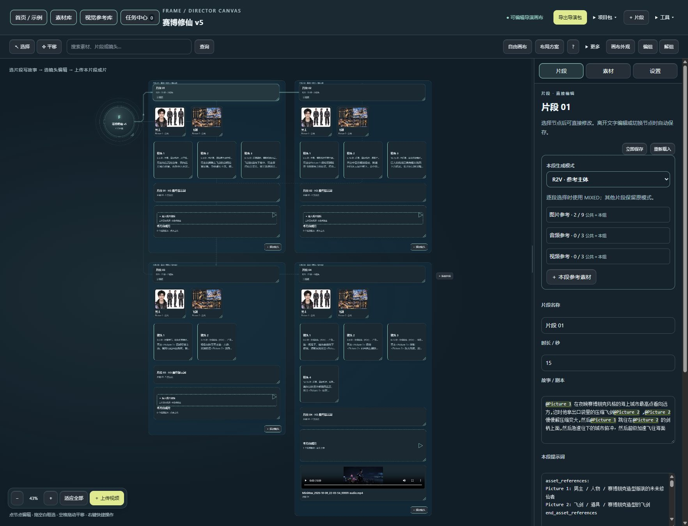
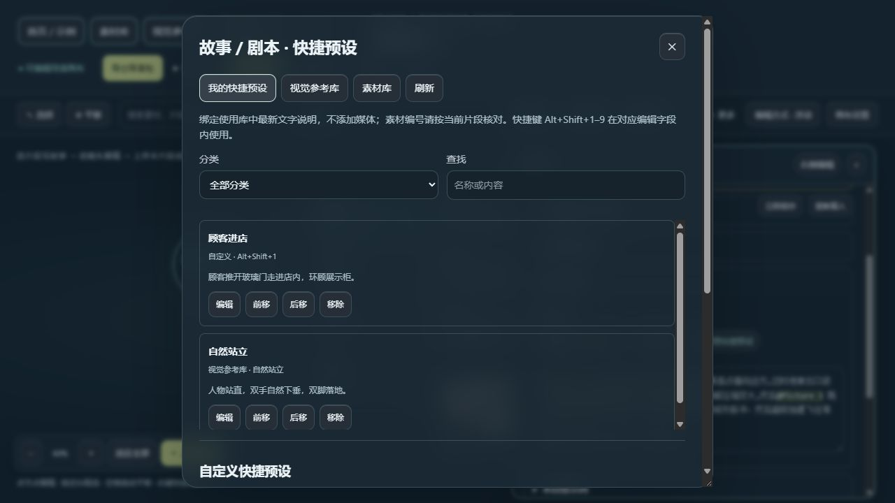
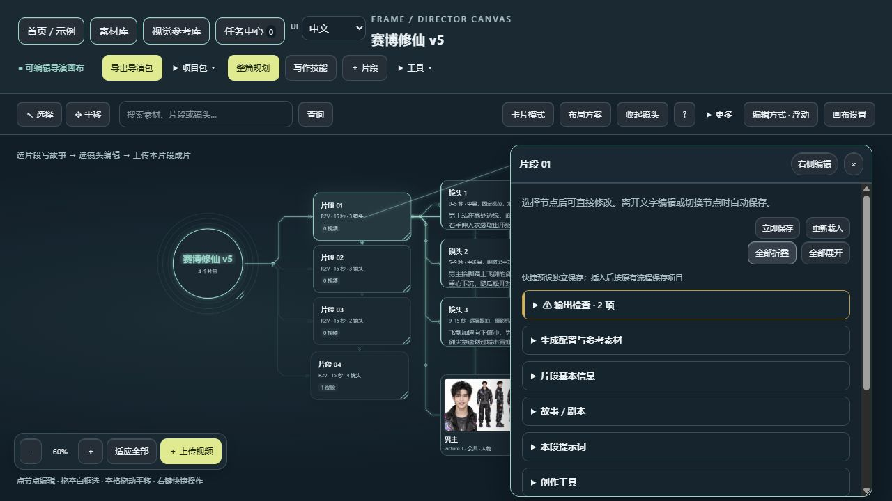
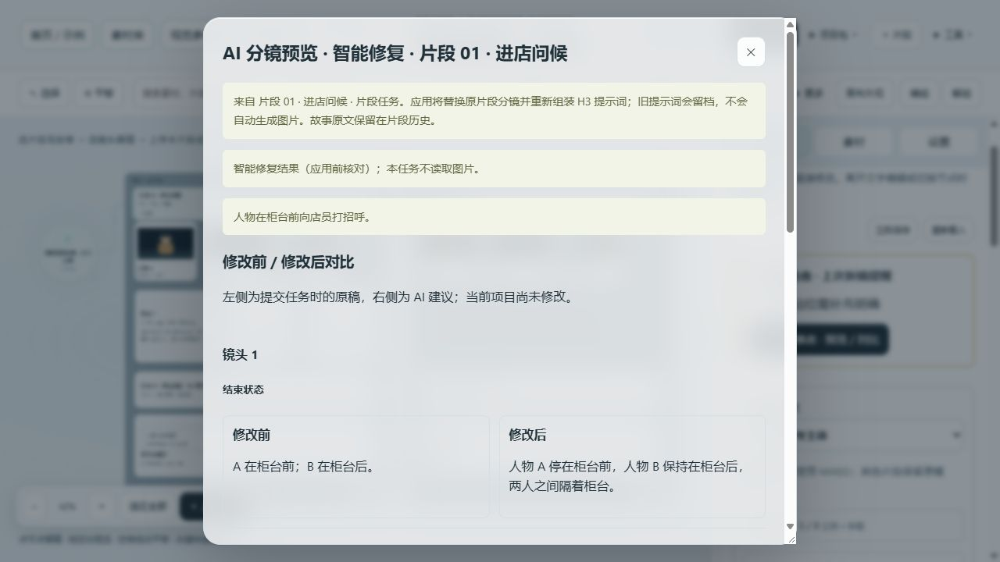
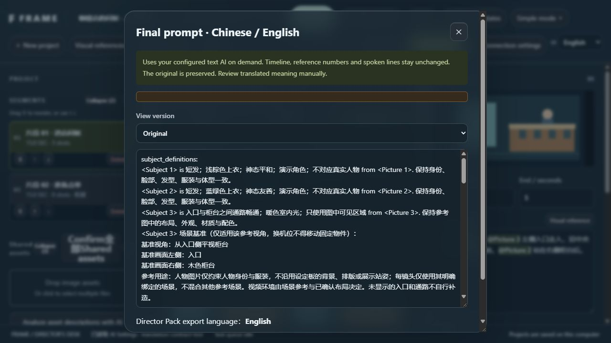
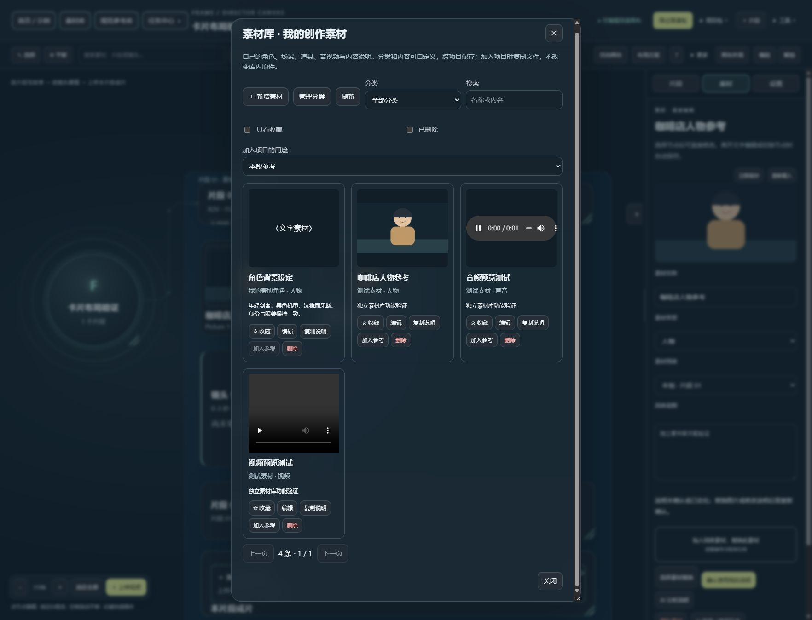
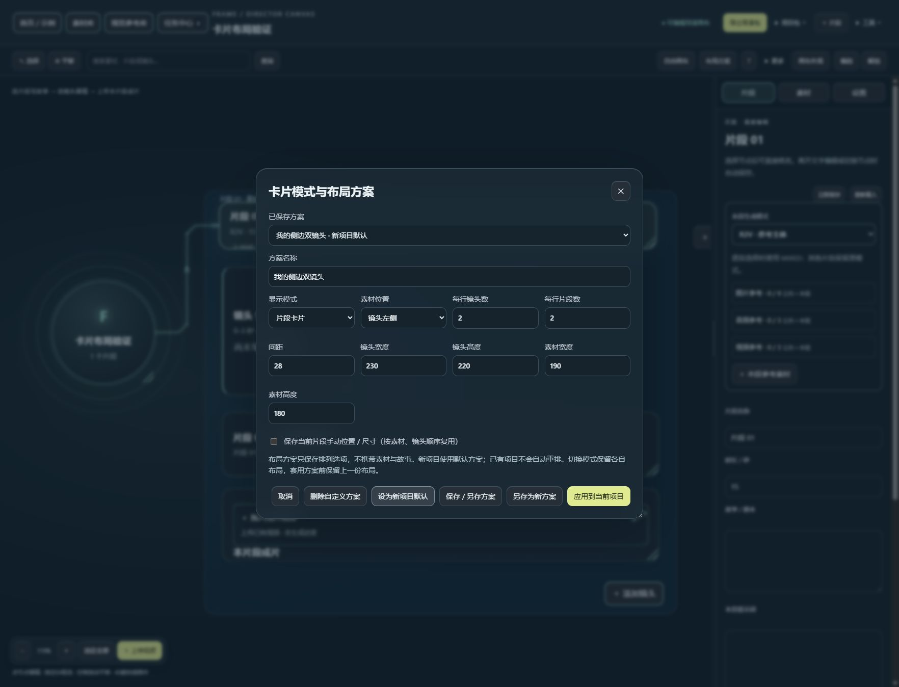

# FRAME · 分镜工作台

**把故事、参考素材、分镜和成片记录，整理在同一张导演画布里。**

Windows · 本地运行 · V3.24 Beta 1 · 基础分镜无需 AI

### [⬇ 下载 Windows 版（EXE，无需 Python）](https://github.com/Alan-Poo-Kai-Lun/frame-storyboard-workbench/releases/download/v3.24-beta.1/FRAME-Workbench-Windows-x64-v3.24-beta.1.exe)

[完整更新日志（V2.1–V3.24）](CHANGELOG.md) · [所有版本与更新包](https://github.com/Alan-Poo-Kai-Lun/frame-storyboard-workbench/releases) · [新手教程](docs/quick-start.md) · [常见问题](docs/faq.md) · [English](docs/README.en.md)



## 三步开始

1. **双击 EXE**，保持启动器运行，浏览器会打开工作台。
2. **点击「体验示例项目」**，直接查看「赛博修仙 v5」的 2 张参考图、4 个片段、12 个镜头和 1 条已有视频。
3. **点片段写故事，点镜头编辑**；准备好后保存项目备份，或导出导演包交给 ComfyUI H3 导演台。

无需先安装 Ollama 或配置 API。AI 分析素材、拆镜和审查可以之后再设置。

## V3.24：浮动编辑与自定义快捷预设

- **浮动编辑**：片段、镜头、素材和最终提示词使用同一套编辑与保存流程。拖动标题栏移动、拖右下角拉伸，也可停靠右侧；镜头支持前后翻页与 `Ctrl + ← / →`。
- **自定义快捷预设**：故事、画面动作、摄影机等文字字段支持名称、内容、排序、编辑、删除及 `Alt + Shift + 1–9`；在对应字段内插入到光标位置。
- **绑定参考库**：将视觉参考库或素材库条目绑定为标签，使用时读取最新文字说明。不会自动添加媒体，Picture 编号仍需按当前片段核对。
- **面板全部折叠 / 展开**：按功能分区，收起保留输入并记忆状态。输出检查收起后仍显示黄色提醒与数量。
- **更清晰的提示词与画布**：本段及最终提示词细分字段高亮，项目根节点可选六种形状，右键使用展开子菜单。
- **整篇剧情规划与写作规则**：设定段数和每段时长，由已配置的 AI 规划，预览确认后追加；规则库支持自定义。没有直接执行本机 Codex 技能或新增 ComfyUI 直连。





截图来自隔离示例项目。57 项后端测试、20 组界面检查和 Windows EXE 自检通过；本轮没有调用真实 AI，也没有验证 GPU 视频生成。详见 [V3.24 更新说明](docs/release-v3.24-beta.1.md)。该公开版本包含此前的 [V3.21](docs/release-v3.21-beta.1.md)、[V3.22](docs/release-v3.22-beta.1.md) 和 [V3.23](docs/release-v3.23-beta.1.md) 本地更新。

## V3.23：浮动编辑与镜头流转

- 片段、镜头、素材和最终提示词可在浮动面板编辑，支持标题栏拖动、右下角拉伸和右侧停靠，记忆模式与位置。
- 前后镜头翻页、`Ctrl + ← / →`、时长计算、显式对齐下一镜开始时间；保存失败保留当前输入。

[详细记录](docs/release-v3.23-beta.1.md)

## V3.22：提示词高亮与画布外观

- 本段及最终提示词分别高亮 Camera、Expression、Sound、Spatial start/end 等字段，保留引用与时间码显示。
- 项目根节点提供六种形状；右键菜单改为可展开子菜单，支持键盘操作和边缘反向展开。

[详细记录](docs/release-v3.22-beta.1.md)

## V3.21：整篇规划与写作辅助

- 整体剧情可指定段数和每段秒数，AI 结果先预览再确认追加；写作规则支持内置摘要和自定义条目。
- 片段级对白语言与标准英文标签、右键高亮 AI 拆镜 / 素材分析、提示词复制与输出检查收纳。

[详细记录](docs/release-v3.21-beta.1.md)

V3.21–V3.23 为本地迭代，首次随 V3.24 一并公开，并非漏发了三个 GitHub 安装包。更早版本请查看[完整更新日志](CHANGELOG.md)。

## V3.20 有什么变化

- **修复导出旧图片**：残留旧媒体不会再覆盖当前参考图；保留原有编号，无需删除重建素材，使用原项目重新导出即可。
- **AI 帮忙修改**：输出检查提醒可提交局部修正；先查看修改前 / 修改后，确认才应用，旧镜头和提示词留档可撤销。
- **右侧属性面板整体收起 / 展开**：边缘箭头扩大画布空间，状态随项目保存。



截图来自隔离示例和模拟模型，实际 AI 建议仍须人工核对。详见 [V3.20 更新说明](docs/release-v3.20-beta.1.md)。

## V3.19 有什么变化

- **界面中英切换**：画布与详细编辑共用语言设置，修复后台刷新重置选择的问题；项目原文保留。
- **双语提示词**：按需调用配置的文本 AI，生成中文、英文副本；任务中心预览后保存，明确选择导演包导出语言。时间线、素材编号和对白保持原文，过期副本需重新翻译。
- **输出检查更醒目**，并提供手动提示词引导与模板。
- **片段卡片可折叠、整体拖动**，展开状态与位置随布局保存。



截图来自隔离测试项目。翻译流程通过模拟模型验证，实际译文质量需用自己的模型审阅。详见 [V3.19 Beta 2 更新说明](docs/release-v3.19-beta.2.md)。

## V3.18 有什么变化

- **片段卡片模式**：素材、横排镜头、最终提示词和成片按片段集中排列；新建卡片片段默认一个镜头，保留自由画布模式。
- **保存自己的布局**：调整素材位置、列数、间距与尺寸，捕获手动排列；保存多个命名方案，选择新项目默认布局。已有项目不会自动重排。
- **独立素材库**：自定义名称、内容说明和分类；搜索、收藏及删除恢复，预览图片、视频和音频，再加入公共或本段参考。项目使用媒体副本。
- **入口更直观**：首页 / 示例、素材库、视觉参考库与任务中心固定在画布左上。
- **保留写作体验**：文字编辑时不自动保存打断输入；空提示词可保存并从故事 AI 拆镜，本机项目支持删除、清空与回收站恢复。

<details>
<summary>查看素材库与布局方案实际截图</summary>





截图来自隔离测试环境，库内展示测试条目；安装包不携带这些测试条目或私人素材库。未调用生成模型。详见 [V3.18 更新说明](docs/release-v3.18-beta.1.md)。

</details>

## 导演包如何接到 ComfyUI

支持 T2V、I2V、FL2V、R2V、V2V、RV2V 与 MIXED 项目；MIXED 可为每段选择 T2V / I2V / FL2V / R2V。按模式明确指定参考素材、首尾帧或源视频，导出时检查必需输入。

在 **[AIMixer / ComfyUI MiniMax H3 Director](https://github.com/AIMixer/ComfyUI_MiniMaxH3_Director)** 节点内点击「导入导演包」，选择 `.mmxpack.zip`。插件、工作流和模型需要另行准备。已核对七种模式的包结构与目标导入器读取；实际生成效果仍需在你的模型环境验证，见 [对接说明](docs/h3-director-compatibility.md)。

FRAME 负责规划、编辑与记录；图片和视频在外部工具生成，再放回对应片段。项目与设置保存在本机；使用云模型时，请求发送到你配置的服务。

## 使用与维护

| 你想做什么 | 从这里开始 |
|---|---|
| 跟着做第一个项目 | [新手图文教程](docs/quick-start.md) |
| 更新、迁移或备份数据 | [安装、更新与数据](docs/install-and-data.md) |
| 了解完整功能和历史更新 | [功能说明](docs/workbench-guide.md) · [更新记录](CHANGELOG.md) |
| 遇到问题 | [常见问题](docs/faq.md) · [提交问题](https://github.com/Alan-Poo-Kai-Lun/frame-storyboard-workbench/issues/new/choose) |

<details>
<summary>开发、源码与授权</summary>

源码运行需要 Python 3.10+，见 [安装说明](docs/install-and-data.md#源码启动)。开发检查：

```bash
python -m unittest discover -s tests -v
python tools/check_release.py
python tools/build_release.py
```

[发布管理](docs/releasing.md) · [贡献说明](CONTRIBUTING.md) · [安全反馈](SECURITY.md)

当前源码公开可见，采用 **All rights reserved**，授权以 [LICENSE](LICENSE) 为准。素材与第三方来源见 [NOTICE](NOTICE.md)。

</details>
