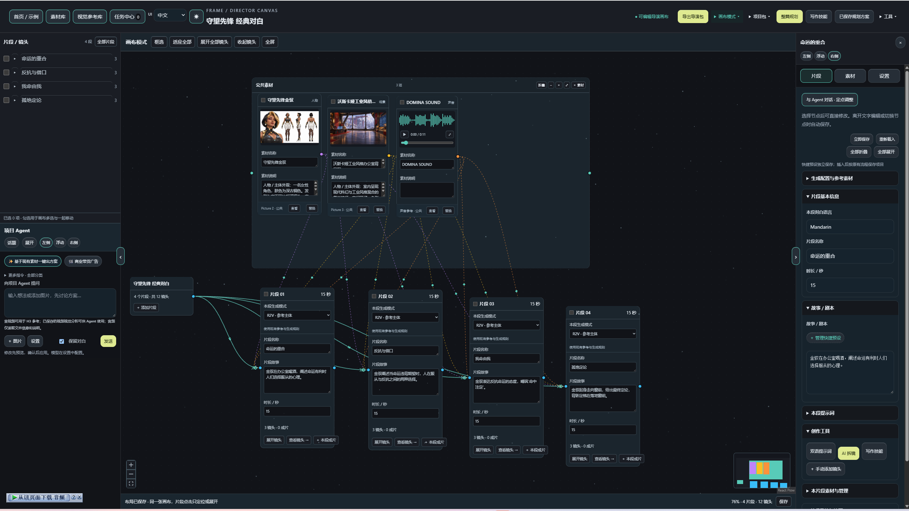
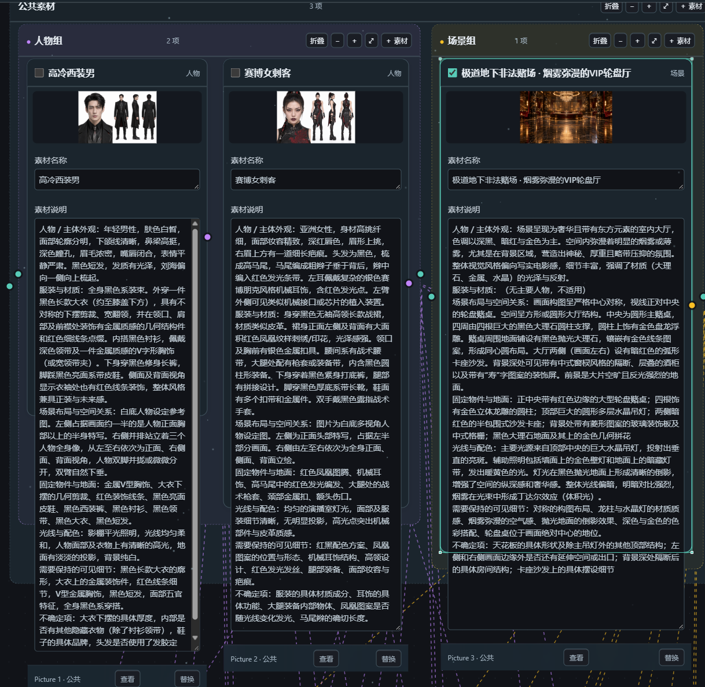
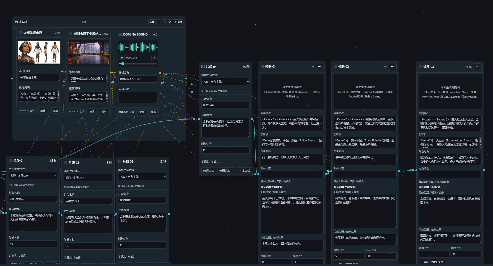
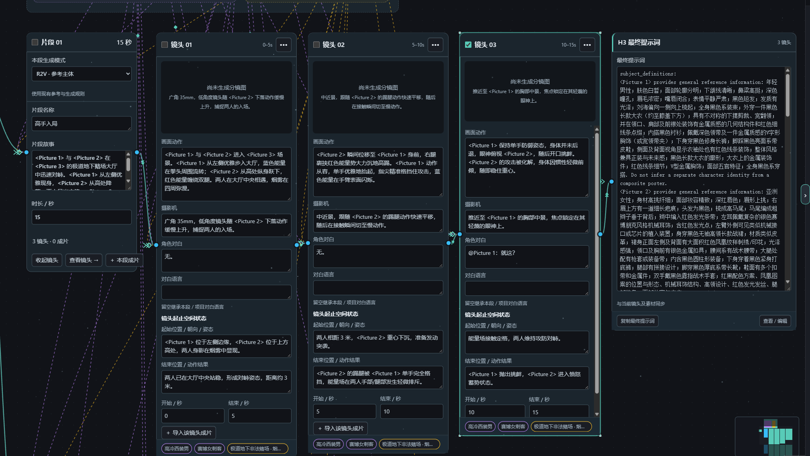
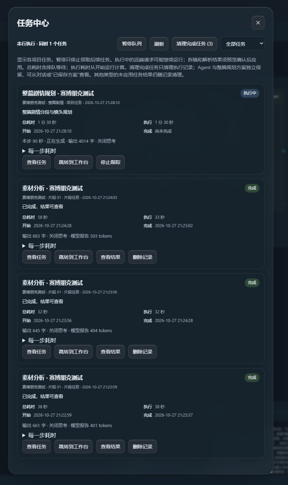

# FRAME · AI 分镜导演工作台

**把参考素材、剧情、镜头和最终提示词放在同一张可编辑画布上。**

FRAME 面向 AI 短视频、广告与故事分镜创作：整理人物和场景参考，规划片段，逐镜编辑动作、摄影机、对白与起止空间状态，再将提示词和导演包交给外部视频生成工具。

**Windows · 本地运行 · V3.38 / 画布 R12**　[English](docs/README.en.md) · [版本下载](https://github.com/Alan-Poo-Kai-Lun/frame-storyboard-workbench/releases) · [使用教程](docs/quick-start.md)

> 当前仓库源码为 R12，包含最终提示词和卡片尺寸补修。已发布 EXE 请以 Releases 页的版本标签为准；更新源码不会自动替换你电脑上的程序。FRAME 本身不生成视频，AI 辅助功能需要连接你自己的模型服务。

## 看工作台怎么组织一个项目



左侧浏览片段和镜头，也可以与项目 Agent 讨论；中间查看素材引用和镜头顺序；右侧编辑选中节点的属性、参考素材和画布外观。画布模式与卡片模式使用同一 React Flow 内核，编辑同一份项目数据。

这些是用户提供的实际运行截图。总览与镜头编辑截图拍摄于 2026-10-26，分组与最终提示词截图拍摄于 2026-10-27，分别反映当时的界面；它们不是效果图，也不代表所有截图都来自完全相同的补修版本。[截图来源说明](docs/assets/screenshots/README.md)

## 从素材到最终提示词

### 1. 先整理人物、场景和声音参考



公共素材与片段素材分开管理。R12 将素材放入「人物组」「场景组」「道具与声音」容器，支持整体移动与折叠。素材卡片可以编辑名称和说明、查看或替换文件；视频与音频支持卡片内播放、暂停和拖动进度。

从素材端点连接到镜头，会同步镜头的素材绑定；输入 `@` 也可以选择参考素材。**提及素材不等于模型已经看过或听过文件**：规划使用的说明、分析结果和媒体输入能力取决于配置与实际执行的任务。

### 2. 按片段安排镜头



每个片段设置故事、时长和生成模式。展开后逐镜填写：

- **画面动作**：谁在什么位置做什么，动作如何承接。
- **摄影机**：景别、机位、焦段与运动方式。
- **对白和语言**：角色说什么，使用什么语言。
- **镜头起止空间状态**：起始位置、朝向和姿态，以及结束位置或动作结果。
- **开始／结束时间**：明确镜头在片段中的时间范围。

使用「自动对齐」整理片段和镜头；选中卡片后，在右侧「设置 → 当前节点尺寸」调整宽高，也可拖动边角。尺寸与布局支持保存和撤销，较小卡片中的内容可内部滚动。

### 3. 在最后一个镜头后查看 H3 最终提示词



每个片段的镜头序列后连接「H3 最终提示词」节点，汇总当前镜头与参考素材。你可以复制完整提示词，或通过「查看／编辑」进入原有编辑入口。生成好的视频可以导入镜头成片或片段成片区域，播放核对、备注和对比。

## 让 AI 辅助，修改先预览

配置本机 Ollama 或兼容 API 后，可使用素材分析、整篇剧情规划、片段拆镜、写作技能和项目／节点 Agent。文字规划需要合适的文字模型，图片理解需要支持图片输入的模型；云端接口的费用由服务商收取。

方案先预览，确认后再应用到项目。写作技能用于辅助表达与分镜规则，不代表自动生成的视频必然符合要求。



任务中心显示排队和执行状态、耗时及结果入口。**暂停队列只停止领取后续任务；停止跟踪不保证远端模型请求立即终止。** 截图中的耗时来自具体任务，不作为速度承诺。

## 第一次使用

1. 在 [Releases](https://github.com/Alan-Poo-Kai-Lun/frame-storyboard-workbench/releases) 选择所需版本的 Windows EXE，放到独立文件夹运行，保持启动器打开。
2. 从首页打开「官方示例」并创建副本，先试手动编辑，无需连接 AI。
3. 添加参考素材，填写并确认说明；创建片段、展开镜头，编辑动作和摄影机。
4. 用 `Ctrl+Z` 撤销、`Ctrl+Shift+Z` 重做，检查最终提示词。
5. 需要 AI 时再配置模型连接；需要备份时保存项目包。

当前 Windows EXE 的临时目录策略需要可写的 **D: 盘**；无 D: 盘环境尚未验证。升级前先备份并**退出旧启动器**，只关闭浏览器不会停止旧服务。R12 EXE 使用端口 `8852`，数据保存在 EXE 同目录的 `FRAME-Canvas-R12-Data`。[安装与数据迁移](docs/install-and-data.md)

## 保存与交接

| 目的 | 操作 |
|---|---|
| 下次继续编辑或迁移电脑 | 「项目包」中保存项目备份，之后导入 |
| 把文字交给视频模型 | 复制片段的 H3 最终提示词，并准备对应素材 |
| 交接到 H3 导演台 | 导出 `.mmxpack.zip` 导演包 |
| 核对已有视频 | 导入镜头／片段成片，播放、备注与对比 |

导演包不是成片，也不是通用 ComfyUI 工作流。当前接收端为 [AIMixer / MiniMax H3 导演台](https://github.com/AIMixer/ComfyUI_MiniMaxH3_Director)，需另行配置其插件与工作流；工作台内尚未提供一键调用 ComfyUI 生成视频。[对接说明](docs/h3-director-compatibility.md)

项目保存在本地；调用云端模型时，相关请求内容会发送到所配置的服务。请勿把 API Key、私人项目或未获授权的素材提交到公开仓库。

## 开发与验证

后端为 Python，本地浏览器界面使用 HTML/CSS/JavaScript，节点画布使用 React 与 `@xyflow/react`。

```bash
python -m pip install Pillow==12.3.0
python server.py
```

源码服务默认打开 `http://127.0.0.1:8845`；Windows BAT 与 EXE 的端口设置不同，可通过参数指定。修改节点前端后：

```bash
cd frontend
npm ci
npm run typecheck
npm run build
```

类型检查覆盖新增的素材分组与节点几何 JS/JSDoc 模块，不能替代整个动态 JSX 界面的类型检查。构建后须按 [发布说明](docs/releasing.md) 更新 vendor 校验值。

```bash
python tools/check_release.py
python -m unittest discover -s tests -v
python tools/test_browser.py
```

浏览器回归所需 Playwright 与浏览器安装方式见 [CI 工作流](.github/workflows/check.yml)。R12 补修 EXE 已通过 53 项浏览器检查；Agent 流程回归使用本地模拟响应，不能当作真实模型效果验证。

[更新记录](CHANGELOG.md) · [R12 说明](docs/release-v3.38-canvas-r12.md) · [常见问题](docs/faq.md) · [问题反馈](https://github.com/Alan-Poo-Kai-Lun/frame-storyboard-workbench/issues)

源码公开可见，**不等于允许任意使用或再分发**。授权以 [LICENSE](LICENSE) 为准，依赖与来源说明见 [NOTICE](NOTICE.md)。
