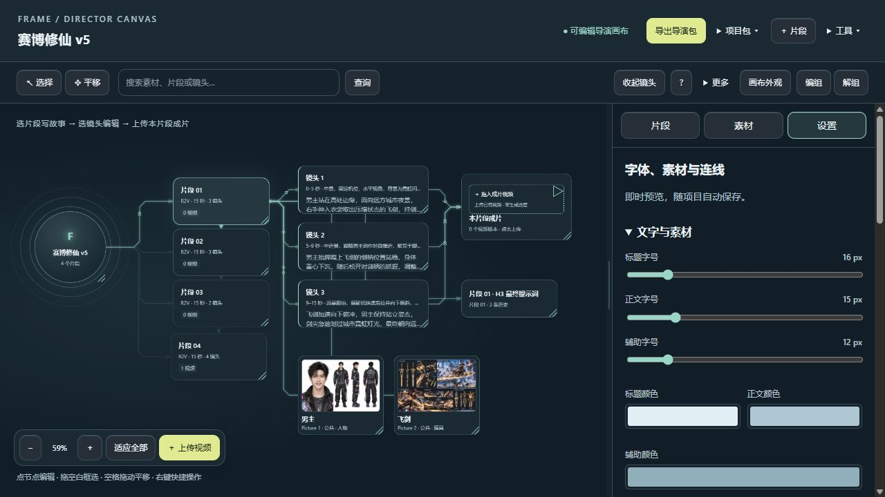

# FRAME · 分镜工作台

**把故事、参考素材、分镜和成片记录，整理在同一张导演画布里。**

Windows · 本地运行 · V3.16 Beta · 基础分镜无需 AI

### [⬇ 下载 Windows 版（EXE，无需 Python）](https://github.com/Alan-Poo-Kai-Lun/frame-storyboard-workbench/releases/download/v3.16-beta.1/FRAME-Workbench-Windows-x64-v3.16-beta.1.exe)

[所有版本与更新包](https://github.com/Alan-Poo-Kai-Lun/frame-storyboard-workbench/releases) · [新手教程](docs/quick-start.md) · [常见问题](docs/faq.md) · [English](docs/README.en.md)


## 三步开始

1. **双击 EXE**，保持启动器运行，浏览器会打开工作台。
2. **点击「体验示例项目」**，直接查看「赛博修仙 v5」的 2 张参考图、4 个片段、12 个镜头和 1 条已有视频。
3. **点片段写故事，点镜头编辑**；准备好后保存项目备份，或导出导演包交给 ComfyUI H3 导演台。

无需先安装 Ollama 或配置 API。AI 分析素材、拆镜和审查可以之后再设置。

## V3.16 有什么变化

- **右侧直接编辑**：常驻「片段 / 素材 / 设置」，本段生成模式、提示词和输入素材就地调整；停止输入后自动保存，并显示保存状态。
- **拖入图片、视频、音频**：空白处添加公共参考，镜头 / 片段卡添加该片段参考，素材卡同类替换；成片卡接收已有视频记录。
- **画布更易读**：素材画面随节点尺寸调整，可直接播放音视频；字号、颜色、网格、PCB 连线、HUD 箭头与光效均可设置。
- **整理与交接**：素材删除前查看影响、删除后可恢复；保留编组、一键确认素材、完整项目备份和导演包导入 / 导出。

<details>
<summary>查看新版设置面板实际截图</summary>



两张截图均来自 V3.16 的内置示例，未调用生成模型。更多变化见 [V3.16 更新说明](docs/release-v3.16-beta.1.md)。

</details>

## 导演包如何接到 ComfyUI

支持 T2V、I2V、FL2V、R2V、V2V、RV2V 与 MIXED 项目；MIXED 可为每段选择 T2V / I2V / FL2V / R2V。按模式明确指定参考素材、首尾帧或源视频，导出时检查必需输入。

在 **[AIMixer / ComfyUI MiniMax H3 Director](https://github.com/AIMixer/ComfyUI_MiniMaxH3_Director)** 节点内点击「导入导演包」，选择 `.mmxpack.zip`。插件、工作流和模型需要另行准备。已核对七种模式的包结构与目标导入器读取；实际生成效果仍需在你的模型环境验证，见 [对接说明](docs/h3-director-compatibility.md)。

FRAME 负责规划、编辑与记录；图片和视频在外部工具生成，再放回对应片段。项目与设置保存在本机；使用云模型时，请求发送到你配置的服务。

## 使用与维护

| 你想做什么 | 从这里开始 |
|---|---|
| 跟着做第一个项目 | [新手图文教程](docs/quick-start.md) |
| 更新、迁移或备份数据 | [安装、更新与数据](docs/install-and-data.md) |
| 了解完整功能和历史更新 | [功能说明](docs/workbench-guide.md) · [更新记录](CHANGELOG.md) |
| 遇到问题 | [常见问题](docs/faq.md) · [提交问题](https://github.com/Alan-Poo-Kai-Lun/frame-storyboard-workbench/issues/new/choose) |

<details>
<summary>开发、源码与授权</summary>

源码运行需要 Python 3.10+，见 [安装说明](docs/install-and-data.md#源码启动)。开发检查：

```bash
python -m unittest discover -s tests -v
python tools/check_release.py
python tools/build_release.py
```

[发布管理](docs/releasing.md) · [贡献说明](CONTRIBUTING.md) · [安全反馈](SECURITY.md)

当前源码公开可见，采用 **All rights reserved**，授权以 [LICENSE](LICENSE) 为准。素材与第三方来源见 [NOTICE](NOTICE.md)。

</details>
