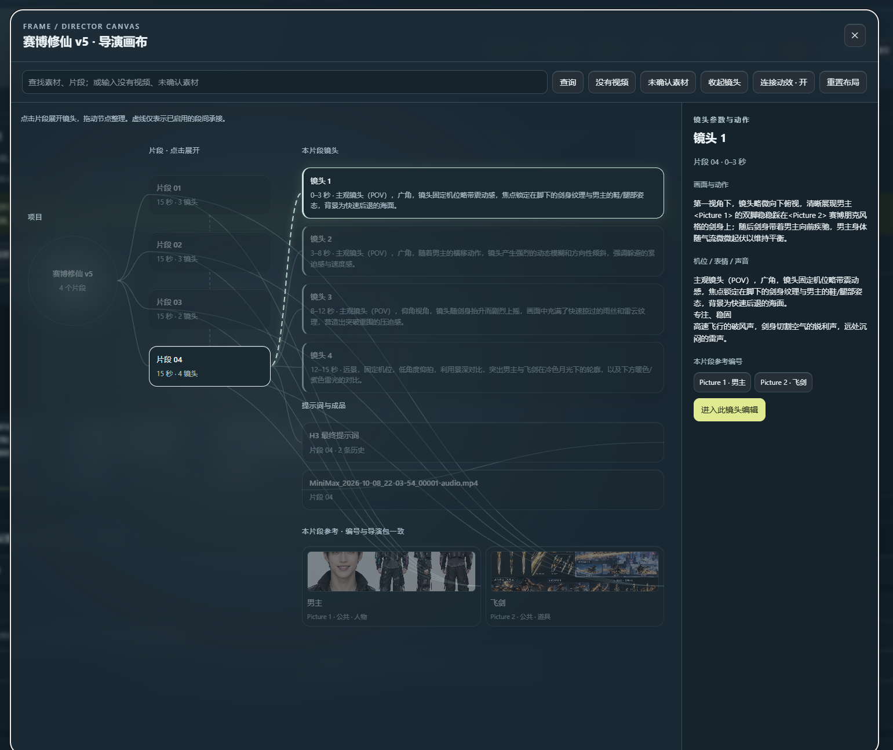
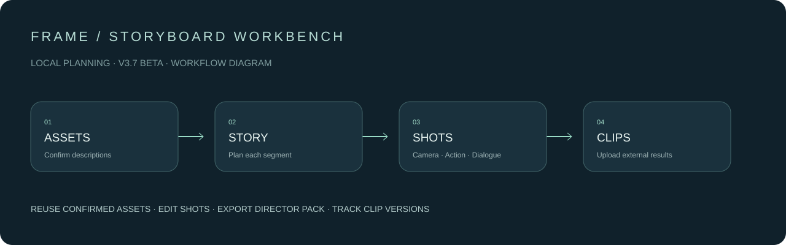

# FRAME · 分镜工作台

**把素材、故事、分镜与视频记录，整理在同一个本地导演工作台。**

`V3.12 Beta` · `Windows EXE / Python 3.10+ 源码版` · `Windows 优先` · `本地运行` · `暂时保留权利`

> **先开始分镜，再按需加入 AI。** 基础分镜不需要 Ollama、API 或 H3 导演台。AI 辅助需要 Ollama 或兼容 API，二选一；H3 视频交接的依赖见 [ComfyUI 对接说明](docs/h3-director-compatibility.md)。

[⬇ Windows EXE / 更新包](https://github.com/Alan-Poo-Kai-Lun/frame-storyboard-workbench/releases) · [🚀 第一次使用：图文入门](docs/quick-start.md) · [常见问题](docs/faq.md) · [English](docs/README.en.md) · [功能与历史说明](docs/workbench-guide.md) · [更新记录](CHANGELOG.md) · [发布管理](docs/releasing.md)



> 真实截图来自维护者先前的演示项目，展示升级前版本；V3.7 已增加全屏、平移缩放与详情栏调宽。截图里的角色与飞剑是虚构演示素材，不代表生成质量。当前为公开源码 Beta，暂未采用开源许可证。

**第一次打开？** 首页点击「体验示例项目」，直接进入总览，查看自绘咖啡店素材和人工编写分镜；不调用 AI。也可点击「创建新项目」，进入总览，沿故事 → 素材 → 分镜三步创作。本机项目会显示为列表，可打开不同项目；旧版导入的项目可通过「找回旧项目」扫描现存备份，创建或导入示例前会自动备份旧项目。

**默认在总览开始创作。** 点片段写故事 / 添加素材 → 点镜头修改动作、摄影机和对白 → 点成片上传视频。右侧可以直接保存，切换节点也会保存；专业参数按需展开。最终提示词可查看和修改，任务结果在任务中心预览应用。拖空白可框选，Shift 点选追加，拖选中节点可一起移动；右键显示快捷操作，复杂操作可进入「详细编辑」。



**视觉参考可以整包共享。** 参考库点击「导出整合包」，包含自定义 / 已替换参考、说明和图片、GIF、视频；别人导入前可预览，默认保留自己的重复条目。媒体容量提升到 500MB，并显示已用空间。内置默认示意图随软件提供，不另打包。

## 适合什么用途

为本地 AI 视频创作者整理素材说明、编排分镜、管理片段承接，并导出 H3 导演包。可以配合 Ollama 或兼容的文字模型接口使用。

**工作台负责策划与记录。图片和视频在外部工具生成，生成后可上传到对应片段。**

## 主要功能

| 功能 | 当前能力 |
|---|---|
| 新手入口 | 三个首页入口、继续本机项目、默认简洁模式、内置无需 AI 的示例 |
| 项目备份 | 完整 `.frame.json` 备份与导入，无需 H3 导演台 |
| 导演画布 | 全屏、节点自由拖动、平移缩放、项目波纹、右侧详情调宽 |
| 素材管理 | 公共 / 本组素材、拖入替换、Picture 引用与具体说明 |
| 素材确认 | 人工确认或 AI 分析后确认；已确认说明供后续文字拆镜复用 |
| AI 拆镜 | 队列、分阶段耗时、生成进度、失败输出保存与重新解析 |
| 分镜编辑 | 镜头参数、动作、表情、对白、起止空间状态、历史版本 |
| 视觉参考库 | 可自定义说明及图片、GIF、MP4 / WebM 动态参考 |
| 提示词 | 片段内参考编号、最终提示词、历史与导出检查 |
| 视频记录 | 上传、播放、备注、按片段保存并随导演包打包 |
| 模型管理 | Ollama 模型检测、任务内复用、任务结束或手动卸载 |

## 快速开始

**普通 Windows 用户（推荐）**：打开 [GitHub Releases](https://github.com/Alan-Poo-Kai-Lun/frame-storyboard-workbench/releases)，下载 `FRAME-Workbench-Windows-x64-版本号.exe`，双击即可启动，无需 Python。保持小启动器运行，它会自动打开浏览器中的工作台。首页可以先体验无需 AI 的示例。

**源码用户**：安装 Python 3.10+，下载源码并解压，双击 `Start-Windows.bat`；其他系统运行 `python3 server.py`，访问 `http://127.0.0.1:8787`。无需安装第三方 Python 运行包。

### 更新与数据

- 在工作台点击 **检查更新**，查看已发布版本和 EXE / 源码更新 ZIP 下载入口。
- EXE：退出旧启动器，再运行新版。项目、素材、视觉参考、任务和连接设置默认保存在 `%LOCALAPPDATA%\FRAME\Workbench\data`，各 EXE 版本共用，不在程序临时目录内。
- 源码：下载 Releases 中专门的 `FRAME-Storyboard-Workbench-版本号.zip`，关闭服务器，拖到原目录的 `Update-Windows.bat`，再启动并按 Ctrl+F5。原 `data/` 保留，旧程序备份放在 `versions/`。
- 从源码转 EXE：先关闭源码版，把 EXE 放入原目录再首次启动。目标用户数据为空时复制旧 `data/`；原目录保留。已有 EXE 数据时使用项目备份导入。
- 更新检查是手动操作，不会上传项目、素材或模型密钥，也不会静默安装。Beta 更新通过版本列表提供。

详见 [本次更新说明](docs/release-v3.12-beta.1.md)与 [Windows EXE 数据迁移说明](docs/release-v3.9-beta.1.md)。源码版端口占用时可使用 `--port 8788`；`--no-browser` 关闭自动打开浏览器。

### Ollama 配置

先在自己电脑启动 Ollama，并安装所需模型。默认服务地址为 `http://127.0.0.1:11434`。纯文字拆镜选择文字模型；分析图片必须选择支持图片输入的视觉模型。模型推理速度取决于模型、量化、显存与输出长度。

## 更新与数据

关闭工作台网页及后台终端，把新 ZIP 拖到**原安装目录**的 `Update-Windows.bat`。**GitHub 的源码 ZIP 不能直接拖入安装更新脚本。** 更新程序会保留 `data/` 并将旧程序归档到 `versions/`。重启后按 Ctrl+F5。

- `data/` 保存项目、连接设置、素材说明及参考媒体；完整备份该目录。
- API Key 保存于本机设置，请勿上传 `data/` 到 GitHub。
- `versions/` 保存旧程序，不适合提交源码仓库。
- 连接模型服务时，请求内容会发送到你配置的服务；选择云接口时并非完全离线。
- 发布包名中的 `v1` 是沿用的文件名；实际软件版本以界面和 `version.json` 为准。

## 兼容性与已知限制

- 目标接收端：**AI 搅拌手 / AIMixer 的 H3 导演台**；格式 `minimax-h3-director-pack` / `formatVersion: 1`。这只是包格式版本，不是插件版本。未固定实测的插件版本，不能承诺所有新版 / 分支兼容。
- Windows 启动脚本优先；其他系统的 Python 启动方式尚需更多实机测试。
- 本地测试通过不代表所有显卡、浏览器、模型或视频编码都能兼容。
- 视频播放依赖浏览器支持的编码；视频记录属于片段，不自动识别镜头归属。
- 单视频上限 50MB，项目视频合计上限 150MB，导演包解压资源上限约 400MB。
- 当前不提供图片 / 视频生成、视频剪辑合并或云托管服务。
- IDM 等浏览器插件可能拦截本地媒体；可在插件中排除 localhost。

## 开发与反馈

以下命令在 GitHub **源码目录**运行；安装 ZIP 不包含开发测试脚本。

```bash
python -m unittest discover -s tests -v
python tools/check_release.py
python tools/build_release.py
```

问题反馈请使用仓库 Issue 模板，附版本、复现步骤和脱敏错误信息。请勿公开真实客户资料、API Key 或完整个人导演包。重大隐私问题请通过仓库所有者的私下联系方式反馈。

## 权利与素材

项目目前 **All rights reserved**，详情见 [LICENSE](LICENSE)。仓库公开可见，尚未授予开源或一般商用许可；授权范围以 LICENSE 为准。

此仓库排除了原内部测试导演包、独立人物图、店铺图片及生成视频。文档中的历史界面截图包含虚构演示素材缩略图；咖啡店示例包由自绘示意图和人工镜头组成。运行程序时所使用的模型、节点、工作流和外部素材各自适用其权利要求。见 [来源说明](NOTICE.md)。
