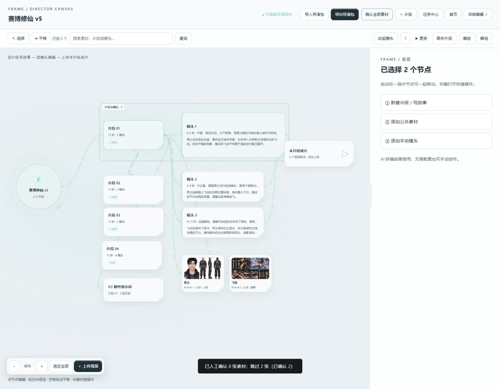

# FRAME · 分镜工作台

**把故事、参考素材、分镜和成片记录，整理在同一张导演画布里。**

Windows · 本地运行 · V3.14 Beta · 基础分镜无需 AI

## 下载并开始

### [⬇ 下载 Windows 版（EXE，无需 Python）](https://github.com/Alan-Poo-Kai-Lun/frame-storyboard-workbench/releases/download/v3.14-beta.1/FRAME-Workbench-Windows-x64-v3.14-beta.1.exe)

[所有版本与更新包](https://github.com/Alan-Poo-Kai-Lun/frame-storyboard-workbench/releases) · [新手图文教程](docs/quick-start.md) · [常见问题](docs/faq.md) · [English](docs/README.en.md)

1. **双击 EXE**，保持小启动器运行，浏览器会打开工作台。
2. **点击「体验示例项目」**，查看「赛博修仙 v5」的素材、4 个片段、12 个镜头和已有视频。
3. **点片段写故事，点镜头编辑**；准备好以后，保存项目备份或导出导演包。

不需要先安装 Ollama 或配置 API。AI 拆镜可以之后再设置。



*截图来自 V3.14 的「赛博修仙 v5」示例项目。*

## 你可以用它做什么

- **整理素材**：公共与本组参考、具体说明、一键人工确认。
- **编排分镜**：编辑动作、摄影机、对白和时长，保留历史版本。
- **使用导演画布**：框选编组、整组拖动、调整节点大小，自定义颜色与网格。
- **按需使用 AI**：连接 Ollama 或兼容 API，辅助分析素材和拆镜。
- **保存与交接**：完整项目备份、导入 / 导出 H3 导演包，记录各片段视频版本。

FRAME 负责规划与记录。图片和视频在外部工具生成，再放回对应片段。

## 下一步

| 你想做什么 | 从这里开始 |
|---|---|
| 跟着做第一个项目 | [新手图文教程](docs/quick-start.md) |
| 更新软件、迁移或备份数据 | [安装、更新与数据](docs/install-and-data.md) |
| 把导演包交给 ComfyUI | [H3 导演台对接说明](docs/h3-director-compatibility.md) |
| 查看完整功能和更新 | [功能说明](docs/workbench-guide.md) · [V3.14 更新](docs/release-v3.14-beta.1.md) · [更新记录](CHANGELOG.md) |
| 遇到问题 | [常见问题](docs/faq.md) · [提交问题](https://github.com/Alan-Poo-Kai-Lun/frame-storyboard-workbench/issues/new/choose) |

H3 交接需要另行安装 AIMixer 的 ComfyUI H3 导演台、工作流和模型，详情见对接说明。项目与设置保存在本机；使用云模型时，请求会发送到你配置的服务。

<details>
<summary>开发、源码与授权</summary>

源码运行需要 Python 3.10+，见 [安装说明](docs/install-and-data.md#源码启动)。开发检查在仓库源码目录执行：

```bash
python -m unittest discover -s tests -v
python tools/check_release.py
python tools/build_release.py
```

[发布管理](docs/releasing.md) · [贡献说明](CONTRIBUTING.md) · [安全反馈](SECURITY.md)

当前源码公开可见，采用 **All rights reserved**，授权以 [LICENSE](LICENSE) 为准。素材与第三方来源见 [NOTICE](NOTICE.md)。

</details>
