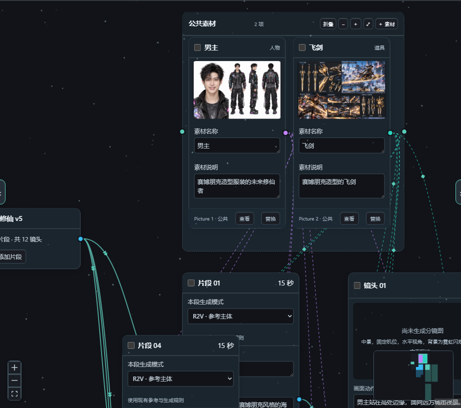

# FRAME Storyboard Workbench · Canvas R12

[中文](../README.md)

Real project assets are grouped by character, scene, and props/audio. Category frames move their children and collapse without removing references. Material-to-shot Bezier connections synchronize stable asset IDs, typed media bindings and the compiled prompt, with undo/redo.

This repository now contains the R12 source, including final-prompt and node-size fixes. Published Windows binaries remain identified by their release tags. Run the independent R12 EXE on port 8852. Data uses FRAME-Canvas-R12-Data beside the EXE; old data can be copied into an empty R12 directory without replacing the source. Back up projects before testing.

The source ZIP includes tests and compiled frontend assets, without personal data or node_modules. npm run typecheck strictly checks the new JS/JSDoc grouping module; the legacy dynamic JSX interface is covered by production compilation and browser regressions, not a full TypeScript type check.

## 2. Try it once without configuring AI

1. On the home screen, click the **"Official example"** project ("赛博修仙 v5") and create a copy when prompted.
2. Click a **segment** to read that part of the story, then click a **shot** to see its action, dialogue and prompt.
3. Edit one line of shot action and click away; watch the save status. Nodes can be expanded for details, and the inspector panel edits the same fields.
4. Press `Ctrl+Z` to undo that edit, then `Ctrl+Shift+Z` to bring it back.
5. Click the **"H3 final prompt"** node to read and copy the prompt for that segment.
6. To keep a standalone backup, use **Project pack → Save project backup / handoff**.

That covers the whole loop: read the story → edit a shot → undo → read the prompt → save a backup. The videos in the example are existing files; opening the example never calls a model or renders anything.



Screenshot from the isolated V3.38 Canvas R10 official example project; the people and locations are teaching assets. [Screenshot notes](assets/screenshots/README.md)

## 3. Bring your own story and media

Three words to know: a **segment** is a short piece of story (say 15 seconds), a **shot** is one frame inside it, and an **asset** is a reference file — a character, a location, a product.

1. Go back to the home screen, choose **Create project**, and name it.
2. Drag reference images onto empty canvas space to add assets. Click an asset, give it a name, describe what is actually visible, check it, then confirm.
3. Use **+ Add segment** on the canvas to start a piece of story. Select it and write in **Story / script**; type `@` to reference an asset by name.
4. Use **+ Add shot** next to a segment or inside its card to fill in action, dialogue and timing. If AI is configured, you can let it plan the shots first and apply after previewing.

For example: add three assets — customer, barista, café — then write with `@`: "The customer walks into the café, the barista nods, the customer stops at the counter." Then split it into three shots: entering, greeting, replying.

**Mentioning an `@` asset does not mean the AI has looked at the image.** Image analysis runs separately and needs confirmation. When you write the description yourself, the AI plans from your words. [Full tutorial for your first project](quick-start.md)

The canvas is for arranging relationships freely; **Card mode** is for reading one segment at a time. Both edit the same project.

## 4. Making the canvas yours

Open the **inspector → Settings**. The first block is **Dynamic theme**:

| I want to | Do this |
|---|---|
| Change the overall mood | Pick one of the ten presets (Cyber Reel, Aurora Deep, Darkroom Film…); switching crossfades |
| Use my own image or video as a backdrop | *Backdrop & atmosphere* → choose from the backdrop list, or **Choose image / video from disk** |
| Fewer particles, or none at all | Adjust particle density, speed and strength; pick "None" to remove them |
| Stop the background fighting my content | Adjust **backdrop dim** and **vignette** |
| No animation whatsoever | Tick **Advanced appearance → Reduce motion** |

Uploaded backdrops live in the **workbench-wide backdrop library**, so every project can reuse them; each file is capped at 60 MB and is not bundled into exports. Theme parameters are saved with the project. Uploaded backdrop files are not exported; copy the workbench backdrop library or select the files again when moving to another machine.

## 5. Connecting a model (only when you want AI help)

Writing the story, adding shots, organising assets and saving a project never need a model. AI shot splitting, image analysis and project chat do.

Open **gear → AI connection** on the home screen and choose one:

| Option | What you need |
|---|---|
| Local Ollama | Ollama running, the model installed, and the exact model name selected |
| OpenAI-compatible API | The provider's endpoint, model name and API key; billing follows the provider |

Text planning needs a text model; analysing images needs a vision-capable model. Test the connection before using the features.

AI jobs appear in the **Task centre**. **A finished job still needs to be reviewed and applied** before it touches your project. With cloud endpoints, requests and related content are sent to the provider you configured. [Configuration and troubleshooting](faq.md#模型与拆镜)

## 6. Saving the project, or handing it to a video tool

| Your goal | Use this |
|---|---|
| Keep editing later, or back up | Project pack → Save project backup / handoff, which writes a `.frame.json`; import it from the home screen later |
| Copy text into an external video tool | Copy the prompt from a shot or the final-prompt node, and prepare assets for that tool |
| Hand it to the ComfyUI H3 director | **Export director pack** at the top, review, then download `.mmxpack.zip` |
| Keep generated video | Drag the video into the segment's **finished video** node, play it, add notes |

**A director pack is not a video, and not a generic ComfyUI workflow.** The receiving side is currently [AIMixer's MiniMax H3 Director](https://github.com/AIMixer/ComfyUI_MiniMaxH3_Director): install its plugin, workflow and models separately, then use **Import director pack** inside the director. [Compatibility notes](h3-director-compatibility.md)

If you have not set up the H3 director yet, just save a project backup. Exporting and importing the pack is manual today; there is no one-click ComfyUI render from inside the workbench.

## More, when you need it

- **Project management**: search, grid/list, rename, duplicate and trash on the home screen; single click selects, double click opens.
- **Assets and references**: type `@` to pick an asset by name, hover to preview, copy images, paste into the library, duplicate.
- **Undo and redo**: `Ctrl+Z` / `Ctrl+Shift+Z` covering edits, deletes, replacements and pastes, up to 30 steps.
- **AI assistance**: whole-story planning, per-segment shot splitting, writing skills, project and node chat — always preview before applying.
- **Recovering deletions**: saved plans can restore missing segments and shots.
- **Appearance**: day/night themes, 12 built-in presets, custom colours; glow, spotlight, junction pads and glass can be switched off, with reduced-motion support.

The workbench now uses one canvas / card-flow editor; the separate "detailed edit" page is gone. [Full changelog](../CHANGELOG.md)

## Problems, backups and data

- **Won't open, port in use, or black media**: see [FAQ](faq.md). Do not delete the data folder first.
- **Something went wrong?** Use **Tools ▾ → Export diagnostics** and attach the JSON — it is far easier to act on than a screenshot.
- **Updating the EXE**: back up your data, quit the old launcher, run the new EXE. The new build keeps data in **`FRAME-Canvas-R12-Data` next to the EXE**; an empty data directory can copy adjacent R9 data on first launch. For other versions, use the launcher migration option or import a project backup. Old directories are preserved.
- **Source updates and migration**: [Install, update and data](install-and-data.md). A source copy keeps its data in `data/` next to the program.
- **Reporting**: [open an issue](https://github.com/Alan-Poo-Kai-Lun/frame-storyboard-workbench/issues/new/choose) with version, steps and what happened. Never attach API keys or private projects.

<details>
<summary>Developers: running from source, tests, licensing</summary>

Running from source needs Python 3.10+:

```bash
python -m pip install Pillow==12.3.0
python server.py
```

`python server.py` uses `http://127.0.0.1:8845`; `Start-Windows.bat` uses **8828**. The EXE launcher uses **8852** and opens the browser. The `--port` argument overrides the port.

```bash
python -m unittest discover -s tests -v
python tools/check_release.py
```

Canvas sources live in `frontend/`; after changing them run `node frontend/build.cjs` to produce `web/vendor/reactflow-a/app.js`, then refresh the hashes in `vendor-manifest.json`.

[Release management](releasing.md) · [Contributing](../CONTRIBUTING.md) · [Security](../SECURITY.md)

The source is public but **all rights reserved**; see [LICENSE](../LICENSE) for the actual terms, and [NOTICE](../NOTICE.md) for provenance and dependencies. Test records and historical screenshots document behaviour, not a guarantee of model output quality or compatibility with every machine.

</details>
