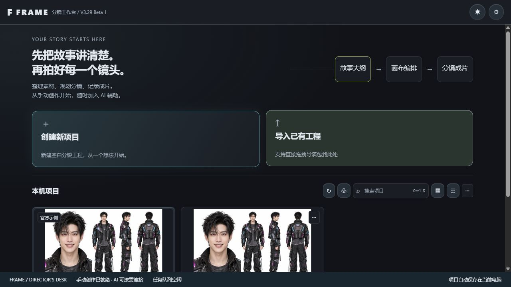
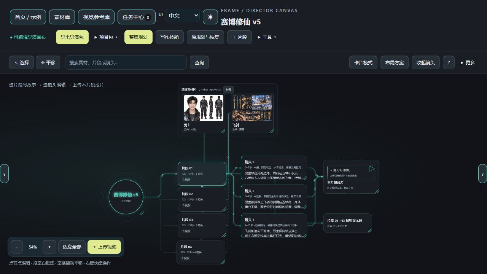
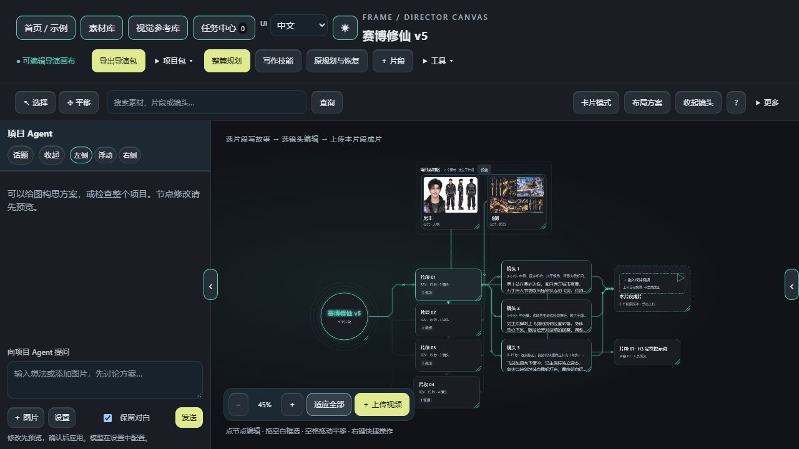
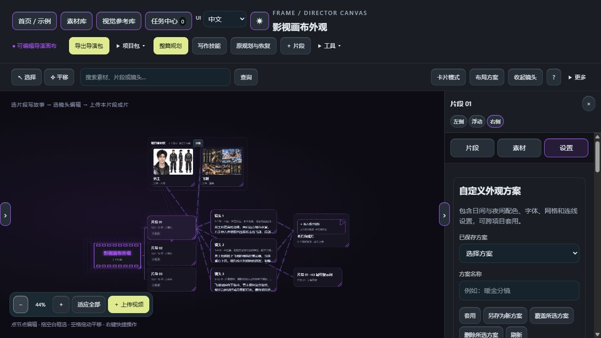

# FRAME Storyboard Workbench

A local workspace for stories, project assets, shot lists, H3 prompts and uploaded video records.

**V3.29 Beta 1 · Windows · Basic storyboarding works without AI.** Publicly visible source; all rights reserved. See [LICENSE](../LICENSE).

[**Download Windows EXE — no Python required**](https://github.com/Alan-Poo-Kai-Lun/frame-storyboard-workbench/releases/download/v3.29-beta.1/FRAME-Workbench-Windows-x64-v3.29-beta.1.exe) · [ZIP updater](https://github.com/Alan-Poo-Kai-Lun/frame-storyboard-workbench/releases/download/v3.29-beta.1/FRAME-Storyboard-Workbench-v3.29-beta.1.zip) · [Release notes and checksums](https://github.com/Alan-Poo-Kai-Lun/frame-storyboard-workbench/releases/tag/v3.29-beta.1)

[中文](../README.md) · [Complete changelog, V2.1–V3.29](../CHANGELOG.md) · [Step-by-step tutorial (Chinese)](quick-start.md) · [Troubleshooting](faq.md)



## Get started

1. Run the EXE and keep its launcher open. The workbench opens in your browser.
2. Open the official Cyber Cultivation v5 sample to create a copy, create a blank project, or import a Director Pack. The sample contains two reference images, four segments, twelve shots and one existing video.
3. Select a segment to write its story, then select a shot to edit. Use cards for grouped content or the free canvas for relationships. Save a project backup or export a Director Pack.

Configure Ollama or a compatible API in settings when you need AI. Image analysis requires a vision-capable model. Cloud requests are sent to the configured service.

## What's included in V3.29

This public release includes the cumulative V3.25–V3.29 local iterations. Individual local versions do not imply separate published installers.

- **Project hub:** media covers, an official sample, grid/list views, search, duplicate, rename, Director Pack export and recoverable deletion. Single-click selects; double-click opens the last mode.
- **Two Agent entry points:** project conversations for ideas and planning; segment, shot or asset conversations for targeted edits. Topics have separate histories and recoverable deletion. Preview changes before applying them.
- **Docking:** drag Agent and property panels to the left, right or floating position. Resize, snap to an edge and collapse with edge arrows; panel state is remembered.
- **Independent project assets:** the asset dock remains visible with zero segments. Uploading assets creates no implicit segment; deleting a segment preserves project media. Categories follow the asset library, including custom categories.
- **Planning recovery and languages:** choose output and dialogue languages separately. Saved original plans can restore deleted segments without another model call.
- **Appearance:** independent light/dark palettes, card-container colors and named reusable profiles. Twelve built-in profiles are available on a fresh installation; local profiles with the same name take priority.
- **Canvas styles:** film, octagon, pill and badge roots; rounded, shared-bus and dotted lines; additional decorative effects and terminal markers. Effects never represent render progress.







Screenshots use isolated sample projects, not private user projects. The Agent screenshot shows the interface without fabricated model replies. See [screenshot provenance](assets/screenshots/README.md).

Validation: **93 backend tests, 26 DOM integration groups, GitHub Linux/Windows builds and an isolated EXE self-test passed.** Real model-output quality and GPU video generation were not tested. [V3.29 notes (Chinese)](release-v3.29-beta.1.md).

## Export to ComfyUI

Director Packs target [AIMixer / ComfyUI MiniMax H3 Director](https://github.com/AIMixer/ComfyUI_MiniMaxH3_Director). Import the `.mmxpack.zip` using the director node's pack-import control. Install its plugin, workflow and models separately. See [compatibility details](h3-director-compatibility.md).

T2V, I2V, FL2V, R2V, V2V, RV2V and MIXED projects have explicit media requirements. FRAME plans, edits and records; images and videos are generated externally and added back to the project. FRAME does not render, edit or concatenate final videos.

## Source, data and updates

Source users need Python 3.10+. Install Pillow for project-cover thumbnail processing:

```bash
python -m pip install Pillow==12.3.0
python server.py
```

Open http://127.0.0.1:8787. On Windows you can use `Start-Windows.bat` after installing the dependency. The packaged EXE already includes it.

Back up and keep the complete `data/` folder private; model settings may contain API keys. To update an existing Windows installation, close its server, drag the ZIP updater onto `Update-Windows.bat`, restart and hard-refresh. Program backups are kept in `versions/`. See [installation and data](install-and-data.md), [release maintenance](releasing.md), [LICENSE](../LICENSE) and [NOTICE](../NOTICE.md).
