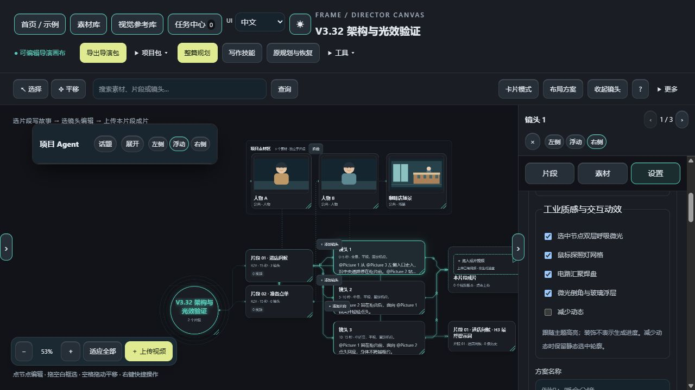

# FRAME Storyboard Workbench

**Turn a story into shots, then hand prompts and reference assets to your video-generation tool.**

Write stories, organize character and location references, and edit shot actions and dialogue. AI assistance is optional. FRAME does not generate video; add externally generated videos back to the project to review and record them.

**Windows · Runs locally · V3.37 Beta 1**　[中文](../README.md)

V3.37 adds named asset previews, resizable node details, visible fullscreen controls and two minimal backgrounds. Hand tracking and the duplicate recovery toolbar entry are removed; existing plans remain intact. Download the new EXE or source/BAT ZIP below. Existing desktop installations are not overwritten automatically. [Release notes](release-v3.37-beta.1.md).

## 1. Download and open

**New Windows users: choose the EXE. Python is not required.**

[**Download Windows EXE**](https://github.com/Alan-Poo-Kai-Lun/frame-storyboard-workbench/releases/download/v3.37-beta.1/FRAME-Workbench-Windows-x64-v3.37-beta.1.exe)

Run it and keep the small launcher window open. The workbench opens in your browser but runs on your computer.

[Full source / BAT ZIP](https://github.com/Alan-Poo-Kai-Lun/frame-storyboard-workbench/releases/download/v3.37-beta.1/FRAME-Storyboard-Workbench-v3.37-beta.1.zip) is for source users and requires Python. EXE users do not also need this ZIP. [Release and checksums](https://github.com/Alan-Poo-Kai-Lun/frame-storyboard-workbench/releases/tag/v3.37-beta.1) · [Installation and data](install-and-data.md)

## 2. Try the sample without AI

1. Open the **Official sample** project on Home and follow the prompt to create a copy.
2. Select a **segment** to read its story, then a **shot** to inspect actions and dialogue.
3. Edit a shot action. Leave the text field and check the save status. Inline details and the property panel both support editing.
4. Select its **H3 final prompt** node to view and copy the segment prompt.
5. Use **Project pack → Save project backup / handoff** to download a project backup.

This is the basic workflow: read the story, edit a shot, inspect the prompt, and back up the project. Opening the sample makes no model calls; its video is an existing file.



This screenshot uses an isolated tutorial project. [Screenshot provenance](assets/screenshots/README.md)

## 3. Create your own project

A **segment** is a short piece of the story, such as 15 seconds. A **shot** is one planned view within it. An **asset** is a reference file, such as a character, location or product image.

1. Choose **Create project** on Home and give it a name.
2. Drop reference images onto empty canvas space. Name each asset, describe what is actually visible, and confirm the description.
3. Use **Add segment**, select it, and write its story. Type `@` and choose an asset by name to reference it.
4. Use **Add shot** beside the segment or inside its card. Set actions, dialogue and timing, or configure AI to propose shots for review.

An `@` reference binds an asset; it does **not** mean a model has inspected the image. Run image analysis separately and confirm the result, or use your own verified description.

Canvas and **Card mode** edit the same project. [Full tutorial (Chinese)](quick-start.md)

## 4. Connect AI only when needed

Manual editing, asset organization and saving require no model. AI planning, image analysis and Agent chat require a configured service.

Open **Home settings → AI connection settings** and choose:

| Option | What to prepare |
|---|---|
| Local Ollama | Run Ollama, install the required model, and select its actual model name |
| Compatible API | Your provider's endpoint, model ID and API key; provider fees may apply |

Text planning needs a text model. Image analysis needs a vision-capable model. Test the connection before using AI tools.

Watch jobs in **Task Center**. A completed task still needs **review and explicit application** before it changes the project. Cloud requests and relevant content go to your configured provider. [Troubleshooting](faq.md)

## 5. Back up, copy prompts or hand off

| Goal | Action |
|---|---|
| Continue later or back up | Save a project backup (`.frame.json`); import it from Home later |
| Use prompts in another tool | Copy the shot or final prompt and prepare references as that tool requires |
| Use ComfyUI's H3 Director | Export a Director Pack (`.mmxpack.zip`) after checking the project |
| Keep generated video records | Drop existing video onto the matching segment output node |

**A Director Pack is neither a video nor a generic ComfyUI workflow.** It targets [AIMixer's MiniMax H3 Director](https://github.com/AIMixer/ComfyUI_MiniMaxH3_Director). Prepare that plugin, workflow and models separately, then use its **Import Director Pack** control. [Compatibility details](h3-director-compatibility.md)

You can save project backups without installing the director. This version uses manual export/import; it does not provide one-click ComfyUI video generation from the workbench.

## Explore when you need it

Home includes search, grid/list views, duplicate, rename and Trash. Single-click selects; double-click opens. The workbench includes full-name asset mentions, image clipboard operations, planning recovery, writing skills, Agent conversations, twelve appearance profiles and reduced motion.

V3.32 uses canvas/card editing and removes the separate detailed-editor page. [Version notes](release-v3.32-beta.1.md) · [Changelog](../CHANGELOG.md)

## Updates, data and help

- EXE data defaults to `%LOCALAPPDATA%\FRAME\Workbench\data`. Back it up, exit the old launcher, then run the new EXE.
- Source data defaults to the application's `data/` directory. [Install, update and migrate](install-and-data.md).
- [Troubleshooting](faq.md) · [Report an issue](https://github.com/Alan-Poo-Kai-Lun/frame-storyboard-workbench/issues/new/choose). Include your version and reproduction steps; keep API keys and private projects out of reports.

<details>
<summary>Developers: run from source and licensing</summary>

Python 3.10+ is required:

```bash
python -m pip install Pillow==12.3.0
python server.py
```

Open `http://127.0.0.1:8787`. Windows users can also run `Start-Windows.bat`.

```bash
python -m unittest discover -s tests -v
python tools/check_release.py
```

[Release maintenance](releasing.md) · [Contributing](../CONTRIBUTING.md) · [Security](../SECURITY.md)

Source is publicly visible; **all rights reserved**. See [LICENSE](../LICENSE) and [NOTICE](../NOTICE.md). Test results and historical interfaces are documented in version notes; they do not guarantee model output or compatibility with every system.

</details>
