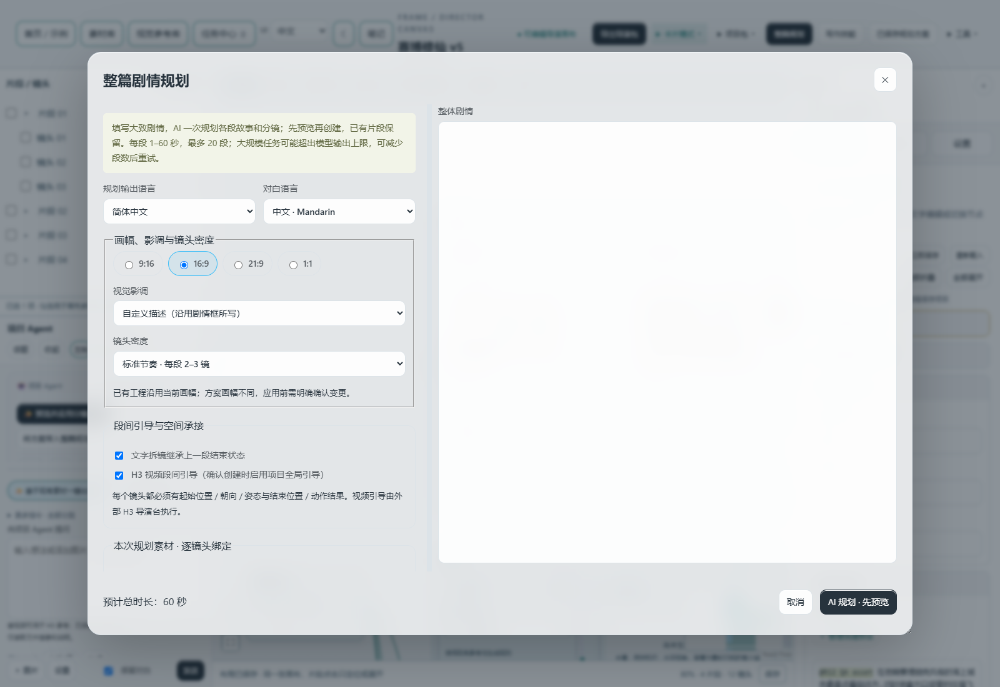

# FRAME · AI Storyboard Workbench

**Keep assets, story segments, shots, notes and final prompts on one editable canvas.**

FRAME supports planning and handoff for AI short films, ads and storyboards: organize references, plan segments, edit action/camera/dialogue/spatial states, then send prompts and director packages to external generation tools.

**Windows · Local workbench · V3.41 / R15** · [中文](../README.md) · [Downloads](https://github.com/Alan-Poo-Kai-Lun/frame-storyboard-workbench/releases) · [Quick start](quick-start.en.md) · [Changelog](CHANGELOG.en.md)

> Repository source and published EXEs are separate: check the exact Release tag. Updating GitHub does not replace your installed program. FRAME does not generate images or videos. AI features use your configured service; cloud requests may incur charges.

## Workflow


Card and canvas modes share one React Flow engine and the same project data. Browse segments and shots on the left, organize the workflow in the middle, and edit the selected node on the right.

The overview is a user-supplied screenshot from October 26, 2026, not the complete R15 interface. Some controls have moved. The R15 screenshot below comes from an isolated test project. [Screenshot provenance](assets/screenshots/README.md)

### 1. Organize references and confirm descriptions

Public and segment-specific references remain separate. Character, scene, and props/audio frames move and collapse their children together. Edit asset names and descriptions, view or replace files, and play/pause/seek audio and video within cards.

Right-click an asset → **AI and conversation → Analyze description / Reverse prompt**. Analysis task results open the description draft and history for confirmation. Saved reverse-prompt results remain readable after the source asset is deleted, as long as the task record has not been cleared.

The reusable library supports media viewing, dropped files, pasted images, drag ordering and creation dates. Unknown dates on old entries are labelled. Agent can `@` library text without adding it to the canvas; this **does not automatically send library media to a vision model**. Generation references still need to be added and bound to the project.

Images use a PNG clipboard item; Windows audio/video uses a file-drop clipboard format. External paste support depends on the receiving application.

### 2. Plan the story and review each shot



The desktop planner has adjustable settings/story columns and fixed actions. Narrow windows stack the sections. Agent input height is independently adjustable.

Set each segment's story, duration and generation mode, then edit each shot's action, camera, dialogue, language, timing and spatial start/end states. Auto-alignment, saved sizing and layout undo remain available.

**AI continuity review** calls the configured text model and displays character identities, scene landmarks, shot states, issues and proposed changes. Selected changes update the draft first; explicit application updates the canvas. Input is story text and asset dossiers, **not inspection or acceptance testing of a rendered video**. Local rule checks and AI review are different features.

### 3. Leave creative notes on the canvas

Right-click empty canvas → **More editing → New Markdown note**. Create multiple notes, rename, edit/preview, move and resize them. Dropping a note into a group assigns real parent membership so it moves and collapses with that group; detach it when needed. Copying, duplication, deletion, undo and redo are supported. The global project note remains, with one visible scrolling editor.

Markdown is parsed by locally bundled Marked and sanitized by DOMPurify. Common formatting and tables are supported; remote embedded media are not loaded.

### 4. Check final prompts and finished videos

Each segment ends with an **H3 final prompt** node after its last shot. **View / Edit** opens a separate dialog with field highlighting, plain-text copying, reading and editing. Saving uses the existing timeline parser; cancelling leaves the project unchanged.

Generate videos externally, then import them into the relevant shot or segment output area for playback, notes and comparison. Outputs remain separate from references.

### 5. Save and hand off

Director-package export can include:

- Global/canvas notes, including group membership and layout;
- Agent conversations and saved plan application status;
- Story-planning inputs, parameters, drafts and saved review reports.

`handoff/README.md` provides readable records; `handoff/records.json` contains structured data restored on import. API keys, connection settings and temporary Agent image attachments are excluded from these records. Preserving the process helps reproduce the workflow, but does not guarantee identical regenerated model output.

Task Center shows status, stage timing and results. Pausing only prevents new tasks being claimed; stopping tracking does not guarantee immediate cancellation of remote requests. Deliberately cleared task results may be unrecoverable unless separately archived.

## Install or update

1. Download the matching Windows EXE or ZIP from [Releases](https://github.com/Alan-Poo-Kai-Lun/frame-storyboard-workbench/releases).
2. Back up your data and **exit the old launcher**; closing the browser does not stop the service.
3. Place the new EXE beside existing data, or select the existing directory in the launcher. The default is `FRAME-Data`; older directories follow the existing migration mechanism.
4. Keep the launcher open. Start with manual editing, then configure AI when needed.

Switching interface language does not translate project content. Never commit `FRAME-Data`, private assets or credentials. [Step-by-step guide](quick-start.en.md)

## Develop and verify

```bash
python -m pip install -r requirements.txt
python server.py
# http://127.0.0.1:8845

npm ci --prefix frontend
npm run build --prefix frontend
npm run typecheck --prefix frontend
python tools/check_release.py
python -m unittest discover -s tests -v
```

Frontend builds refresh the local bundle, dependency notices and checksums. `typecheck` strictly checks grouping and geometry JS/JSDoc modules; the dynamic JSX interface is covered by production compilation and browser regressions, not a full TypeScript check.

R15 local delivery passed 205 backend tests, 59 regression checks, 30 feature checks and EXE self-tests. AI used a local mock and image clipboard construction used a stub. These checks do not establish real-model quality, rendered-video continuity or compatibility with every paste target. Check GitHub Actions and the exact Release separately for public build status.

[Bilingual R15 release notes](release-v3.41-canvas-r15.md) · [Release process](releasing.md) · [中文更新日志](../CHANGELOG.md)

Public source does not imply an open-source license. See [LICENSE](../LICENSE) for usage and redistribution terms and [NOTICE](../NOTICE.md) for dependency provenance.
