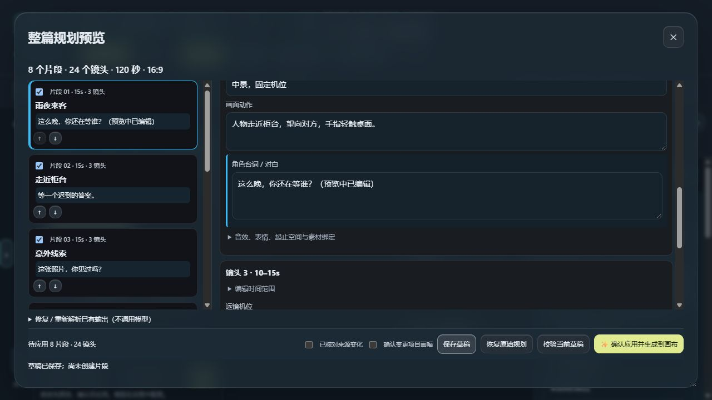

# V3.33 Beta 1 · 本地交付版

本次在源码中修复并打包，使用单独 EXE 或解压后的源码／BAT 启动，不自动替换桌面安装，不推送或发布 GitHub。ComfyUI 直连跳过，教程维持原版。

## 本次改动

1. **方案独立保存**：推理完成时将方案、原始输出及必要的输入快照存入当前项目的独立归档。任务中心“清理完成任务”只清理执行记录，Agent 气泡仍能打开分镜方案。项目包菜单可打开“已保存方案”。
2. **可挽救的校验结果**：时间线、素材编号等瑕疵保留为警告草稿，允许查看并修正。素材不会按名字相近自动替换；“按画面中的有效引用绑定”由用户明确点击。修正后校验通过才可创建节点。解析失败可以修改已保存输出并重新解析，完全不调用模型；明确重新生成才重新推理。
3. **双栏规划预览**：左侧片段目录显示时长、镜头数与第一句对白，支持拖拽或上下按钮排序、勾选要应用的片段；右侧编辑标题、时长、剧情、运镜、动作、对白、起止状态和素材绑定。底部常驻保存、校验、恢复原始及应用入口。窄屏改为上下分区。
4. **草稿恢复**：预览编辑即时保留浏览器草稿，并延迟保存到本机服务。关闭再打开或重启后可继续修改。重新解析会明确替换预览草稿；原始模型输出仍独立保存。方案只能首次应用一次，已应用方案使用原规划恢复入口处理误删节点。
5. **Agent 可读分镜卡片**：结构化方案显示概览与分段折叠卡片，动作、运镜和台词分行展示。预览按钮置于卡片工具栏。工具原始 JSON 不再直接显示在对话流；显式的修复入口仍可查看原始输出。普通文字回答保持可阅读格式，不会因为大括号就丢弃用户内容。
6. **灵感与规划参数**：项目 Agent 输入框上方提供素材感知、开局、导演微调与交付胶囊，可横向滑动；点击只插入文字，保留已有草稿。规划增加画幅、影调、镜头密度，随项目保存并传入模型请求；已有工程沿用画幅，不同画幅应用前需确认。

## 数据与兼容

- 独立方案位于用户数据目录的 `saved-plans`。项目 JSON 中带 `planArchive`；旧工程无该字段仍正常读取。已经被旧版本物理删除的推理结果不能凭空恢复。
- 完整 `.frame.json` 备份包含方案归档与讨论附图，请仅分享你希望交付的数据。导演包继续导出已确认片段的原规划快照与素材，不携带私密 Agent 讨论归档。
- 素材被删除、替换或修改时不会猜测绑定；请核对素材后修正或重新规划。预览草稿不等于可执行方案，应用前仍检查时间线、必填空间状态与有效引用。
- 镜头密度为模型目标，偏离时提示核对，不以牺牲对白与动作因果强行凑数。画幅不决定景别或景深，不做错误的强制关联。
- EXE 是程序文件，ZIP 是源码／BAT 版本（需要 Python），都不是用户数据备份。试用新版前仍推荐导出原工程备份；新版可读取原有项目、外观和技能。

## 验证边界

后端回归、界面交互检查、真实浏览器操作与 EXE 隔离自检的最终结果随交付目录中的验证报告提供。测试采用隔离数据和固定的合成规划案例；没有以这些结果冒充真实模型的生成质量验证，也未验证 ComfyUI 直连。

## 实际界面

下图为隔离验证工程的实际浏览器截图，使用固定的离线测试案例，不代表 AI 实测生成效果。

