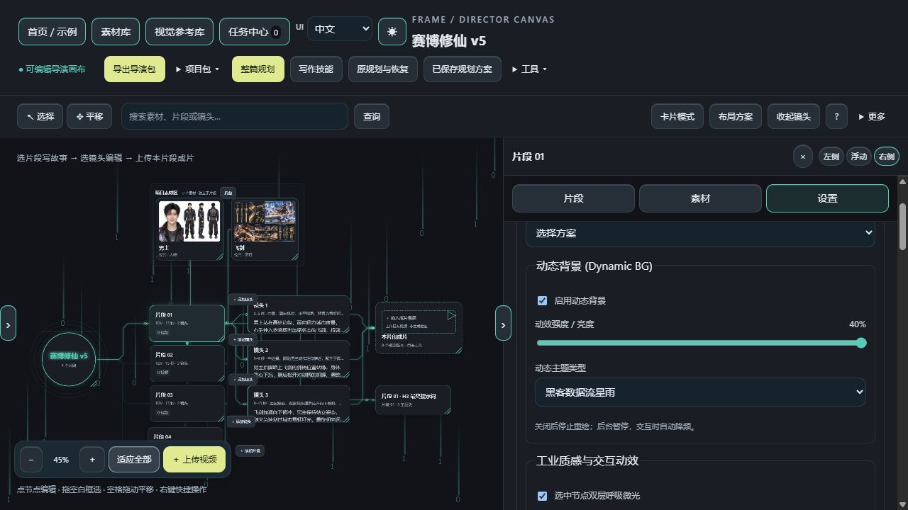

# V3.34 Beta 1 · 本地交付版

本次交付独立 EXE 和完整源码／BAT ZIP，不自动安装、覆盖桌面程序、提交或推送 GitHub。ComfyUI 直连继续跳过，教程未改。

## 已实现

- **框选残留修复**：释放事件覆盖全局；pointercancel、失焦、丢失指针捕获、切到后台时收尾。异步保存期间先松手，不会在保存完成后又生成残留选框。隐藏选框强制不参与显示，退出画布解除监听。
- **折叠素材整体移动**：移动代理胶囊时，全部隐藏素材使用相同世界坐标增量，保留间距；展开和重开后读取已保存坐标，支持移动撤销。引用连线以胶囊底部为起点。
- **四种动态背景**：深渊脉冲星环、黑客数据流星雨、深空微尘星轨（72 粒子）、雷达全息波束。以主题高亮色绘制，透明度仅施加一次；新滑块1%–40%、默认10%。旧工程的0仍按零强度处理，原有8%等值保留。旧工程未启用则保持关闭。模式、强度、开关随日夜配置、项目和外观方案保存。
- **性能控制**：背景上限30 FPS、交互降为10 FPS；后台／减少动态暂停，关闭后取消重绘并清空。日间使用正片叠底、夜间使用滤色，保持文字阅读。

## 手势 Beta：使用方式

在画布顶部“工具”菜单中打开“隔空手势控制 (Beta)”，允许浏览器访问摄像头。运行库、WASM 与手部模型均随包存放，不在开启时依赖 CDN，不上传或保存摄像头画面。检测在独立 Worker 中执行，默认关闭，不保存为自动启动状态。

| 手势 | 操作 |
|---|---|
| 单独伸出食指 | 镜像虚拟光标；外观中启用探照灯时联动网格 |
| 拇指与食指捏合 | 指向卡片后捏合抓取，移动并松开放置 |
| 五指张开并移动 | 按手掌中心增量平移画布 |
| 握拳保持超过0.5秒 | 平滑适应全部；冷却1.5秒，需改变手势后再次触发 |
| V 手势保持超过0.65秒 | 进出沉浸演示模式；冷却1.5秒，需改变手势后再触发 |

演示模式隐藏编辑面板、自动适应视口，退出时恢复原视口。可以点击“退出演示”或按 Esc，不依赖摄像头才能退出。

小窗可隐藏，隐藏小窗仍在检测；“关闭手势”或小窗的关闭按钮才会停止摄像头。关闭／退出画布／切换标签页／设备断开／检测异常时停止媒体轨道、终止 Worker、取消循环并移除浮层；再次使用需手动开启。相机权限迟到的请求也会被安全关闭。

## 验证边界

验证日志和汇总随交付目录提供。包含后端回归、选框越界与异步开始竞态、折叠整组坐标、手势分类与防抖冷却、权限失败、迟到授权释放、Worker/轨道停止、四种背景与限帧等检查。

真实浏览器另用官方静态手部图片验证随包模型在 Worker 中推理并返回21个关键点。这证明本地运行链路，不等同于真实摄像头连续手势操作、各类光照／设备识别率或硬件指示灯时延已经验收。手势为实验性功能，鼠标操作保留。不能承诺整个工作台 CPU/GPU 占用归零；停止的是手势模块的检测与资源。

依赖来源与许可见 [NOTICE](../NOTICE.md)，逐文件SHA-256见 `vendor-manifest.json`。本版明确新增实际第三方视觉运行库和手部检测模型，不改变 FRAME 主体代码的许可范围。

## 实际界面

下图为隔离示例工程的真实浏览器截图，动态背景强度40%，不代表默认亮度。手势实际相机操作尚未实测，不能用静态截图代替硬件验收。

